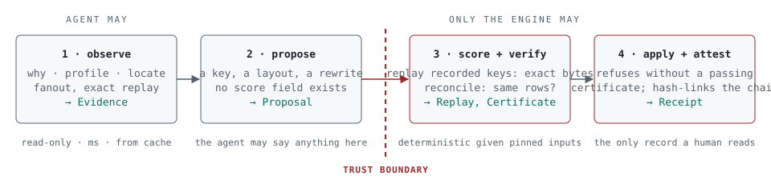
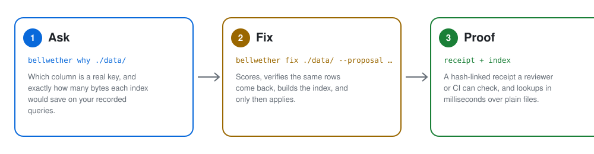

<h1 align="center">Bellwether</h1>

<p align="center"><b>Find out why your lake queries read a thousand times more than they return, build the index that fixes it, and prove the fix returned the same rows. One binary. No cluster.</b></p>

<p align="center">
  <a href="https://github.com/vncp/bellwether/actions/workflows/ci.yml"></a>
  
  
  <a href="LICENSE.md"></a>
</p>

Bellwether is a standalone index and query advisor for Parquet lakes, written in Rust. Point it at a folder of files. It measures which columns actually discriminate rows, replays your real query keys against hypothetical indexes to compute exact savings, builds a row-group-precision index with composite and point-in-time keys, and attests every change with a reconciliation receipt. A coding agent can drive it, but only the engine is allowed to measure, verify, or apply.

<p align="center">
  <picture>
    <source media="(prefers-color-scheme: dark)" srcset="docs/assets/loop-dark.svg">
    
  </picture>
</p>

## In one minute

<p align="center">
  <picture>
    <source media="(prefers-color-scheme: dark)" srcset="docs/assets/three-steps-dark.svg">
    
  </picture>
</p>

Jobs over a data lake routinely read a thousand times more than they return, because nobody knows which column a real index should be on, and nobody can prove a faster version of the job returns the same rows. Bellwether answers both questions from the files' own statistics: the cost of any candidate index is computed exactly, never estimated, and every applied change ends in a receipt a reviewer or a CI gate can check.

## The loop

An agent (or a person) may **observe** and **propose**. Only the engine may **score**, **verify**, and **apply**. The boundary is enforced by the record types, not by a prompt: a proposal has no score field, and a receipt cannot be written without a certificate that passed.

## How `fix` proves a change

In order, every time: **score** the proposal by exact replay, **verify** that the old and new way return the same rows over every key the workload touched, **apply** by building the index and committing the manifest, then **attest** with a receipt. 
The order never changes: score, verify, apply, attest. The engine recomputes the replay and the data's fingerprint itself immediately before using them, so a caller cannot supply a cost, a verdict, or a stale certificate.

## From files to a plan

Footers and statistics in, scan plan out: profile the columns, replay your recorded keys against each candidate index for an exact cost, build immutable index segments plus one small manifest, and hand your engine a list of files and row groups with a residual predicate. 
Nothing above the file layer is format-specific: a text file's fixed byte-range chunks play the role of Parquet row groups, and a SQL table is a planned source.

## Highlights

- 🔎 **Tells you which column to index, with evidence.** Fanout per column (files and row groups touched per value), then an exact replay of your recorded query keys against each candidate key. The cost is a sum of row-group statistics, never an estimate.
- 🎯 **Prunes to the row group, not the file.** Composite keys with prefix lookup, latest-version and as-of lookups over plain append-only files. Single-key seek in the core index: ~0.2 µs at 10k keys, ~0.5 µs at 1M keys.
- 🧾 **Shows its receipts.** Every applied change hash-links the evidence it was based on, the proposal, the exact before-and-after replay, and a reconciliation certificate proving the same rows came back. If it cannot prove something, it says so.
- 🧬 **Learns your workload's rulebook.** `evolve` runs a reflective, population-based search over query plans, physical designs, and whole pipelines in the style of GEPA and SkillOpt, with two substitutions those methods never had: an exact loss (replay) and a hard constraint (reconciliation). The backward pass is counterfactual attribution, numeric knobs get real finite-difference descent, selection is Pareto across your recorded runs, and the output is a rulebook promoted only by held-out replay.
- 🤖 **Agent-first, with a trust boundary.** MCP tools in three tiers: `observe.*` and `propose.*` for the agent, `apply.*` for the engine alone. A confused or compromised agent can waste your time and nothing else.
- 🗂️ **Parquet stays Parquet.** Immutable sidecar segments and a manifest committed by conditional PUT. No table format conversion, no locks, no new file format. Local disk, S3, Azure, GCS.
- ⏱️ **Time travel without a table format.** `latest` and `asof` answer "the current state of these keys" and "their state on March 3rd" across a folder of history files, located to the row group.
- 💻 **Runs on a laptop.** Memory is bounded per operation and stated in the docs. The "which files do I need" question no longer needs a cluster or a JVM.

## How it compares

| | Bellwether | Delta Lake / Iceberg skipping | Apache Hudi indexes | ClickHouse skipping indexes | A database index |
|---|---|---|---|---|---|
| Runs | one process | inside the query engine | inside the Hudi writer and engine | inside ClickHouse | inside the database |
| Granularity | row group | file (min/max) | file group or record | granule | row |
| Key kinds | exact, bloom, range, temporal | min/max statistics | bloom, record-level, column stats | minmax, set, bloom variants | B-tree |
| Composite keys | native, prefix seek | Z-order or clustering columns | record key | multi-column expressions | yes |
| Latest / as-of | native over plain files | table time travel | incremental and point-in-time queries | no | via `ROW_NUMBER` scan |
| Tells you which key to index | measured fanout + exact replay | no | no | no | estimated (what-if API) |
| Verifies a change returned the same rows | reconciliation certificate | no | no | no | no |
| Agent interface | MCP, with trust boundary | no | no | no | no |
| Data must be converted or loaded | no | yes (table format) | yes (Hudi table) | yes | yes |

The honest summary: the index kinds are not new. What is new is the diagnosis, the receipt, and the boundary between an agent that proposes and an engine that proves.

## Evolve: optimization that learns from exact replay

Most LLM query optimizers score their own suggestions with an estimate and verify them by hope. Bellwether has the two things text-space optimizers like [GEPA](https://arxiv.org/abs/2507.19457) and [SkillOpt](https://github.com/microsoft/SkillOpt) need and most data systems lack: a loss you cannot game and a gate you cannot skip. `evolve` is that loop applied to data pipelines.

```
population ← { baseline }
repeat until budget:
    parent ← Pareto-select(population)                 best on at least one recorded run
    trace  ← replay(parent, workload)                  exact bytes per run, per operator
    attr   ← attribute(parent, trace)                  Δ per node by counterfactual replay
    child  ← propose(parent, trace, attr, rulebook)    LLM for structure · descent for knobs · rules
    if not reconcile(child): discard                   never ranked, never applied
    population ← pareto-update(population, child)
rulebook ← distill(archive), promoted only if held-out replay reproduces the gain
```

What makes it different from a per-query rewriter:

- **It optimizes sets and pipelines, not calls.** Plans are mutated as DAGs and scored whole, so the semi-join that only pays off once the prefilter moves is found as a bundle. Physical design is a set of keys scored against every run with maintenance cost as its own objective. Pipelines are DAGs of steps with lineage, and equivalence is certified at the pipeline output, which admits non-local rewrites (push a filter three steps upstream, share a materialized intermediate) that no SQL prover can express.
- **The gradient is real where it can be and honest where it cannot.** Knobs (bloom rate, key-count gates, lookbacks, chunk sizes) get exact finite differences, because replay is deterministic. Structure gets a textual gradient grounded in exact per-node attribution. A learned surrogate may propose, never score.
- **Tail protection by construction.** Selection is Pareto over runs × objectives, so a rewrite that wins at the median batch and loses at the p95 batch cannot kill the candidate that protects the tail.
- **Replayable.** Every prompt, completion, score, certificate, and frontier snapshot is a content-addressed ledger record, and a search replays from its ledger byte for byte.

Design: [`docs/evolve.md`](docs/evolve.md), ADRs [021](docs/adr/021-reflective-workload-optimization.md) through [025](docs/adr/025-rulebook-validation.md).

## What you will run

```bash
# Why did this job read 54 GB to return 3 rows, and what would have fixed it?
bellwether why ./orders/ --from last_week_keys.parquet --key order_id

# Build an index, in one manifest commit
bellwether index ./orders/ --key exact:order_id --key temporal:order_id@updated_at

# Which files and row groups hold these keys; their current state; their state on a date
bellwether locate ./orders/ --keys keys.parquet
bellwether latest ./orders/ --keys keys.parquet
bellwether asof ./orders/ --keys keys.parquet --at 2026-03-03T00:00:00Z

# Record a proposal citing the evidence `why` printed (agents do this through MCP)
bellwether propose ./orders/ --evidence <evidence hash> --by me --key exact:order_id

# Score, verify, apply, attest: ends with a receipt hash, or a refusal
bellwether fix ./orders/ --proposal <proposal hash> --workload <workload hash>
bellwether receipt show ./orders/ <receipt hash>

# Prove two datasets agree, by key, latest version, and exact decimal totals
bellwether reconcile ./orders/ ./orders-rewritten/ --key order_id --latest-by updated_at

# Render every receipt and profile from the ledger: funnel, fanout, realized-vs-predicted
bellwether report ./orders/ --html out/

# Arriving later: evolve (M6) and the MCP server (WP12)
bellwether evolve ./pipeline/ --workload runs/ --budget 50g
bellwether mcp
```

Every command takes `--json` and then prints its typed result as one JSON line, with each ledger record it wrote embedded with its hash: the same value the MCP server returns (ADR 010). Exit codes: 0 success, 1 a certificate failed or mismatches were found, 2 usage, 3 refused at the trust boundary, 4 engine error.

### Measured: a ClickBench slice

Measured by WP9 on 2026-10-24. Machine: Apple M3 Pro, 12 cores, 36 GB, macOS 26.4.1, local SSD; **debug build** (rustc 1.99.1). Data: ClickBench `hits_compatible/athena_partitioned/hits_0.parquet` through `hits_9.parquet` (10 files, 28 row groups, 10,000,000 rows), unindexed to start, in a scratch directory (deleted afterwards). Keys: 1,000 distinct `UserID` values sampled with DuckDB (`SELECT UserID FROM (SELECT DISTINCT UserID FROM read_parquet('hits_*.parquet')) USING SAMPLE reservoir(1000 ROWS) REPEATABLE (42)`). The transcript below is verbatim, from a script that ran each command in turn and printed its exit code and wall time.

```text
$ bellwether why hits
why /private/tmp/claude-501/-Users-vncp-repos/336d6fc2-80a6-4514-9809-e589ebb67329/scratchpad/clickbench/hits: not indexed
funnel: no workload; pass --from <keys.parquet> to replay a run under each candidate key
                                         files   row groups              bytes           
  dataset                                   10           28      1,486,306,919     1.5 GB  10,000,000 rows
exit 0  (.159047000 s)

$ bellwether why hits --from userid_keys.parquet
why /private/tmp/claude-501/-Users-vncp-repos/336d6fc2-80a6-4514-9809-e589ebb67329/scratchpad/clickbench/hits: not indexed
funnel: 1 run(s), keys p50/p95/max 1,000/1,000/1,000; exact sums of row-group statistics, summed over runs
                                         files   row groups              bytes           
  dataset                                   10           28      1,486,306,919     1.5 GB  10,000,000 rows
  current (no index)                        10           28      1,486,306,919     1.5 GB  
  exact:UserID                              10           27      1,485,098,816     1.5 GB  floor: only row groups holding a key, recommended

culprit (UserID): no index serves this lookup, so it reads every row group
recommended: exact:UserID reads 1,485,098,816 bytes (1.5 GB) instead of 1,486,306,919 (1.5 GB)

records
  workload  23e59631372a8bf9c65bf2ab17b2449383701b4268c1c2a86171a3fe2c95e9c2
  proposal  fe985b6e8f46f2c74bd34035fe25bbab9dc98050a8174a4b40bc22321d211096  replay 32dbf2856f4c  exact:UserID
exit 0  (16.923555000 s)

$ bellwether index hits --key exact:UserID
index /private/tmp/claude-501/-Users-vncp-repos/336d6fc2-80a6-4514-9809-e589ebb67329/scratchpad/clickbench/hits: committed manifest sequence 1
  files: 10 new, 0 changed, 0 removed, 0 unchanged; 28 row groups read; 2 segments written, 2 live

  key spec                                    complete at
  exact:UserID                                          1

manifest 55089d7dc979b173bb25b6fed8bc2f655f62ac86b3d86c2f7bf8d9846b96630c
exit 0  (17.225682000 s)

$ bellwether locate hits --keys userid_keys.parquet
locate: 1,000 keys on (UserID) at manifest sequence 1
                                         files   row groups              bytes
  live                                      10           28                  -
  planned                                   10           27      1,485,098,816     1.5 GB
  specs: exact:UserID

  file                                                          row groups              bytes
  ...09-e589ebb67329/scratchpad/clickbench/hits/hits_0.parquet           2        122,401,403
  ...09-e589ebb67329/scratchpad/clickbench/hits/hits_1.parquet           3        174,899,190
  ...09-e589ebb67329/scratchpad/clickbench/hits/hits_2.parquet           4        229,279,215
  ...09-e589ebb67329/scratchpad/clickbench/hits/hits_3.parquet           3        192,438,843
  ...09-e589ebb67329/scratchpad/clickbench/hits/hits_4.parquet           3        140,863,574
  ...09-e589ebb67329/scratchpad/clickbench/hits/hits_5.parquet           2        122,241,642
  ...09-e589ebb67329/scratchpad/clickbench/hits/hits_6.parquet           3        122,862,108
  ...09-e589ebb67329/scratchpad/clickbench/hits/hits_7.parquet           2        123,858,220
  ...09-e589ebb67329/scratchpad/clickbench/hits/hits_8.parquet           3        122,669,790
  ...09-e589ebb67329/scratchpad/clickbench/hits/hits_9.parquet           2        133,584,831

evidence efbaa46c169c40b46e8765045c33d0ae87da96380ebe67e12c2a84e4f6852b24
exit 0  (.685103000 s)

$ bellwether why hits --from userid_keys.parquet
why /private/tmp/claude-501/-Users-vncp-repos/336d6fc2-80a6-4514-9809-e589ebb67329/scratchpad/clickbench/hits: manifest sequence 1, current keys: exact:UserID
funnel: 1 run(s), keys p50/p95/max 1,000/1,000/1,000; exact sums of row-group statistics, summed over runs
                                         files   row groups              bytes           
  dataset                                   10           28      1,486,306,919     1.5 GB  10,000,000 rows
  current                                   10           27      1,485,098,816     1.5 GB  

culprit (UserID): the serving key exact:UserID
recommended: none; no candidate reads fewer bytes than the current configuration

records
  workload  23e59631372a8bf9c65bf2ab17b2449383701b4268c1c2a86171a3fe2c95e9c2
exit 0  (.688599000 s)
```

An index does not help this workload on this layout: 1,000 random users together touch 27 of the 28 row groups, so even an exact index (the floor: only row groups that hold a queried key) saves 0.08% of the bytes. Rows are not clustered by `UserID`, and that layout, not a missing index, is what the job pays for. The replay's prediction before the index existed (1,485,098,816 bytes) is exactly what the index then planned. The bytes are exact and do not depend on the build; the timings do (most of the 17 s `why` is building a transient `exact:UserID` index over 10,000,000 rows in a debug build). This transcript was taken before the profile was wired into `why`; `why` now also prints the fanout table, the lints, and the profile Evidence it records, and the funnel above is unchanged (the bytes are exact).

<p align="center">
  <picture>
    <source media="(prefers-color-scheme: dark)" srcset="docs/assets/clickbench-funnel-dark.svg">
    
  </picture>
</p>

### Measured: real public data

On 2026-10-24, every CLI verb was run in a release build, on the same machine, against data nobody here generated: six months of NYC yellow-taxi trips (20,332,093 rows) and 12 hours of GH Archive events (1,768,515 rows, flattened from nested JSON by DuckDB). [`scripts/realdata.sh`](scripts/realdata.sh) reproduces the run, downloads included. The verbatim transcript and the defect list are in [docs/measured/2026-10-24-realdata.md](docs/measured/2026-10-24-realdata.md).

- **No wrong number turned up.** On both datasets, `why`'s predicted bytes equalled `locate`'s planned bytes. Both GitHub exact plans and all six `latest` and `asof` plans equalled an oracle that reads the rows with DuckDB, down to the row group.
- **Taxi, by pickup zone: no index can help, and the tool says so.** All 262 zones appear in all 22 row groups, so even an exact index reads 341,861,576 of 341,861,576 bytes, and `why` recommends nothing. `latest` per zone on the same index needs only 6 of the 22 row groups (94.4 MB), which `why` could not see then; `why --from <keys> --latest-by <time column>` now prices it.
- **`reconcile` checked a 20-million-row rewrite.** It proved the DuckDB rewrite of the taxi files identical (182 s). With one `tip_amount` changed, it failed with exit 1, but only the `--json` output named the key that differs; the human output now names the first 10.
- **Ten GitHub repositories: the full loop worked.** `why` predicted 5,190,369 of 12,817,897 bytes, and `fix` verified, applied, and attested the index; `locate` then planned exactly 5,190,369 bytes.

The run found 14 defects, filed in that document, and all 14 are fixed since, each with a regression test (`crates/bellwether-cli/tests/realdata.rs`). The two that mattered most:

- `index` refused any dataset that has a nested column. Nested columns are now recorded and skipped as key candidates; a nested key column is refused by name.
- `fix` attested a key that its own replay predicted saves nothing. It now refuses with `nothing_to_gain` (exit 3) unless `--allow-no-gain`.

## Status

Pre-alpha. The architecture and on-disk format are fixed and documented; the crates are being built against them, each landing by reviewed pull request.

- [x] Contract crate, architecture, invariants, threat model, format, 27 decision records
- [x] Engine foundations: canonical encoding, segments and blooms, Parquet and text sources, object-store manifest commits, the ledger; each crate reviewed against its invariants, with the reviewer's probes kept as regression tests
- [x] **M1** `why` works with no index built: footers, the profile's fanout and lints as a recorded Evidence, and replay
- [x] **M2** the index: `index`, `locate`, `latest`, `asof`
- [x] **M3** receipts: `fix` writes one
- [ ] **M4** agent-first: the loop runs end to end from an MCP client
- [ ] **M5** format v0.1 frozen with a compatibility fixture
- [ ] **M6** `evolve` and `report`: reflective optimization of plans, keys, layouts, and whole pipelines against your recorded workload, with charts rendered from the ledger
- [ ] **M7** a SQL table reconciles against a folder of files with a certificate; plans execute inside DataFusion and DuckDB without a sidecar step; receipts gate pull requests
- [ ] **M8** the loss covers joins, windows, projections, and layouts exactly; rules transfer across datasets; receipts are signed

Install from source once M1 lands:

```bash
cargo install --git https://github.com/vncp/bellwether bellwether-cli
```

## What Bellwether deliberately is not

- **Not a query engine.** It produces a scan plan (files, row groups, residual predicate). DuckDB, DataFusion, Polars, Spark, or your own code reads the rows.
- **Not a table format.** It never rewrites your data or asks you to convert it.
- **Not a database.** If your data fits in Postgres or SQL Server, use their indexes. Bellwether is for data that lives as files because it is too big, too shared, or owned by a pipeline. A SQL table can be one side of a reconcile, with costs labeled measured rather than exact.
- **Not an estimator.** Every cost it reports is a sum of statistics from the files that exist. A number that cannot be computed exactly is labeled, never guessed.
- **Not an autonomous agent.** The model proposes. The engine scores, verifies, applies, and signs. That direction never reverses.

## Architecture at a glance

Twelve crates, dependencies pointing one way, enforced by a script in CI. The CLI and the MCP server hold no engine logic: both call the `bellwether` facade, so what the CLI prints as `--json` is byte for byte what an agent receives.

On disk: immutable `segments/` named by content hash, one `manifest.json` advanced by conditional PUT with a sequence number, an append-only `ledger/` of hash-named records, and a rebuildable `cache/`.

Deeper: [glossary](docs/glossary.md) · [adding an index kind](docs/adding-an-index-kind.md) · [time-series capabilities](docs/time-series-capabilities.md) · [architecture](docs/architecture.md) · [invariants and their tests](docs/invariants.md) · [threat model](docs/threat-model.md) · [on-disk format](docs/format.md) · [decision records](docs/adr/) · [rule catalog](docs/rule-catalog.md) · [agent loop](docs/agent-loop.md) · [benchmark methodology](docs/benchmark.md) · [work packages](docs/work-packages.md)

## Where it came from

Years of untangling slow pipelines on a large financial data platform, where every fix was the same fix: stop reading what you do not need, and prove you did not break anything. Bellwether is that fix as a tool.

## Contributing and license

See [CONTRIBUTING.md](CONTRIBUTING.md). Licensed under MIT with a hosted-service provision; see [LICENSE.md](LICENSE.md).
