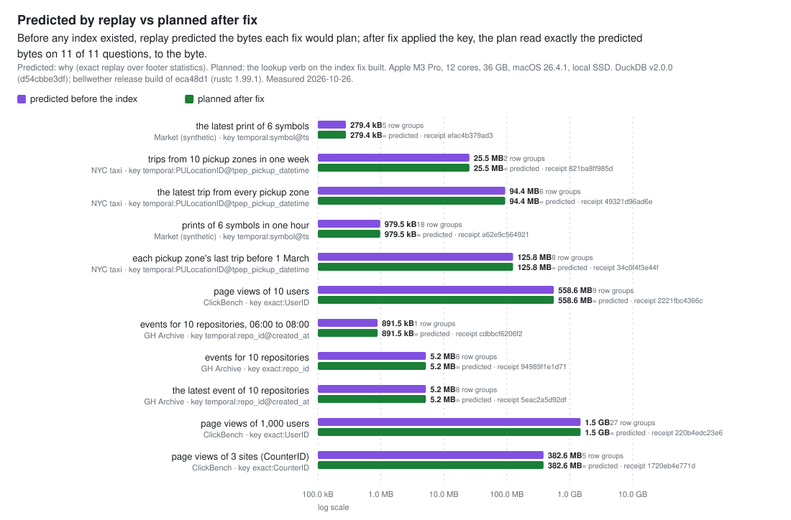

<p align="center">
  <picture>
    <source media="(prefers-color-scheme: dark)" srcset="docs/assets/readme/wordmark-dark.svg">
    
  </picture>
</p>

<p align="center"><b>Find out why your lake queries read a thousand times more than they return, build the index that fixes it, and prove the fix returned the same rows. One binary. No cluster.</b></p>

<p align="center">NYC taxi, trips from 10 pickup zones in one week: <b>342.3 MB → 25.5 MB</b> read for the same 1,090 rows, verified. <a href="#results">Results</a></p>

<p align="center">
  <a href="#what-you-can-do-with-it">What you can do with it</a> ·
  <a href="#in-one-minute">In one minute</a> ·
  <a href="#thirty-second-start">Start</a> ·
  <a href="#how-it-works">How it works</a> ·
  <a href="#results">Results</a> ·
  <a href="#how-fix-proves-a-change">How fix proves a change</a> ·
  <a href="#for-a-coding-agent">For a coding agent</a> ·
  <a href="#architecture">Architecture</a> ·
  <a href="#docs">Docs</a>
</p>

<p align="center">
  <a href="https://github.com/vncp/bellwether/actions/workflows/ci.yml"></a>
  
  
  <a href="LICENSE.md"></a>
</p>

## What you can do with it

- **Find out why a job reads too much.** `bellwether why` replays the keys a job looked up under every candidate index and prints the funnel: the dataset, what the job reads now, what each candidate would read, and the key to build. When no index can help, it says so and names the cause.
- **Build the index, with a receipt.** `bellwether fix` scores the change by exact replay, verifies the same rows come back, builds the index in one manifest commit, and ends with a receipt hash a reviewer or a CI gate can check. Or it refuses, and says why.
- **Prove two datasets agree.** `bellwether reconcile` compares two folders by key, latest version, and exact decimal totals, names the keys that differ, and writes a certificate either way, inside a memory budget you set.
- **Ask time-series questions of plain files.** The current state of a set of keys, their state on March 3rd, and what was known at a given moment about the state at another (`asof --valid --known`, no lookahead), located to the row group.
- **Let a coding agent drive it, safely.** `bellwether mcp` serves the same engine over MCP, in tiers of tools; every refusal carries a stable code and one next step.
- **Reconcile a SQL table against files** *(landing with [#11](https://github.com/vncp/bellwether/pull/11))*. A table becomes one side of a reconcile, with costs labeled measured rather than exact.
- **Diagnose a slow query in a warehouse through its lake copy.** When a query engine that keeps its own storage (ClickHouse, Kusto) has a Parquet twin, `why --twin-of` diagnoses the data's shape on the twin, the agent rewrites the query, and `fix` measures both versions in the engine from its own query log, reconciles their exported results, and writes an attest-only receipt with the twin's prediction error.

## In one minute

1. **Ask.** `bellwether why ./data/ --from keys.parquet` profiles the columns (files and row groups each value touches), replays the recorded keys under every candidate key, and prints the funnel, the culprit, and the recommended key, with the `fix` line to run.
2. **Fix.** `bellwether fix ./data/ --proposal … --workload …` scores, verifies, applies, and attests, in that order. If the replay predicts no saving it refuses (`nothing_to_gain`) and applies nothing.
3. **Proof.** The receipt hash. `bellwether receipt show` walks it back through the certificate, the replay, the proposal, and the evidence; `bellwether report` draws every receipt's funnel; `locate`, `latest`, and `asof` now plan only the row groups that hold the keys.

<p align="center">
  <picture>
    <source media="(prefers-color-scheme: dark)" srcset="docs/assets/readme/capture-why-dark.svg">
    
  </picture>
</p>
<p align="center"><em><code>bellwether why</code> on an unindexed folder · bench ledger corpus, 12 recorded runs · release build of 3a0c26a</em></p>

Read the funnel top down: the dataset, what the recorded runs read now (with no index over Parquet, what the files' own min/max statistics skip to, with the full scan above it as context, labelled `current: no index (min/max pruning)`), then each candidate key with what it would read on the same runs. The floor is the key on the workload's own columns, which reads only the row groups that hold a key; `recommended` names the cheapest candidate and the `fix` line to apply it. When every candidate reads about as much as the floor and the floor reads nearly everything, the culprit line says the layout is the cause, not a missing index.

## Thirty-second start

From source (Rust 1.89 or newer):

```sh
cargo install --locked --git https://github.com/vncp/bellwether bellwether-cli     # → bellwether
```

Your first `why`, on the keys one run of your job looked up (a Parquet file of them):

```sh
bellwether why ./orders/ --from last_week_keys.parquet --key order_id
```

It ends with the `fix` line to run, hashes filled in. Your first `fix` scores, verifies, builds, and attests, and prints a receipt hash or a refusal:

```sh
bellwether fix ./orders/ --proposal <proposal hash> --workload <workload hash>
```

No data at hand? `bellwether bench generate --out demo` writes a synthetic versioned ledger, `bellwether bench workload --corpus demo` records runs of lookups against it, and `bellwether why demo/data --bench-workload demo` starts from there. The `why`, `fix`, `report`, and MCP captures in this README start that way, on a smaller corpus; the time-series capture uses `bellwether bench market`. [`scripts/readme-captures.sh`](scripts/readme-captures.sh) has the exact commands.

## How it works

Bellwether is a standalone index and query advisor for Parquet lakes, written in Rust. Point it at a folder of files. It measures which columns actually discriminate rows, replays your real query keys against hypothetical indexes to compute exact savings, builds a row-group-precision index with composite and point-in-time keys, and attests every change with a reconciliation receipt.

Costs come from the files' own statistics. `why` records the keys a job looked up as a workload and replays it against the current configuration and every candidate key; each cost is a sum of row-group statistics from the files that exist, never an estimate, and a number that cannot be computed exactly is labeled, never guessed. A lookup (`locate`, `latest`, `asof`) hands your engine a list of files and row groups with a residual predicate. Nothing above the file layer is format-specific: a text file's fixed byte-range chunks play the role of Parquet row groups.

An agent (or a person) may **observe** and **propose**. Only the engine may **score**, **verify**, and **apply**. The boundary is enforced by the record types, not by a prompt: a proposal has no score field, and a receipt cannot be written without a certificate that passed. A confused or compromised agent can waste your time and nothing else.

<p align="center">
  <picture>
    <source media="(prefers-color-scheme: dark)" srcset="docs/assets/readme/loop-dark.svg">
    
  </picture>
</p>
<p align="center"><em>The loop and the trust boundary · drawn by <code>scripts/render_figures.py</code></em></p>

## Contents

- [What you can do with it](#what-you-can-do-with-it)
- [In one minute](#in-one-minute)
- [Thirty-second start](#thirty-second-start)
- [How it works](#how-it-works)
- [Results](#results)
- [Highlights](#highlights)
- [Index kinds](#index-kinds)
- [How `fix` proves a change](#how-fix-proves-a-change)
- [Questions over time](#questions-over-time)
- [For a coding agent](#for-a-coding-agent)
- [How it compares](#how-it-compares)
- [Planned: evolve](#planned-evolve)
- [Architecture](#architecture)
- [Run it](#run-it)
- [Query engines as sources](#query-engines-as-sources)
- [Status](#status)
- [Docs](#docs)
- [Where it came from](#where-it-came-from)
- [Contributing and license](#contributing-and-license)

## Results

<!-- results:showcase-headline:begin -->
<!-- Generated by scripts/render_charts.py from docs/measured/results/showcase.json; do not edit by hand. -->

14 questions people ask of 4 datasets (3 public, 1 synthetic). Each is answered on the same files by DuckDB alone (with its own min/max pruning) and by DuckDB reading only the row groups Bellwether planned after `bellwether why` recommended a key and `bellwether fix` verified, applied, and attested it; 4 questions are exceptions, each marked in its row. Both DuckDB answers are fingerprinted and must match; they did on every question with a plan. These are the 10 where the plan read at least 5% less, biggest reduction first (`rg` is row groups):

| Dataset | Question | Rows | DuckDB alone | DuckDB on Bellwether's plan | Fewer bytes | Full scan | How |
|---|---|---:|---:|---:|---:|---:|---|
| Market (synthetic) | the latest print of 6 symbols | 6 | 12.5 MB (194 rg) | **312.2 kB (5 rg)** | 40× | 52.3 MB (960 rg) | DuckDB's min/max statistics skip to 194 row groups; `temporal:symbol@ts` plans 5 of 960 |
| Market (synthetic) | 6 symbols at 16:00 as known that evening (no lookahead) | 6 | 7.3 MB (99 rg) | **376.4 kB (6 rg)** | 19× | 52.3 MB (960 rg) | DuckDB's min/max statistics skip to 99 row groups; `temporal2:symbol@ts,known_at` plans 6 of 960. Bitemporal keys cannot be proposed or receipted until storage version 2, so this key was built with `index` and has no receipt |
| NYC taxi | trips from 10 pickup zones in one week | 1,090 | 342.3 MB (22 rg) | **25.5 MB (2 rg)** | 13× | 341.9 MB (22 rg) | the files carry no min/max statistics on any column, so DuckDB reads every row group; `temporal:PULocationID@tpep_pickup_datetime` plans 2 of 22 |
| NYC taxi | the latest trip from every pickup zone | 269 | 342.3 MB (22 rg) | **94.6 MB (6 rg)** | 3.6× | 341.9 MB (22 rg) | the files carry no min/max statistics on any column, so DuckDB reads every row group; `temporal:PULocationID@tpep_pickup_datetime` plans 6 of 22 |
| Market (synthetic) | prints of 6 symbols in one hour | 275 | 3.3 MB (24 rg) | **1.2 MB (18 rg)** | 2.8× | 52.3 MB (960 rg) | DuckDB's min/max statistics skip to 24 row groups; `temporal:symbol@ts` plans 18 of 960 |
| NYC taxi | each pickup zone's last trip before 1 March | 274 | 342.3 MB (22 rg) | **126.0 MB (8 rg)** | 2.7× | 341.9 MB (22 rg) | the files carry no min/max statistics on any column, so DuckDB reads every row group; `temporal:PULocationID@tpep_pickup_datetime` plans 8 of 22 |
| ClickBench | page views of 10 users | 33 | 1.4 GB (24 rg) | **560.1 MB (9 rg)** | 2.6× | 1.5 GB (28 rg) | DuckDB's min/max statistics skip to 24 row groups; `exact:UserID` plans 9 of 28 |
| GH Archive | events for 10 repositories, 06:00 to 08:00 | 1 | 2.3 MB (4 rg) | **907.9 kB (1 rg)** | 2.6× | 12.8 MB (24 rg) | DuckDB's min/max statistics skip to 4 row groups; `temporal:repo_id@created_at` plans 1 of 24 |
| GH Archive | events for 10 repositories | 31 | 13.0 MB (24 rg) | **5.3 MB (8 rg)** | 2.5× | 12.8 MB (24 rg) | DuckDB's min/max statistics skip no row group for these keys; `exact:repo_id` plans 8 of 24 |
| GH Archive | the latest event of 10 repositories | 11 | 13.0 MB (24 rg) | **5.3 MB (8 rg)** | 2.5× | 12.8 MB (24 rg) | DuckDB's min/max statistics skip no row group for these keys; `temporal:repo_id@created_at` plans 8 of 24 |

<sub>Apple M3 Pro, 12 cores, 36 GB, macOS 26.4.1, local SSD. DuckDB v2.0.0 (d54cbbe3df); bellwether release build of 3a0c26a (rustc 1.99.1). Measured 2026-10-26. 1-minute load average while timing: 1.8 to 3.6 on 12 cores. Full scan: exact footer sums. Both DuckDB columns, the plan column included, are DuckDB's profiler (`total_bytes_read`), which counts the footers it reads too, so DuckDB alone can exceed the full scan. The plan's exact footer sums are on [the measured page](docs/measured/showcase.md). Every number is a row of [`docs/measured/results/showcase.json`](docs/measured/results/showcase.json).</sub>

<p align="center">
  <picture>
    <source media="(prefers-color-scheme: dark)" srcset="docs/assets/results-bytes-dark.svg">
    
  </picture>
</p>

<p align="center">
  <picture>
    <source media="(prefers-color-scheme: dark)" srcset="docs/assets/results-replay-dark.svg">
    
  </picture>
</p>

**Reconcile.** Bellwether compared up to 40,664,186 rows (both sides) at 243 k rows/s and reported exactly the planted key in 2 of 2 planted runs; DuckDB's EXCEPT ALL was 6.7× to 24.2× faster on the same files, and writes no certificate (timed at a 1-minute load average of 1.9 to 4.2 on 12 cores).

| Run | Rows, both sides | `bellwether reconcile` | Reported | DuckDB `EXCEPT ALL`, both ways | Reported |
|---|---:|---:|---|---:|---|
| taxi trips against DuckDB's rewrite of the same files | 40,664,186 | 167.07 s | 0 differing keys | 6.95 s | 0 differing rows |
| taxi trips against the rewrite with one tip changed | 40,664,186 | 166.98 s | 1 differing key: `2, 2024-03-01T00:14:03Z, 142, 7.9`, the planted one | 6.89 s | 2 differing rows |
| GH events against a copy | 3,537,030 | 1.77 s | 0 differing keys | 262 ms | 0 differing rows |
| GH events against a copy with one event type changed | 3,537,030 | 1.76 s | 1 differing key: `629347145, 796623, 2024-01-01T05:00:25Z`, the planted one | 262 ms | 2 differing rows |

A changed row is one differing key to `reconcile` and two rows to `EXCEPT ALL` (the old version from one side, the new from the other). `reconcile` writes a certificate holding the counts; the differing keys are in its `--json` output, and the script fails unless the reported key is the planted one. DuckDB's time is one query; Bellwether's includes writing the certificate.

<sub>Apple M3 Pro, 12 cores, 36 GB, macOS 26.4.1, local SSD. DuckDB v2.0.0 (d54cbbe3df); bellwether release build of 3a0c26a (rustc 1.99.1). Measured 2026-10-26. 1-minute load average while timing: 1.9 to 4.2 on 12 cores.</sub>

**Time.** Bellwether's plan plus DuckDB on the plan was faster than DuckDB alone on 2 of the 11 questions with a plan (the latest trip from every pickup zone: 467 ms against 913 ms). On 8, DuckDB on the plan took no more than 5% longer than DuckDB alone, and often less, but the plan step (one `bellwether` process, 25 ms to 176 ms) cost more than that saved. On 1, DuckDB read the plan's row-number ranges more slowly than it scans on its own (page views of 1,000 users: 27 row groups in 482 ms on the plan against 28 row groups in 452 ms alone). Timed at a 1-minute load average of 1.8 to 3.6 on 12 cores. Per-question times, the throughput chart, receipts, and the SQL: [the measured page](docs/measured/showcase.md).

### When an index can't help

On 3 of these 4 questions Bellwether said so before building anything: `why` priced every candidate key by exact replay over the footers against what the files' own min/max statistics already skip without an index (the full scan where the files carry none), recommended nothing, and `fix` refused to attest a key that saves nothing (`nothing_to_gain`). On the remaining one it did not: `why` recommended a key and `fix` attested it, though DuckDB on the plan read about as much as DuckDB alone. The last column gives each cause.

| Dataset | Question | Rows | DuckDB alone | DuckDB on Bellwether's plan | Fewer bytes | Full scan | Why not |
|---|---|---:|---:|---:|---:|---:|---|
| NYC taxi | trips from 10 pickup zones, all six months | 29,529 | 342.3 MB (22 rg) | no plan (`fix` refused) | – | 341.9 MB (22 rg) | the keys sit in 22 of 22 row groups, so `why` recommended nothing and `fix` refused (`nothing_to_gain`) |
| GH Archive | events for 1,000 repositories | 3,787 | 13.0 MB (24 rg) | no plan (`fix` refused) | – | 12.8 MB (24 rg) | the keys sit in 24 of 24 row groups, so `why` recommended nothing and `fix` refused (`nothing_to_gain`) |
| ClickBench | page views of 1,000 users | 6,659 | 1.5 GB (28 rg) | 1.5 GB (27 rg) | same | 1.5 GB (28 rg) | the keys sit in 27 of 28 row groups; `why` still recommended `exact:UserID`, which saves 0.08% of the bytes, and `fix` attested it |
| ClickBench | page views of 3 sites (CounterID) | 974,143 | 384.6 MB (5 rg) | no plan (`fix` refused) | – | 1.5 GB (28 rg) | the files' own min/max statistics already narrow it to 5 of 28 row groups and `exact:CounterID` would plan 5, no fewer bytes, so `why` recommended nothing and `fix` refused (`nothing_to_gain`) |
<!-- results:showcase-headline:end -->

Reproduce everything above, downloads included, with [`scripts/showcase.sh`](scripts/showcase.sh); it rewrites the results file, and [`scripts/render_charts.py`](scripts/render_charts.py) redraws every chart and table from it (CI fails if a committed chart no longer matches the committed numbers). Earlier runs, with their transcripts: [every CLI verb on taxi and GH Archive data](docs/measured/2026-10-24-realdata.md) and [a ClickBench slice before any index existed](docs/measured/2026-10-24-clickbench.md). Performance of the engine itself (lookup latency, index build, reconcile memory budgets): [docs/measured/2026-10-26-performance.md](docs/measured/2026-10-26-performance.md).

## Highlights

- **Tells you which column to index, with evidence.** Fanout per column (files and row groups touched per value), then an exact replay of your recorded query keys against each candidate key.
- **Prunes to the row group, not the file.** Composite keys with prefix lookup, latest-version and as-of lookups over plain append-only files.
- **Shows its receipts.** Every applied change hash-links the evidence it was based on, the proposal, the exact before-and-after replay, and a reconciliation certificate proving the same rows came back. If it cannot prove something, it says so.
- **Agent-first.** MCP tools in tiers (`observe.*`, `propose.*`, `score.*`, `apply.receipt`, `jobs.*`), typed refusals, dry runs, and per-session budgets.
- **Parquet stays Parquet.** Immutable sidecar segments and a manifest committed by conditional PUT. No table format conversion, no locks, no new file format. Local disk, S3, Azure, GCS.
- **Time travel without a table format.** `latest` and `asof` work across a folder of history files, no snapshots or table metadata needed.
- **Runs on a laptop.** Memory is bounded per operation and stated in the docs. The "which files do I need" question no longer needs a cluster or a JVM. [Measured on one](docs/measured/2026-10-26-performance.md), with three caveats from that page:
  - `reconcile` exceeds its stated memory bound on wide row groups at small `--memory-budget` values: 1.6 GiB at 64 MiB on the ledger rung. This is [an open defect](docs/measured/2026-10-26-performance.md#findings).
  - Plan plus read was slower than both a full scan and DuckDB in all 42 measured lookups. The plan makes one store round trip per indexed value ([the measured cause](docs/measured/2026-10-26-performance.md#hypotheses-for-wp22b-ranked-by-expected-gain)). The index saves bytes read, not yet wall time.
  - The lookup timings overlapped another process's compile; [the load record](docs/measured/2026-10-26-performance.md#measured-under-load) shows by how much.

## Index kinds

| Kind | Operator it serves | Declare | Planner |
|---|---|---|---|
| `exact` | key membership, `where key in (...)`, on one column or a composite key (prefix lookups too) | `index --key exact:col[,col]`; `exact:col@ts` also keeps each key's own time range per row group | `locate --keys`: exactly the row groups holding a key; with `--from`/`--to`, only those where that key's own times reach the window |
| `bloom` | the same membership where an exact index would be too large | `index --key bloom:col@0.01` (the target false-positive rate) | `locate --keys`: a superset of the row groups holding a key, never short |
| `range` | a range filter on one ordered column | `index --key range:col` | per-row-group min and max; a window lookup intersects it with the key specs |
| `temporal` | latest and as-of: the newest version of each key, or the version current at an instant | `index --key temporal:col@ts`; on two clocks, `temporal2:col@valid,known` | `latest`, `asof --at`; `asof --valid --known` for what was known at one time about another |
| `counts` (on `exact` and `temporal`) | `count(*) where key in (...)`: the count that precedes a gated query | `index --key exact:col,counts` or `temporal:col@ts,counts` | `count --keys`: exact rows and row groups from the index, no data file read; plans through the spec carry exact row counts |
| `sketch` | `count(distinct col)`; "is this column a key" | `index --key sketch:col[,col][,a+b][,p=14][,minhash=K]` | never (approximate; read by `why`, `sketch cardinality`, `sketch overlap`) |
| `expr` | a filter or join key that is a function of a column: a member of a JSON column, `lower`, `substr`, `cast`, `date_trunc`, `hash` | `index --key "expr:<name>=<expression>:exact"` (or `:exact,counts`, `:bloom@<fpr>`) | point lookups (`locate`) and, with counts, `count` by the same expression after normalization; any other expression is refused, never guessed |

## How `fix` proves a change

In order, every time: **score** the proposal by exact replay, **verify** that the old and new way return the same rows over every key the workload touched, **apply** by building the index and committing the manifest, then **attest** with a receipt. The order never changes. The engine recomputes the replay and the data's fingerprint itself immediately before using them, so a caller cannot supply a cost, a verdict, or a stale certificate.

<p align="center">
  <picture>
    <source media="(prefers-color-scheme: dark)" srcset="docs/assets/readme/capture-fix-dark.svg">
    
  </picture>
</p>
<p align="center"><em><code>bellwether fix</code>, then <code>reconcile</code> against one planted change · bench ledger corpus · release build of 3a0c26a</em></p>

`reconcile` is the same verifier pointed at two folders. It exits 1 when they differ, names the first ten differing keys (`--json` carries every one it kept), prints the exact totals, and says how many passes it made over each side to stay inside `--memory-budget`. Afterwards, `bellwether report` renders every receipt in the ledger as one self-contained HTML file: the funnel behind it, the certificate, and realized against predicted bytes.

<p align="center">
  <picture>
    <source media="(prefers-color-scheme: dark)" srcset="docs/assets/readme/capture-report-dark.svg">
    
  </picture>
</p>
<p align="center"><em><code>bellwether report</code> after that fix, its receipt section drawn below · same corpus and build</em></p>

## Questions over time

For folders of market data (partitioned by date, many symbols per file), five additions, all additive to storage version 1 ([format](docs/format.md), [capabilities and status](docs/time-series-capabilities.md)):

```bash
# day=2026-01-02/ directories become a `day` column: pruned on, never read
bellwether index ./data --partitioning hive --key exact:symbol@ts --key range:ts --key temporal2:symbol@ts,known_at
# a symbol set in a window: only row groups where each symbol's own times reach the window; plans in time order when that order holds
bellwether locate ./data --keys universe.parquet --from 2026-01-05T14:30:00Z --to 2026-01-05T15:30:00Z
# what was known at K about the state at V: restatements and late prints without lookahead
bellwether asof ./data --keys universe.parquet --valid 2026-01-05T16:00:00Z --known 2026-01-06T00:00:00Z
# the same lookup against the index as it was at manifest sequence 3, for a reproducible backtest
bellwether locate ./data --keys universe.parquet --at-manifest 3
```

<p align="center">
  <picture>
    <source media="(prefers-color-scheme: dark)" srcset="docs/assets/readme/capture-asof-dark.svg">
    
  </picture>
</p>
<p align="center"><em><code>bellwether index</code>, then <code>asof --valid --known</code> · bench market corpus, one 10-symbol query · release build of 3a0c26a</em></p>

Measured on the synthetic `market` corpus (`bellwether bench market --rung small`: 50 symbols, 10 days, 216 row groups, 102,739 prints with 3,786 restatements and 3,929 late prints; debug build, [`scripts/market-funnels.py`](scripts/market-funnels.py)), six one-hour windows over 1, 10, and 50 symbols together planned:

| index | row groups | bytes |
|---|---:|---:|
| live, summed over the six | 1,296 | |
| `exact:symbol` | 687 | 9,169,699 |
| `exact:symbol` + `range:ts` | 263 | 3,544,697 |
| `exact:symbol@ts` + `range:ts` (per-key bounds) | 241 | 3,251,282 |
| row groups holding a matching print (ground truth) | 213 | |

All twelve bitemporal lookups in the same workload planned exactly the row groups of the ground-truth winners; a valid-time-only temporal key differed on all twelve, because those queries were drawn around restatements and late prints.

## For a coding agent

Add the server to the agent's MCP configuration (the `mcpServers` block most clients read):

```json
"bellwether": {
  "command": "bellwether", "args": ["mcp", "./orders/"]
}
```

Then ask it to run the prompt `diagnose_slow_query`, which is [`AGENTS.md`](AGENTS.md): observe, read the evidence, propose, have the engine score and verify, apply, quote the receipt hash. Every result carries the record hashes it rests on; every refusal carries a stable code, the facts to act on, and one next step. Details: [`crates/bellwether-mcp`](crates/bellwether-mcp/README.md).

<p align="center">
  <picture>
    <source media="(prefers-color-scheme: dark)" srcset="docs/assets/readme/capture-mcp-dark.svg">
    
  </picture>
</p>
<p align="center"><em><code>bellwether mcp</code> over stdio, a smuggled <code>score</code> refused · bench ledger corpus · release build of 3a0c26a</em></p>

The trust boundary at the wire: a proposal has no score field, so the input schema rejects one before anything is written, and `next` says what to do in MCP terms, never a CLI flag.

| Surface | What it can do | Worst case |
|---|---|---|
| `observe.*` (`observe.why` with no keys, `observe.profile`, `observe.locate`, `observe.asof`) | read footers and the index; write the profile Evidence and cache entries | the agent reads evidence |
| `score.*` (`score.why` with keys or a workload, `score.verify`, `score.record` with a query engine) | ask the engine to replay and verify; the engine writes its own Proposals, Replays, plan Evidence, and Certificates; charged to the session budget; with `--twin-of`, the engine submits a keys query or a rewrite's queries read-only to the one engine the human named | the agent spends its budget and is refused with `budget_exceeded`; a cost or verdict field in the arguments is refused with `caller_supplied_cost` |
| `propose.*` | write a `Proposal` with no score, or nothing with `dry_run` | the ledger holds a bad proposal that scores poorly and never gets a Certificate |
| `apply.receipt` | take a Certificate hash only; the engine applies and then writes the Receipt | the agent asks to apply something unverified and is told no, with a typed code |
| `jobs.*` | start a score or apply call as a job, poll it, read its result | whatever the started tool may do |
| resources (`bellwether://findings`, `receipts`, `scorecard`) | read the ledger | the agent reads the ledger |

## How it compares

| | Bellwether | Delta Lake / Iceberg skipping | Apache Hudi indexes | ClickHouse skipping indexes | A database index |
|---|---|---|---|---|---|
| Runs | one process | inside the query engine | inside the Hudi writer and engine | inside ClickHouse | inside the database |
| Granularity | row group | file (min/max) | file group or record | granule | row |
| Key kinds | exact, bloom, range, temporal, sketch (approximate, never plans), expr | min/max statistics | bloom, record-level, column stats | minmax, set, bloom variants | B-tree |
| Composite keys | native, prefix seek | Z-order or clustering columns | record key | multi-column expressions | yes |
| Latest / as-of | native over plain files | table time travel | incremental and point-in-time queries | no | via `ROW_NUMBER` scan |
| Tells you which key to index | measured fanout + exact replay | no | no | no | estimated (what-if API) |
| Verifies a change returned the same rows | reconciliation certificate | no | no | no | no |
| Agent interface | MCP, with trust boundary | no | no | no | no |
| Diagnoses queries in an engine that owns its storage | via the lake twin, measured in the engine from its own query log | no | no | its own `EXPLAIN` and query log | its own `EXPLAIN` |
| Data must be converted or loaded | no | yes (table format) | yes (Hudi table) | yes | yes |

The honest summary: the index kinds are not new. What is new is the diagnosis, the receipt, and the agent boundary.

What Bellwether deliberately is not:

- **Not a query engine.** It produces a scan plan (files, row groups, residual predicate). DuckDB, DataFusion, Polars, Spark, or your own code reads the rows.
- **Not a table format.** It never rewrites your data or asks you to convert it.
- **Not a database.** If your data fits in Postgres or SQL Server, use their indexes. Bellwether is for data that lives as files because it is too big, too shared, or owned by a pipeline.

## Planned: evolve

Most LLM query optimizers score their own suggestions with an estimate and verify them by hope. Bellwether has the two things text-space optimizers like [GEPA](https://arxiv.org/abs/2507.19457) and [SkillOpt](https://github.com/microsoft/SkillOpt) need and most data systems lack: a loss you cannot game (exact replay) and a gate you cannot skip (reconciliation). `evolve` (M6) is to be that loop applied to data pipelines: a reflective, population-based search over query plans, physical designs, and whole pipelines, with counterfactual attribution as the backward pass, finite-difference descent for numeric knobs, Pareto selection across your recorded runs, and a rulebook promoted only by held-out replay. It is a design, not yet code: [`docs/evolve.md`](docs/evolve.md), ADRs [021](docs/adr/021-reflective-workload-optimization.md) through [025](docs/adr/025-rulebook-validation.md).

## Architecture

<p align="center">
  <picture>
    <source media="(prefers-color-scheme: dark)" srcset="docs/assets/readme/architecture-dark.svg">
    
  </picture>
</p>
<p align="center"><em>Surfaces, crates, and storage · drawn by <code>scripts/render_figures.py</code></em></p>

Fifteen crates, dependencies pointing one way, enforced by a script in CI. The CLI and the MCP server hold no engine logic: both call the `bellwether` facade, so what the CLI prints as `--json` is byte for byte what an agent receives.

| Unit | What it holds | Rule |
|---|---|---|
| `bellwether-types` | records, traits, format constants | no logic; the contract every crate builds against |
| `bellwether-core` | memcomparable keys, segment reader and writer, SBBF blooms, roaring bitmaps, temporal chains, merge | invariants 1 (no false negatives) and 5 (stale versions never win) |
| `bellwether-source` | `Source` for Parquet (real row groups) and CSV / JSON lines (byte-range chunks); fingerprints | depends on the contract only |
| `bellwether-source-sql` | `Source` for SQL tables (SQLite, DuckDB, Postgres, Flight SQL, SQL Server): units with an identity, statistics as bounds | costs over a table are measured, never exact; apply is attest-only (ADR 027) |
| `bellwether-source-engine` | query engines that own their storage as measured sources: the `MeasuredEngine` trait (`submit`, `stats` from the engine's own query log, `export`), ClickHouse and Kusto adapters | costs are measured, never exact; creates nothing inside the engine (ADR 033) |
| `bellwether-store` | `Store` over `object_store`; conditional PUT per backend; the manifest commit protocol; the cache | invariant 4 (readers see one manifest version) |
| `bellwether-ledger` | content-addressed, append-only records; write-time rules | invariants 2 (a receipt implies a passing certificate) and 6 (provenance) |
| `bellwether-build` | discover → fingerprint → assign ids → parallel segments → one manifest commit; incremental; compaction | memory bounded per row group (ADR 018) |
| `bellwether-profile` | fanout, sortedness, range gaps, lints, candidate composites | every Evidence cites its inputs (invariant 6) |
| `bellwether-replay` | the workload recorder; exact cost of current and hypothetical key specs per recorded run | invariant 3 (deterministic) |
| `bellwether-verify` | reconcile two sources by key with latest-by, row hash, decimal totals; coverage statement | multi-pass inside a memory budget, never an unbounded collect |
| `bellwether` | the facade: `Engine`, every operation as a typed result; `fix` runs score → verify → apply → attest in that order | the one code path the CLI and MCP share (ADR 010) |
| `bellwether-cli` | `why`, `index`, `locate`, `latest`, `asof`, `reconcile`, `propose`, `fix`, `receipt`, `report`, `ledger`, `keys`, `bench`, `mcp` | formatting and arguments only |
| `bellwether-mcp` | the same engine as MCP tools in tiers (observe, score, propose, apply, jobs), resources, the `diagnose_slow_query` prompt | envelopes over the facade; no engine logic |
| `bellwether-bench` | synthetic versioned ledger and market corpora, recorded workloads, baselines, SLO assertions | depends on types and source only, never on the engine |

On disk: immutable `segments/` named by content hash, one `manifest.json` advanced by conditional PUT with a sequence number, an append-only `ledger/` of hash-named records, and a rebuildable `cache/`. More: [architecture](docs/architecture.md), [invariants and their tests](docs/invariants.md), [on-disk format](docs/format.md).

## Run it

What you will run, end to end:

```bash
# Why does a job read far more than it returns? (Results: 342.3 MB read for 1,090 taxi trips; 25.5 MB on the planned row groups)
bellwether why ./orders/ --from last_week_keys.parquet --key order_id

# Build an index, in one manifest commit
bellwether index ./orders/ --key exact:order_id --key temporal:order_id@updated_at

# Which files and row groups hold these keys; their current state; their state on a date
bellwether locate ./orders/ --keys keys.parquet
bellwether latest ./orders/ --keys keys.parquet
bellwether asof ./orders/ --keys keys.parquet --at 2026-03-03T00:00:00Z

# Record a proposal citing the evidence `why` printed (agents do this through MCP)
bellwether propose ./orders/ --evidence <evidence hash> --by me --key exact:order_id

# Score, verify, apply, attest: ends with a receipt hash, or a refusal
bellwether fix ./orders/ --proposal <proposal hash> --workload <workload hash>
bellwether receipt show ./orders/ <receipt hash>

# Prove two datasets agree, by key, latest version, and exact decimal totals
bellwether reconcile ./orders/ ./orders-rewritten/ --key order_id --latest-by updated_at

# Render every receipt and profile from the ledger: funnel, fanout, realized-vs-predicted
bellwether report ./orders/ --html report.html

# Serve the same engine to a coding agent over MCP (stdio), bound to one folder
bellwether mcp ./orders/

# A query engine that keeps its own storage, diagnosed through its lake twin (ADR 033)
bellwether workload record ./orders/ --from-engine "$ENGINE" --keys-query keys.sql
bellwether why ./orders/ --workload <workload hash> --twin-of "$ENGINE" --gate in:100000
bellwether propose ./orders/ --rewrite before.sql=after.sql --evidence <twin evidence> --by me
bellwether fix ./orders/ --twin-of "$ENGINE" --proposal <proposal hash> --scratch ./orders/_scratch

# Arriving later: evolve (M6)
bellwether evolve ./pipeline/ --workload runs/ --budget 50g
```

Every command takes `--json` and then prints its typed result as one JSON line, with each ledger record it wrote embedded with its hash: the same value the MCP server returns (ADR 010). Exit codes: 0 success, 1 a certificate failed or mismatches were found, 2 usage, 3 refused at the trust boundary, 4 engine error.

The checks every change goes through (CI runs them; locally, build the bench with `--features bellwether-bench/duckdb` instead of `--all-features`):

```sh
cargo fmt --all -- --check
RUSTFLAGS="-D warnings" cargo clippy --workspace --all-targets --all-features
cargo test --workspace --all-features
RUSTDOCFLAGS="-D warnings" cargo doc --workspace --no-deps --all-features
python3 dev/check-layering.py                 # dependencies point one way
cargo deny --all-features check               # licenses, advisories, sources
python3 scripts/render_charts.py --check      # charts and tables match docs/measured/results
python3 scripts/render_figures.py --check     # README figures match their definitions
python3 scripts/render_terminal.py --check    # README captures match their committed text
```

CI also asserts the latency budgets in release builds (the bench SLOs, replay's p50-run budget, and `observe.why` under 100 ms in process and over stdio) and checks that a frozen format fixture still reads once one exists (M5). The README's captures come from [`scripts/readme-captures.sh`](scripts/readme-captures.sh): it generates its data with `bellwether bench`, runs every command shown in a pseudo-terminal, stores the text beside each image, and redraws them.

## Tables as sources

A SQL table reads like a folder (ADR 027, `bellwether-source-sql`): SQLite in process, DuckDB, Postgres, and Flight SQL through ADBC, SQL Server through ODBC. A run without a snapshot re-reads each unit's identity at the end, and that identity is a checksum of the unit's statistics unless the root names a version column (`version=<column>`): an in-place update that keeps every column's bounds, null count, and bytes is not seen without one. Reconcile a table against the files it came from, ask `why` a lookup over it is slow (every cost measured, and labeled so), and `fix` verifies a key and names the `CREATE INDEX` a human runs: the engine changes nothing in a database and writes no receipt for it.

```bash
# the table against the Parquet files it was loaded from: a certificate naming both
bellwether reconcile 'sql://duckdb/main.trips?db=taxi.duckdb&range=tpep_pickup_datetime&units=24' ./taxi/ \
    --key VendorID,tpep_pickup_datetime,PULocationID,fare_amount --totals fare_amount:dec(2) --index ./ledger
# why these lookups read what they read in the table, costs measured
bellwether why 'sql://duckdb/main.trips?db=taxi.duckdb&range=tpep_pickup_datetime&units=24' \
    --from keys/taxi_pu.parquet --index ./ledger
# reproduce the measured run over 20 million NYC taxi rows in DuckDB and SQLite
scripts/sql-demo.sh
```

Measured 2026-10-26 (UTC) on an Apple M3 Pro (12 cores, 36 GB, macOS 26.4.1), release build: reconciling 20,314,139 keys took 42 s from the DuckDB table and 105 s from the SQLite table against 42 s between two Parquet copies (host load average about 6), each PASS inside one snapshot; with one changed, one deleted, and one added row each table FAILed with exactly 1 mismatched, 1 missing on each side. Results: [`docs/measured/results/sql.json`](docs/measured/results/sql.json), written by [`scripts/sql-demo.sh`](scripts/sql-demo.sh). Which numbers over a table are counts, bounds, or measured: [the crate README](crates/bellwether-source-sql/README.md). A run without a snapshot re-reads every unit's identity at the end; that identity is a checksum of the unit's statistics unless the root names a version column (`version=<column>`), so an in-place update that keeps every column's bounds, null count, and bytes is not seen.

## Query engines as sources

A query engine that keeps its own storage is a measured source (ADR 033, `bellwether-source-engine`): ClickHouse is the reference adapter, Kusto the second, and another engine is one file implementing three operations (`submit` a query under a tag, `export` one run's rows as Parquet, read one run's `stats` from the engine's own query log). The diagnosis runs on the lake twin, exactly; the measurement runs in the engine, and no caller can hand bellwether a number.

```bash
ENGINE='clickhouse://reader@ch.internal:8123/sales/orders?password=env:CH_PASSWORD'
bellwether workload record ./orders/ --from-engine "$ENGINE" --keys-query keys.sql      # the keys, from the engine
bellwether why ./orders/ --workload <workload> --twin-of "$ENGINE" --gate in:100000    # gates, fanout, freshness, twin lints
bellwether propose ./orders/ --rewrite before.sql=after.sql --evidence <twin evidence> --by me
bellwether fix ./orders/ --twin-of "$ENGINE" --proposal <proposal> --scratch ./orders/_scratch
```

`fix` runs every query of the rewrite once, under its own tag, and that run exports its rows into the scratch folder (a hidden folder under the lake root); it reads that run's statistics from the engine's log (`measured`, never `exact`, the model named `clickhouse.query_log`; a run served from a cache, or whose logged rows are not the rows it exported, is refused), reconciles each pair by the proposal's key columns, and writes an attest-only receipt with the twin's prediction beside the engine's realized reads, pair by pair. Bellwether neither edits jobs nor creates anything inside the engine; a human or a CI gate deploys the rewrite. The agent's query text runs with every read privilege of the user bellwether connects as, network table functions included, so connect as a least-privilege user: `SELECT` on the twin's tables and the query log, nothing else. The worked example: [agent loop](docs/agent-loop.md#second-worked-example-a-query-engine-that-owns-its-storage); the adapter sketches for BigQuery, Snowflake, and Postgres: [the crate README](crates/bellwether-source-engine/README.md).

## Status

Pre-alpha. The architecture and on-disk format are fixed and documented; the crates are being built against them, each landing by reviewed pull request. Milestones as [`docs/work-packages.md`](docs/work-packages.md) defines them:

- [x] Contract crate, architecture, invariants, threat model, format, 28 decision records
- [x] Engine foundations: canonical encoding, segments and blooms, Parquet and text sources, object-store manifest commits, the ledger; each crate reviewed against its invariants, with the reviewer's probes kept as regression tests
- [x] **M1** `why` works with no index built: footers, the profile's fanout and lints as a recorded Evidence, and replay
- [x] **M2** the index: `index`, `locate`, `latest`, `asof`
- [x] **M3** receipts: `fix` writes one
- [x] **M4** agent-first: the loop runs end to end from an MCP client
- [ ] **M5** the format frozen after storage version 2 (per-key counts and per-column bytes), with a compatibility fixture
- [ ] **M6** `evolve`: reflective workload optimization over the synthetic ledger, with a rulebook as output and a replayable run in the ledger; the loss covers the relational operators (projection, joins, windows, aggregation input) exactly
- [ ] **M7** a SQL table reconciles against a folder of files with a certificate; plans execute inside DataFusion and DuckDB without a sidecar step; receipts gate pull requests
- [ ] **M8** rules transfer across datasets and the exact-versus-estimated ablation is measured; receipts are signed (signing landed with [#10](https://github.com/vncp/bellwether/pull/10))

Built beyond the milestones: the time-series keys (partition values from paths, ordered plans, `--at-manifest` pinned lookups, per-key time bounds, bitemporal as-of, the `market` corpus), `report` as one HTML file from the ledger, the ledger views (`bellwether ledger findings|receipts|scorecard`), and signed receipts and certificates (`bellwether keys`, `fix --signing-key`, `receipt show --require-signature`).

Not built, or not yet measured:

- **SQL tables as a source.** In review ([#11](https://github.com/vncp/bellwether/pull/11)).
- **Receipts for bitemporal keys.** A `temporal2` key is built with `index` and serves `asof --valid --known`; proposing and receipting one needs storage version 2.
- **`evolve`.** Designed ([`docs/evolve.md`](docs/evolve.md), ADRs 021 to 025); no code yet.
- **Engine adapters, CI receipts, a multi-machine build.** Planned (WP16, WP17, WP22). Today a plan is a list of files and row groups your engine reads, on one machine.
- **Performance.** Latency is measured only where the Results say so; planning beat DuckDB alone on 2 of 14 questions. WP22 measures the rest in release builds.

## Docs

[Architecture](docs/architecture.md) · [glossary](docs/glossary.md) · [invariants and their tests](docs/invariants.md) · [threat model](docs/threat-model.md) · [on-disk format](docs/format.md) · [decision records](docs/adr/) · [agent loop](docs/agent-loop.md) · [rule catalog](docs/rule-catalog.md) · [time-series capabilities](docs/time-series-capabilities.md) · [adding an index kind](docs/adding-an-index-kind.md) · [benchmark methodology](docs/benchmark.md) · [evolve](docs/evolve.md) · [work packages](docs/work-packages.md) · [measured results](docs/measured/showcase.md)

## Where it came from

Years of untangling slow pipelines on a large financial data platform, where every fix was the same fix: stop reading what you do not need, and prove you did not break anything. Bellwether is that fix as a tool.

## Contributing and license

See [CONTRIBUTING.md](CONTRIBUTING.md). Licensed under MIT with a hosted-service provision; see [LICENSE.md](LICENSE.md).
