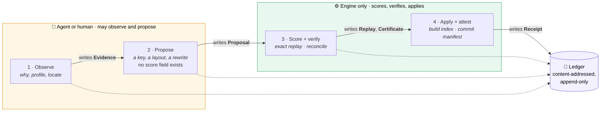
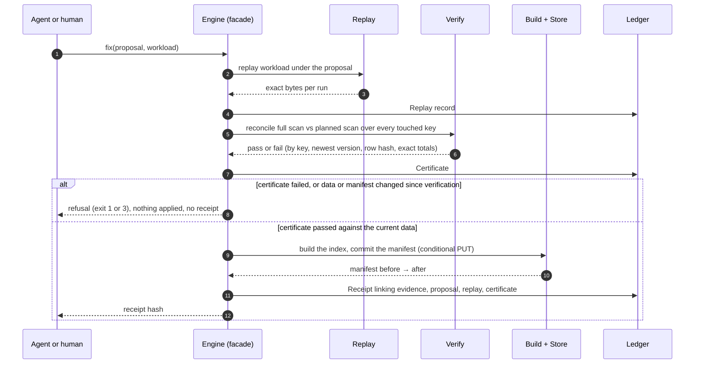
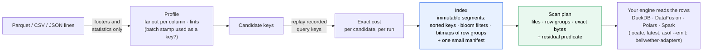
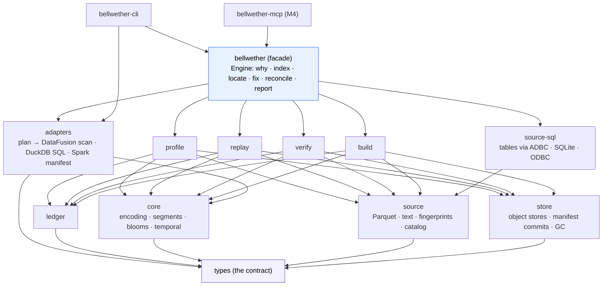

# Architecture

Bellwether is a standalone Rust engine that explains why a query over columnar files read too much, proposes the fix from exact measurement, and attests that the fix returns the same rows. Agent-first, engine-verified.

## The boundary this system defends

> The agent may **observe** and **propose**. Only the engine may **measure**, **verify**, and **apply**. Nothing crosses from the left side of that line to the right without a content-addressed record of why.

Every other decision follows from this sentence. Table-format data skipping and engine-internal indexes have no agent and no verification; they are indexes. The current wave of agentic data tools has an agent and no verification; they trust the model's claim that a rewrite is correct. Bellwether treats the model as a hypothesis generator with no authority and makes the engine's receipts the only thing a human or a CI gate reads.

Three questions the engine answers, and the verb each ships under:

- **`why`**: which column is a real key and which only looks like one (fanout), and what a lookup would have read under each candidate index, computed exactly by replaying recorded key sets. Useful before any index exists.
- **`fix`**: build the recommended index, apply the proposal, reconcile old against new output, emit the receipt.
- **`asof` and `latest`**: the newest version of each key, or the version current at a timestamp, across a plain folder of files, located to the row group.

## The loop

| Stage | Who | Record written | Rule |
|---|---|---|---|
| 1 Observe | agent or human | `Evidence` | read-only, cache-backed, no network, under 100 ms |
| 2 Propose | agent or human | `Proposal` | no score field exists; the agent may say anything |
| 3 Score + verify | engine only | `Replay`, `Certificate` | exact replay of recorded key sets; reconcile over touched keys |
| 4 Apply + attest | engine only | `Receipt` | takes a passing Certificate, applies, then writes the Receipt linking the whole chain |

## Crates

| Crate | Job | Owns invariants |
|---|---|---|
| `bellwether-types` | records, traits, format constants; no logic | — |
| `bellwether-core` | memcomparable keys, segment reader/writer, SBBF blooms, roaring bitmaps, temporal chains, merge | 1, 5 |
| `bellwether-source` | `Source` for Parquet (real row groups) and CSV/JSON lines (byte-range chunks); fingerprints | — |
| `bellwether-source-sql` | `Source` over SQL tables (ADR 027): partitions or key ranges as units with an identity, statistics as bounds from one aggregate per unit, ADBC/SQLite/ODBC reads as Arrow, snapshot discipline, measured costs | — |
| `bellwether-store` | `Store` over `object_store`; conditional PUT per backend; manifest commit protocol; cache | 4 |
| `bellwether-build` | discover → fingerprint → assign ids → parallel segments → one manifest commit; incremental; compaction | — |
| `bellwether-profile` | fanout, sortedness, range gaps, lints, candidate composites | 6 |
| `bellwether-replay` | workload recorder; exact cost of current and hypothetical key specs per recorded run | 3 |
| `bellwether-verify` | reconcile two sources by key with latest-by, row hash, decimal totals; coverage statement | — |
| `bellwether-ledger` | content-addressed append-only records; write-time rules | 2, 6 |
| `bellwether-bench` | synthetic versioned ledger, recorded workloads, baselines, SLO assertions | — |
| `bellwether` | the facade: `Engine` with every operation as a typed result; the one code path the CLI and MCP share; `fix` runs score → verify → apply → attest in that order | 2 (the Receipt rule, with ledger) |
| `bellwether-cli` | `why`, `index`, `locate`, `latest`, `asof`, `reconcile`, `propose`, `fix`, `receipt`, `report`, `bench`; formatting and arguments only | — |
| `bellwether-mcp` | the same engine as MCP tools in three capability tiers | — |
| `bellwether-adapters` | a `ScanPlan` translated for a query engine (WP16): a DataFusion scan pinned to the planned row groups, one DuckDB statement, a Spark manifest and shim; the residual decoded to typed values and run in the plan's order, or refused by name; `CountingStore` and byte classification at the storage boundary. Depends on `types` and `core` only; the facade's `Engine::emit_plan` and the CLI's `--emit` / MCP's `emit` use it and execute nothing | — |

Dependency arrows point one way, and `dev/check-layering.py` fails CI on any edge not listed there. `core` and `source` know nothing above them. `cli` and `mcp` hold no engine logic: both call the `bellwether` facade, so a typed result serialized by the CLI's `--json` is byte for byte what an MCP tool returns.

See `invariants.md`, `threat-model.md`, `format.md`, `work-packages.md`, `agent-loop.md`, `rule-catalog.md`, `benchmark.md`, and `adr/`.

## Diagrams for implementers

### How `fix` proves a change

### From files to a plan

### Crate graph

