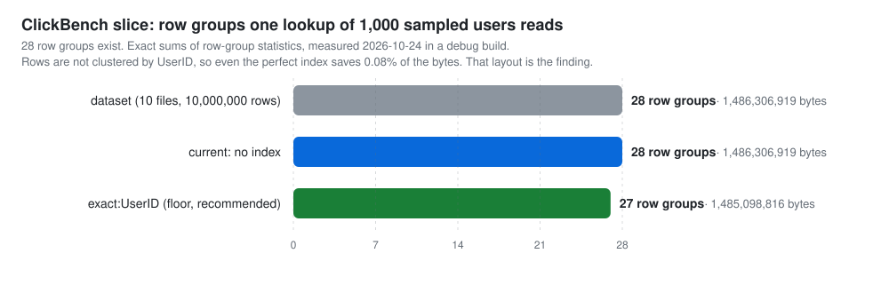

# Measured: a ClickBench slice, end to end with no index

Measured by WP9 on 2026-10-24. Machine: Apple M3 Pro, 12 cores, 36 GB, macOS 26.4.1, local SSD; **debug build** (rustc 1.99.1). Data: ClickBench `hits_compatible/athena_partitioned/hits_0.parquet` through `hits_9.parquet` (10 files, 28 row groups, 10,000,000 rows), unindexed to start, in a scratch directory (deleted afterwards). Keys: 1,000 distinct `UserID` values sampled with DuckDB (`SELECT UserID FROM (SELECT DISTINCT UserID FROM read_parquet('hits_*.parquet')) USING SAMPLE reservoir(1000 ROWS) REPEATABLE (42)`). The transcript below is verbatim, from a script that ran each command in turn and printed its exit code and wall time, except that the scratch directory it ran in is shown as `<scratch>`.

```text
$ bellwether why hits
why <scratch>/clickbench/hits: not indexed
funnel: no workload; pass --from <keys.parquet> to replay a run under each candidate key
                                         files   row groups              bytes
  dataset                                   10           28      1,486,306,919     1.5 GB  10,000,000 rows
exit 0  (.159047000 s)

$ bellwether why hits --from userid_keys.parquet
why <scratch>/clickbench/hits: not indexed
funnel: 1 run(s), keys p50/p95/max 1,000/1,000/1,000; exact sums of row-group statistics, summed over runs
                                         files   row groups              bytes
  dataset                                   10           28      1,486,306,919     1.5 GB  10,000,000 rows
  current (no index)                        10           28      1,486,306,919     1.5 GB
  exact:UserID                              10           27      1,485,098,816     1.5 GB  floor: only row groups holding a key, recommended

culprit (UserID): no index serves this lookup, so it reads every row group
recommended: exact:UserID reads 1,485,098,816 bytes (1.5 GB) instead of 1,486,306,919 (1.5 GB)

records
  workload  23e59631372a8bf9c65bf2ab17b2449383701b4268c1c2a86171a3fe2c95e9c2
  proposal  fe985b6e8f46f2c74bd34035fe25bbab9dc98050a8174a4b40bc22321d211096  replay 32dbf2856f4c  exact:UserID
exit 0  (16.923555000 s)

$ bellwether index hits --key exact:UserID
index <scratch>/clickbench/hits: committed manifest sequence 1
  files: 10 new, 0 changed, 0 removed, 0 unchanged; 28 row groups read; 2 segments written, 2 live

  key spec                                    complete at
  exact:UserID                                          1

manifest 55089d7dc979b173bb25b6fed8bc2f655f62ac86b3d86c2f7bf8d9846b96630c
exit 0  (17.225682000 s)

$ bellwether locate hits --keys userid_keys.parquet
locate: 1,000 keys on (UserID) at manifest sequence 1
                                         files   row groups              bytes
  live                                      10           28                  -
  planned                                   10           27      1,485,098,816     1.5 GB
  specs: exact:UserID

  file                                                          row groups              bytes
  <scratch>/clickbench/hits/hits_0.parquet                               2        122,401,403
  <scratch>/clickbench/hits/hits_1.parquet                               3        174,899,190
  <scratch>/clickbench/hits/hits_2.parquet                               4        229,279,215
  <scratch>/clickbench/hits/hits_3.parquet                               3        192,438,843
  <scratch>/clickbench/hits/hits_4.parquet                               3        140,863,574
  <scratch>/clickbench/hits/hits_5.parquet                               2        122,241,642
  <scratch>/clickbench/hits/hits_6.parquet                               3        122,862,108
  <scratch>/clickbench/hits/hits_7.parquet                               2        123,858,220
  <scratch>/clickbench/hits/hits_8.parquet                               3        122,669,790
  <scratch>/clickbench/hits/hits_9.parquet                               2        133,584,831

evidence efbaa46c169c40b46e8765045c33d0ae87da96380ebe67e12c2a84e4f6852b24
exit 0  (.685103000 s)

$ bellwether why hits --from userid_keys.parquet
why <scratch>/clickbench/hits: manifest sequence 1, current keys: exact:UserID
funnel: 1 run(s), keys p50/p95/max 1,000/1,000/1,000; exact sums of row-group statistics, summed over runs
                                         files   row groups              bytes
  dataset                                   10           28      1,486,306,919     1.5 GB  10,000,000 rows
  current                                   10           27      1,485,098,816     1.5 GB

culprit (UserID): the serving key exact:UserID
recommended: none; no candidate reads fewer bytes than the current configuration

records
  workload  23e59631372a8bf9c65bf2ab17b2449383701b4268c1c2a86171a3fe2c95e9c2
exit 0  (.688599000 s)
```

An index does not help this workload on this layout: 1,000 random users together touch 27 of the 28 row groups, so even an exact index (the floor: only row groups that hold a queried key) saves 0.08% of the bytes. Rows are not clustered by `UserID`, and that layout, not a missing index, is what the job pays for. The replay's prediction before the index existed (1,485,098,816 bytes) is exactly what the index then planned. The bytes are exact and do not depend on the build; the timings do (most of the 17 s `why` is building a transient `exact:UserID` index over 10,000,000 rows in a debug build). This transcript was taken before the profile was wired into `why`; `why` now also prints the fanout table, the lints, and the profile Evidence it records, and the funnel above is unchanged (the bytes are exact).

<p align="center">
  <picture>
    <source media="(prefers-color-scheme: dark)" srcset="../assets/clickbench-funnel-dark.svg">
    
  </picture>
</p>
