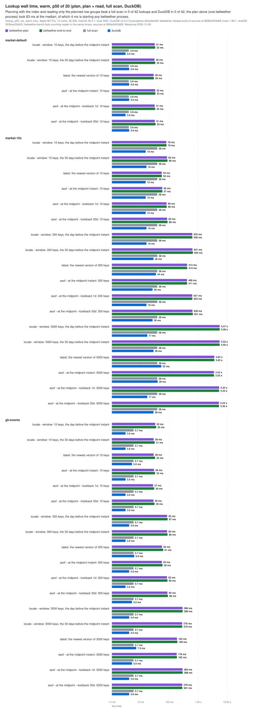
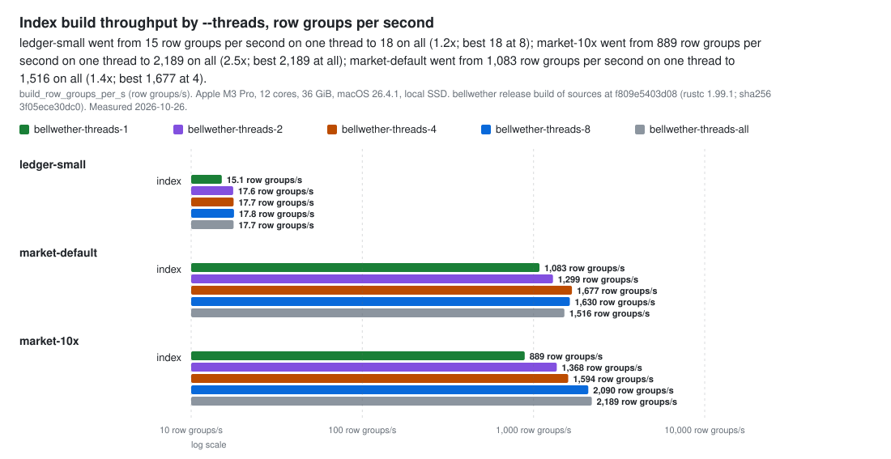
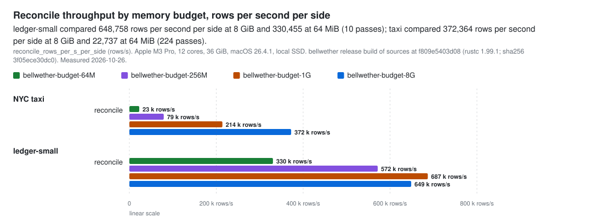
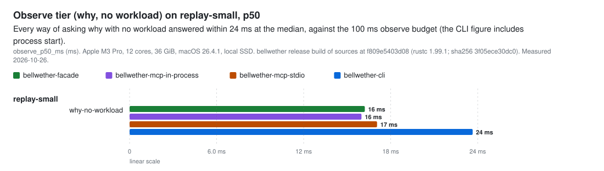

# Measured: release performance (WP22a)

Measured on 2026-10-26 (UTC) with [`scripts/perf.sh`](../../scripts/perf.sh), on one machine and one release binary. [How it ran](#how-it-ran) gives each section's start time, commit, and outside load.

All the numbers are in [`2026-10-26-perf.json`](2026-10-26-perf.json) (`bellwether-perf/1`, [definitions](../benchmark.md#2026-10-25-release-measurements-and-the-perf-schema-wp22a)). Every raw timing sample is in [`2026-10-26-samples.jsonl`](2026-10-26-samples.jsonl), so each p50 and p95 can be recomputed. [`scripts/perf-report.py`](../../scripts/perf-report.py) prints every table below from those files; none is typed by hand.

The README charts use the subset in [`results/perf.json`](results/perf.json), which the README's chart renderer reads. The budgets derived from this run are in [`budgets.toml`](budgets.toml).

- **Machine.** Apple M3 Pro, 12 cores, 36 GiB, macOS 26.4.1, local SSD.
- **Binary.** `bellwether`, release profile with thin LTO, codegen-units 1, and line-table debug info (so the profiles have names); rustc 1.99.1.
  - Its sha256 is `3f05ece30dc06e847027a37400f6360ad9f17e60a3a9582b0667ad0dd85f2c70`. `perf.json` records it per run.
  - It was built from the sources at `f809e54`, the newest commit that touches a Rust source or a Cargo manifest. The tree had no modified sources at any run (`built_from_dirty: false`), and cargo rebuilds whenever one of those files changes.
  - The commits named in [How it ran](#how-it-ran) differ from `f809e54` only in scripts and documents.
  - **Those hashes predate a rebase.** All of them, `f809e54` included, are from this branch before it was rebased onto `cacd4eb` (WP19, signed receipts), and the tag `wp22a-measured-2026-10-26` keeps them. The rebase brought in WP19's Rust changes, which this run did not measure.
- **DuckDB.** v2.0.0 (d54cbbe3df), the CLI, on the same files.
- **Cache.**
  - **Warm** means the same call ran just before.
  - **Cold**, for Bellwether, means a new process, with bellwether's cache directory removed before each sample.
  - **Cold**, for DuckDB, means the first query of a new process.
  - The OS page cache could not be dropped (that needs root), so "cold" here is **process-cold**: file reads still came from memory. Cold-cache disk reads are not measured on this page.
- **Data.**
  - **Generated** by seeded scripts in this repository: `bellwether bench market` at its defaults and at 10× (3,000 symbols, 30 days), and the synthetic ledger's small rung (`bellwether bench generate --rung small`).
  - **Public:** the GH Archive hours 2024-01-01 00 to 11, and the NYC yellow-taxi months 2024-01 to 2024-06. [`scripts/realdata.sh`](../../scripts/realdata.sh) prepares both, and [the real-data page](2026-10-24-realdata.md) describes them.
  - No production data and no production numbers are used anywhere.
- **Key sets.** The lookup key sets are picked with DuckDB's `hash()`, so another DuckDB version could pick different keys. `perf.json` records every key set under `context["keys/…"]`.
- **Commands.** `REALDATA` stands for the work directory of `scripts/realdata.sh`.

  ```sh
  # Everything except the taxi pair (writes benches/out/perf.json and samples.jsonl):
  PERF_WORK=/tmp/perf REALDATA_WORK=$REALDATA scripts/perf.sh --merge \
    --reconcile-datasets ledger,replay --showcase docs/measured/results/perf.json
  # The taxi pair at three budgets, with the one-pass search past 8 GiB:
  PERF_WORK=/tmp/perf REALDATA_WORK=$REALDATA scripts/perf.sh --merge --sections reconcile \
    --reconcile-datasets taxi --reconcile-budgets 8G,1G,256M --showcase docs/measured/results/perf.json
  # Lookups again (see "Measured under load"):
  PERF_WORK=/tmp/perf REALDATA_WORK=$REALDATA scripts/perf.sh --merge --sections lookups \
    --showcase docs/measured/results/perf.json
  # Publish:
  cp benches/out/perf.json docs/measured/2026-10-26-perf.json
  cp benches/out/samples.jsonl docs/measured/2026-10-26-samples.jsonl
  python3 scripts/perf-report.py docs/measured/2026-10-26-perf.json      # the tables on this page
  python3 scripts/perf-budgets.py --perf docs/measured/2026-10-26-perf.json \
    --document docs/measured/2026-10-26-performance.md > docs/measured/budgets.toml
  ```

## Measured under load

Other agents stopped their work for these runs. The owner's desktop apps kept running, and in some sections so did a separate compile in another repository. [How it ran](#how-it-ran) has the full record.

- **Quiet:** build, reconcile on the ledger rung, latency, profiles, and taxi at 8 GiB, 1 GiB, and 256 MiB.
  - At the peak, processes outside the run used 1.0 to 3.1 cores. The 3.1-core peak was during profiles, and came from desktop apps.
  - How long the load lasted, beyond the peak, was recorded only from the lookups rerun on.
- **Lookups (two attempts).** Both attempts overlapped someone's `rustc`, at 580% to 820% CPU.
  - In the published attempt, outside processes used more than 2 cores in 17% of the 196 five-second samples. The median was 1.17 cores.
  - The two attempts agree: per lookup, the warm plan p50 of the published attempt is 0.86 to 1.05 times the other's, with a median of 0.97. [How it ran](#how-it-ran) prints the comparison from the earlier attempt's numbers, which `perf.json` keeps.
  - The lookup timings are published with that record.
- **Taxi at 64 MiB.** This row is from an earlier run, under 5.5 cores of outside load. It is 15 minutes per run, and was not repeated.

Load does not affect counts: row groups, bytes, passes, segments, meter peaks, and resident bytes per key.

**Single runs.** Reconcile and build timings are few runs. Each reconcile wall time is one run (n = 1); each build wall time is the median of 3.


## Findings

1. **Reconcile exceeds its stated memory bound.** The verify README states the bound: the budget, plus one decoded row group (`peak_batch_bytes`), plus the fingerprint lists, plus a footer cache capped at 256 MiB. On the ledger small rung (8,000,000 rows a side, with `latest_by` and totals by group), peak memory grows as the budget shrinks:

   | budget | passes | meter peak | peak RSS | peak footprint | stated bound |
   |---|---:|---:|---:|---:|---:|
   | 1 GiB | 1 | 164.4 MiB | 456.3 MiB | 447.7 MiB | 1,317.8 MiB |
   | 256 MiB | 3 | 68.4 MiB | 1,303.9 MiB | 1,268.4 MiB | 549.8 MiB |
   | 64 MiB | 10 | 18.3 MiB | 1,625.3 MiB | 1,616.5 MiB | 357.8 MiB |

   - At 64 MiB the peak is 4.5 times the bound.
   - The peak footprint (`/usr/bin/time -l`) counts dirty memory only, not mapped file pages, so this is not the page cache.
   - The taxi pair stays under its bound at every budget, even at 64 MiB with 224 passes: 459.7 MiB against 462.2 MiB. So the excess does not simply grow with the number of passes.

   The reviewer of this measurement reproduced it in about 10 s on a small generated corpus:

   ```sh
   bellwether bench generate --out tiny --days 2 --files 2 --row-groups-per-file 8 \
     --rows-per-row-group 100000 --entities 100000
   ```

   That corpus was reconciled against a copy of itself, with the flags above:

   | rows per row group | budget | passes | meter peak | peak RSS |
   |---:|---|---:|---:|---:|
   | 100,000 | 1G / 256M / 64M | 1 | 8.9 MiB | 429 MiB |
   | 100,000 | 16M | 4 | 2.2 MiB | 823 MiB |
   | 100,000 | 8M | 8 | 1.1 MiB | 831 MiB |
   | 10,000 | 64M, 16M, 8M | 1 to 8 | - | 31 to 41 MiB |

   Peak memory follows row-group size, and roughly doubles once there is more than one pass. Even one pass is over the bound: at 16 MiB the bound is about 294 MiB. The cause is open and needs a heap profile; it is tracked as a defect, separately from this page.

   The repro on the ledger rung, run from `PERF_WORK`:

   ```sh
   bellwether reconcile ledger-small/data ledger-small/data-copy --key entity_id --latest-by version_ts \
     --totals amount --group-by status --memory-budget 64M --index /tmp/rss-idx --quiet
   ```

2. **Planning is where a lookup's time goes, and plan time grows with the number of keys.** On `market-10x` (2,268 row groups), the warm p50 plan for `locate --window` over one day takes:

   - 78 ms at 10 keys;
   - 622 ms at 300 keys;
   - 5.6 s at 3,000 keys.

   Reading the planned row groups adds 0.5 to 23 ms. On the same files, DuckDB answers in 15 to 52 ms, and a full scan through the byte-counting reader takes 38 ms.

   Plan plus read lost to both the full scan and DuckDB in all 42 lookups measured. That still holds with process start (3.7 ms, `bellwether --version`) taken off: the closest case is 1.34 times the full scan.

   The bytes saved are real: 241,358 planned of 31,932,514 at 10 keys. The time lost is plan cost, and the profile finds where it goes (hypothesis 3). The plan reads each indexed value with its own store round trip: 89.5% of the main thread's wall time is under `ObjectStoreBackend::get_range` on the 3,000-key window. On remote object storage each of those round trips would cost more, not less, so this result is not an artifact of fast local disk.
3. **Builds use few cores.** Throughput scales 2.46 times at 12 threads on `market-10x`, and 1.17 times on the ledger rung. Run without the profiler, both builds kept about 1.2 cores busy on average at `--threads` 12 (hypotheses 2 and 9).
4. **Reconcile runs on one thread.** One pass needs much more budget than the state it holds:

   - **Ledger rung.** One pass needs 592 MiB of budget for 164.4 MiB of state, 3.6 times as much. It holds 401,325 keys over 8,000,000 rows.
   - **Taxi.** One pass needs 16 GiB for 9.68 GiB of state, 1.65 times as much. It holds 20,314,139 keys over 20,332,093 rows.
5. **The observe tier and replay are well within their budgets.**

   - `why` with no workload answers in 16 to 24 ms at p50 (budget 100 ms). That covers the facade, MCP in process, MCP over stdio, and the CLI including process start.
   - The replay p50 run takes at most 0.44 ms (SLO 5 ms).
6. **Resident bytes per key (contract v3, entry 32)** were measured in a release build.

   - An open transient segment writer holds **320 bytes per key** resident, against 9 bytes accounted: 35.5 times.
   - The layout map holds **84 bytes per key**, against 73 accounted: 1.15 times.

   The build and replay READMEs now state both constants.


## Charts

[`scripts/render_charts.py`](../../scripts/render_charts.py) draws the charts, and the table of every chart row, from [`results/perf.json`](results/perf.json), and CI checks that they match the committed numbers. The lookup chart shows the negative result from finding 2: on these local, warm files, no lookup beat a full scan or DuckDB.

<p align="center">
  <picture>
    <source media="(prefers-color-scheme: dark)" srcset="../assets/results-perf-lookup-latency-dark.svg">
    
  </picture>
</p>

<p align="center">
  <picture>
    <source media="(prefers-color-scheme: dark)" srcset="../assets/results-perf-build-dark.svg">
    
  </picture>
</p>

<p align="center">
  <picture>
    <source media="(prefers-color-scheme: dark)" srcset="../assets/results-perf-reconcile-dark.svg">
    
  </picture>
</p>

<p align="center">
  <picture>
    <source media="(prefers-color-scheme: dark)" srcset="../assets/results-perf-observe-dark.svg">
    
  </picture>
</p>

<details><summary>Every chart row (902 rows)</summary>

<!-- results:perf:begin -->
| Dataset | Query | Side | Metric | Value | Unit | Exactness |
|---|---|---|---|---:|---|---|
| taxi | reconcile | bellwether-budget-64M | reconcile_rows_per_s_per_side | 22,737 | rows/s | measured |
| taxi | reconcile | bellwether-budget-64M | reconcile_passes | 224 | passes | exact |
| ledger-small | index | bellwether-threads-1 | build_row_groups_per_s | 15.1 | row groups/s | measured |
| ledger-small | index | bellwether-threads-1 | build_peak_rss_bytes | 282,705,920 | bytes | measured |
| ledger-small | index | bellwether-threads-2 | build_row_groups_per_s | 17.6 | row groups/s | measured |
| ledger-small | index | bellwether-threads-2 | build_peak_rss_bytes | 325,943,296 | bytes | measured |
| ledger-small | index | bellwether-threads-4 | build_row_groups_per_s | 17.7 | row groups/s | measured |
| ledger-small | index | bellwether-threads-4 | build_peak_rss_bytes | 348,585,984 | bytes | measured |
| ledger-small | index | bellwether-threads-8 | build_row_groups_per_s | 17.8 | row groups/s | measured |
| ledger-small | index | bellwether-threads-8 | build_peak_rss_bytes | 357,023,744 | bytes | measured |
| ledger-small | index | bellwether-threads-all | build_row_groups_per_s | 17.7 | row groups/s | measured |
| ledger-small | index | bellwether-threads-all | build_peak_rss_bytes | 356,630,528 | bytes | measured |
| market-default | index | bellwether-threads-1 | build_row_groups_per_s | 1083.3 | row groups/s | measured |
| market-default | index | bellwether-threads-1 | build_peak_rss_bytes | 18,235,392 | bytes | measured |
| market-default | index | bellwether-threads-2 | build_row_groups_per_s | 1299.0 | row groups/s | measured |
| market-default | index | bellwether-threads-2 | build_peak_rss_bytes | 20,021,248 | bytes | measured |
| market-default | index | bellwether-threads-4 | build_row_groups_per_s | 1676.8 | row groups/s | measured |
| market-default | index | bellwether-threads-4 | build_peak_rss_bytes | 23,445,504 | bytes | measured |
| market-default | index | bellwether-threads-8 | build_row_groups_per_s | 1629.5 | row groups/s | measured |
| market-default | index | bellwether-threads-8 | build_peak_rss_bytes | 23,085,056 | bytes | measured |
| market-default | index | bellwether-threads-all | build_row_groups_per_s | 1515.9 | row groups/s | measured |
| market-default | index | bellwether-threads-all | build_peak_rss_bytes | 23,265,280 | bytes | measured |
| market-10x | index | bellwether-threads-1 | build_row_groups_per_s | 888.6 | row groups/s | measured |
| market-10x | index | bellwether-threads-1 | build_peak_rss_bytes | 24,543,232 | bytes | measured |
| market-10x | index | bellwether-threads-2 | build_row_groups_per_s | 1368.1 | row groups/s | measured |
| market-10x | index | bellwether-threads-2 | build_peak_rss_bytes | 27,082,752 | bytes | measured |
| market-10x | index | bellwether-threads-4 | build_row_groups_per_s | 1593.9 | row groups/s | measured |
| market-10x | index | bellwether-threads-4 | build_peak_rss_bytes | 33,603,584 | bytes | measured |
| market-10x | index | bellwether-threads-8 | build_row_groups_per_s | 2090.1 | row groups/s | measured |
| market-10x | index | bellwether-threads-8 | build_peak_rss_bytes | 42,745,856 | bytes | measured |
| market-10x | index | bellwether-threads-all | build_row_groups_per_s | 2188.9 | row groups/s | measured |
| market-10x | index | bellwether-threads-all | build_peak_rss_bytes | 50,724,864 | bytes | measured |
| ledger-small | reconcile | bellwether-budget-8G | reconcile_rows_per_s_per_side | 648,758 | rows/s | measured |
| ledger-small | reconcile | bellwether-budget-8G | reconcile_passes | 1 | passes | exact |
| ledger-small | reconcile | bellwether-budget-1G | reconcile_rows_per_s_per_side | 686,984 | rows/s | measured |
| ledger-small | reconcile | bellwether-budget-1G | reconcile_passes | 1 | passes | exact |
| ledger-small | reconcile | bellwether-budget-256M | reconcile_rows_per_s_per_side | 571,665 | rows/s | measured |
| ledger-small | reconcile | bellwether-budget-256M | reconcile_passes | 3 | passes | exact |
| ledger-small | reconcile | bellwether-budget-64M | reconcile_rows_per_s_per_side | 330,455 | rows/s | measured |
| ledger-small | reconcile | bellwether-budget-64M | reconcile_passes | 10 | passes | exact |
| in-test corpus | in-test-corpus-one-cached-candidate | bellwether | replay_p50_run_ms | 0.003 | ms | measured |
| in-test corpus | in-test-corpus-committed-index-through-the-build-planner | bellwether | replay_p50_run_ms | 0.03 | ms | measured |
| replay-small | bench-corpus-exact-entity-id-one-cached-candidate | bellwether | replay_p50_run_ms | 0.025 | ms | measured |
| replay-small | bench-corpus-exact-entity-id-committed-index-through-the-build-planner | bellwether | replay_p50_run_ms | 0.343 | ms | measured |
| replay-small | bench-corpus-bloom-entity-id-one-cached-candidate | bellwether | replay_p50_run_ms | 0.039 | ms | measured |
| replay-small | bench-corpus-bloom-entity-id-committed-index-through-the-build-planner | bellwether | replay_p50_run_ms | 0.439 | ms | measured |
| replay-small | why-no-workload | bellwether-facade | observe_p50_ms | 16.216 | ms | measured |
| replay-small | why-no-workload | bellwether-mcp-in-process | observe_p50_ms | 15.988 | ms | measured |
| replay-small | why-no-workload | bellwether-mcp-stdio | observe_p50_ms | 17.06 | ms | measured |
| replay-small | why-no-workload | bellwether-cli | observe_p50_ms | 23.651 | ms | measured |
| ledger-small | why-preregistered | bellwether-cold | why_p50_ms | 7325.636 | ms | measured |
| ledger-small | why-preregistered | bellwether-cold | why_p95_ms | 7344.969 | ms | measured |
| ledger-small | why-preregistered | bellwether-warm | why_p50_ms | 6021.034 | ms | measured |
| ledger-small | why-preregistered | bellwether-warm | why_p95_ms | 6122.937 | ms | measured |
| in-process UInt64 keys | open_writer_exact_u64 | bellwether | resident_bytes_per_key | 319.8 | bytes | measured |
| in-process UInt64 keys | layout_map_9_byte_keys | bellwether | resident_bytes_per_key | 84.3 | bytes | measured |
| taxi | reconcile | bellwether-budget-8G | reconcile_rows_per_s_per_side | 372,364 | rows/s | measured |
| taxi | reconcile | bellwether-budget-8G | reconcile_passes | 2 | passes | exact |
| taxi | reconcile | bellwether-budget-1G | reconcile_rows_per_s_per_side | 214,183 | rows/s | measured |
| taxi | reconcile | bellwether-budget-1G | reconcile_passes | 14 | passes | exact |
| taxi | reconcile | bellwether-budget-256M | reconcile_rows_per_s_per_side | 79,089 | rows/s | measured |
| taxi | reconcile | bellwether-budget-256M | reconcile_passes | 56 | passes | exact |
| market-default | locate-window-1d-k10 | bellwether-plan | lookup_p50_ms_warm | 30.868 | ms | measured |
| market-default | locate-window-1d-k10 | full-scan | lookup_p50_ms_warm | 3.888 | ms | measured |
| market-default | locate-window-1d-k10 | bellwether-plan | row_groups | 36 | row groups | exact |
| market-default | locate-window-1d-k10 | bellwether-plan | bytes | 488,080 | bytes | exact |
| market-default | locate-window-1d-k10 | full-scan | row_groups | 216 | row groups | exact |
| market-default | locate-window-1d-k10 | full-scan | bytes | 2,868,637 | bytes | exact |
| market-default | locate-window-1d-k10 | bellwether-plan | lookup_p95_ms_warm | 32.995 | ms | measured |
| market-default | locate-window-1d-k10 | full-scan | lookup_p95_ms_warm | 4.08 | ms | measured |
| market-default | locate-window-1d-k10 | bellwether-end-to-end | lookup_p50_ms_warm | 32.0 | ms | measured |
| market-default | locate-window-1d-k10 | bellwether-end-to-end | lookup_p95_ms_warm | 34.169 | ms | measured |
| market-default | locate-window-1d-k10 | bellwether-plan | lookup_p50_ms_cold | 32.24 | ms | measured |
| market-default | locate-window-1d-k10 | full-scan | lookup_p50_ms_cold | 4.044 | ms | measured |
| market-default | locate-window-1d-k10 | bellwether-plan | lookup_p95_ms_cold | 36.851 | ms | measured |
| market-default | locate-window-1d-k10 | full-scan | lookup_p95_ms_cold | 4.085 | ms | measured |
| market-default | locate-window-1d-k10 | bellwether-end-to-end | lookup_p50_ms_cold | 33.316 | ms | measured |
| market-default | locate-window-1d-k10 | bellwether-end-to-end | lookup_p95_ms_cold | 37.916 | ms | measured |
| market-default | locate-window-1d-k10 | duckdb | lookup_p50_ms_warm | 3.0 | ms | measured |
| market-default | locate-window-1d-k10 | duckdb | lookup_p95_ms_warm | 3.0 | ms | measured |
| market-default | locate-window-1d-k10 | duckdb | lookup_p50_ms_cold | 6.0 | ms | measured |
| market-default | locate-window-1d-k10 | duckdb | lookup_p95_ms_cold | 6.0 | ms | measured |
| market-default | locate-window-30d-k10 | bellwether-plan | lookup_p50_ms_warm | 30.339 | ms | measured |
| market-default | locate-window-30d-k10 | full-scan | lookup_p50_ms_warm | 3.888 | ms | measured |
| market-default | locate-window-30d-k10 | bellwether-plan | row_groups | 78 | row groups | exact |
| market-default | locate-window-30d-k10 | bellwether-plan | bytes | 1,042,140 | bytes | exact |
| market-default | locate-window-30d-k10 | full-scan | row_groups | 216 | row groups | exact |
| market-default | locate-window-30d-k10 | full-scan | bytes | 2,868,637 | bytes | exact |
| market-default | locate-window-30d-k10 | bellwether-plan | lookup_p95_ms_warm | 33.11 | ms | measured |
| market-default | locate-window-30d-k10 | full-scan | lookup_p95_ms_warm | 4.08 | ms | measured |
| market-default | locate-window-30d-k10 | bellwether-end-to-end | lookup_p50_ms_warm | 32.194 | ms | measured |
| market-default | locate-window-30d-k10 | bellwether-end-to-end | lookup_p95_ms_warm | 34.768 | ms | measured |
| market-default | locate-window-30d-k10 | bellwether-plan | lookup_p50_ms_cold | 29.705 | ms | measured |
| market-default | locate-window-30d-k10 | full-scan | lookup_p50_ms_cold | 4.044 | ms | measured |
| market-default | locate-window-30d-k10 | bellwether-plan | lookup_p95_ms_cold | 33.212 | ms | measured |
| market-default | locate-window-30d-k10 | full-scan | lookup_p95_ms_cold | 4.085 | ms | measured |
| market-default | locate-window-30d-k10 | bellwether-end-to-end | lookup_p50_ms_cold | 31.508 | ms | measured |
| market-default | locate-window-30d-k10 | bellwether-end-to-end | lookup_p95_ms_cold | 35.008 | ms | measured |
| market-default | locate-window-30d-k10 | duckdb | lookup_p50_ms_warm | 4.0 | ms | measured |
| market-default | locate-window-30d-k10 | duckdb | lookup_p95_ms_warm | 4.0 | ms | measured |
| market-default | locate-window-30d-k10 | duckdb | lookup_p50_ms_cold | 6.0 | ms | measured |
| market-default | locate-window-30d-k10 | duckdb | lookup_p95_ms_cold | 6.0 | ms | measured |
| market-default | latest-k10 | bellwether-plan | lookup_p50_ms_warm | 28.294 | ms | measured |
| market-default | latest-k10 | full-scan | lookup_p50_ms_warm | 3.888 | ms | measured |
| market-default | latest-k10 | bellwether-plan | row_groups | 8 | row groups | exact |
| market-default | latest-k10 | bellwether-plan | bytes | 104,112 | bytes | exact |
| market-default | latest-k10 | full-scan | row_groups | 216 | row groups | exact |
| market-default | latest-k10 | full-scan | bytes | 2,868,637 | bytes | exact |
| market-default | latest-k10 | bellwether-plan | lookup_p95_ms_warm | 31.065 | ms | measured |
| market-default | latest-k10 | full-scan | lookup_p95_ms_warm | 4.08 | ms | measured |
| market-default | latest-k10 | bellwether-end-to-end | lookup_p50_ms_warm | 28.785 | ms | measured |
| market-default | latest-k10 | bellwether-end-to-end | lookup_p95_ms_warm | 31.522 | ms | measured |
| market-default | latest-k10 | bellwether-plan | lookup_p50_ms_cold | 28.777 | ms | measured |
| market-default | latest-k10 | full-scan | lookup_p50_ms_cold | 4.044 | ms | measured |
| market-default | latest-k10 | bellwether-plan | lookup_p95_ms_cold | 30.172 | ms | measured |
| market-default | latest-k10 | full-scan | lookup_p95_ms_cold | 4.085 | ms | measured |
| market-default | latest-k10 | bellwether-end-to-end | lookup_p50_ms_cold | 29.276 | ms | measured |
| market-default | latest-k10 | bellwether-end-to-end | lookup_p95_ms_cold | 30.707 | ms | measured |
| market-default | latest-k10 | duckdb | lookup_p50_ms_warm | 4.0 | ms | measured |
| market-default | latest-k10 | duckdb | lookup_p95_ms_warm | 5.0 | ms | measured |
| market-default | latest-k10 | duckdb | lookup_p50_ms_cold | 7.0 | ms | measured |
| market-default | latest-k10 | duckdb | lookup_p95_ms_cold | 7.0 | ms | measured |
| market-default | asof-k10 | bellwether-plan | lookup_p50_ms_warm | 32.011 | ms | measured |
| market-default | asof-k10 | full-scan | lookup_p50_ms_warm | 3.888 | ms | measured |
| market-default | asof-k10 | bellwether-plan | row_groups | 9 | row groups | exact |
| market-default | asof-k10 | bellwether-plan | bytes | 119,122 | bytes | exact |
| market-default | asof-k10 | full-scan | row_groups | 216 | row groups | exact |
| market-default | asof-k10 | full-scan | bytes | 2,868,637 | bytes | exact |
| market-default | asof-k10 | bellwether-plan | lookup_p95_ms_warm | 34.469 | ms | measured |
| market-default | asof-k10 | full-scan | lookup_p95_ms_warm | 4.08 | ms | measured |
| market-default | asof-k10 | bellwether-end-to-end | lookup_p50_ms_warm | 32.596 | ms | measured |
| market-default | asof-k10 | bellwether-end-to-end | lookup_p95_ms_warm | 35.189 | ms | measured |
| market-default | asof-k10 | bellwether-plan | lookup_p50_ms_cold | 30.382 | ms | measured |
| market-default | asof-k10 | full-scan | lookup_p50_ms_cold | 4.044 | ms | measured |
| market-default | asof-k10 | bellwether-plan | lookup_p95_ms_cold | 33.978 | ms | measured |
| market-default | asof-k10 | full-scan | lookup_p95_ms_cold | 4.085 | ms | measured |
| market-default | asof-k10 | bellwether-end-to-end | lookup_p50_ms_cold | 30.981 | ms | measured |
| market-default | asof-k10 | bellwether-end-to-end | lookup_p95_ms_cold | 34.595 | ms | measured |
| market-default | asof-k10 | duckdb | lookup_p50_ms_warm | 4.0 | ms | measured |
| market-default | asof-k10 | duckdb | lookup_p95_ms_warm | 4.0 | ms | measured |
| market-default | asof-k10 | duckdb | lookup_p50_ms_cold | 7.0 | ms | measured |
| market-default | asof-k10 | duckdb | lookup_p95_ms_cold | 7.0 | ms | measured |
| market-default | asof-lookback-1d-k10 | bellwether-plan | lookup_p50_ms_warm | 30.861 | ms | measured |
| market-default | asof-lookback-1d-k10 | full-scan | lookup_p50_ms_warm | 3.888 | ms | measured |
| market-default | asof-lookback-1d-k10 | bellwether-plan | row_groups | 36 | row groups | exact |
| market-default | asof-lookback-1d-k10 | bellwether-plan | bytes | 488,080 | bytes | exact |
| market-default | asof-lookback-1d-k10 | full-scan | row_groups | 216 | row groups | exact |
| market-default | asof-lookback-1d-k10 | full-scan | bytes | 2,868,637 | bytes | exact |
| market-default | asof-lookback-1d-k10 | bellwether-plan | lookup_p95_ms_warm | 34.674 | ms | measured |
| market-default | asof-lookback-1d-k10 | full-scan | lookup_p95_ms_warm | 4.08 | ms | measured |
| market-default | asof-lookback-1d-k10 | bellwether-end-to-end | lookup_p50_ms_warm | 31.952 | ms | measured |
| market-default | asof-lookback-1d-k10 | bellwether-end-to-end | lookup_p95_ms_warm | 35.894 | ms | measured |
| market-default | asof-lookback-1d-k10 | bellwether-plan | lookup_p50_ms_cold | 28.301 | ms | measured |
| market-default | asof-lookback-1d-k10 | full-scan | lookup_p50_ms_cold | 4.044 | ms | measured |
| market-default | asof-lookback-1d-k10 | bellwether-plan | lookup_p95_ms_cold | 30.018 | ms | measured |
| market-default | asof-lookback-1d-k10 | full-scan | lookup_p95_ms_cold | 4.085 | ms | measured |
| market-default | asof-lookback-1d-k10 | bellwether-end-to-end | lookup_p50_ms_cold | 29.372 | ms | measured |
| market-default | asof-lookback-1d-k10 | bellwether-end-to-end | lookup_p95_ms_cold | 31.009 | ms | measured |
| market-default | asof-lookback-1d-k10 | duckdb | lookup_p50_ms_warm | 3.0 | ms | measured |
| market-default | asof-lookback-1d-k10 | duckdb | lookup_p95_ms_warm | 4.0 | ms | measured |
| market-default | asof-lookback-1d-k10 | duckdb | lookup_p50_ms_cold | 6.0 | ms | measured |
| market-default | asof-lookback-1d-k10 | duckdb | lookup_p95_ms_cold | 6.0 | ms | measured |
| market-default | asof-lookback-30d-k10 | bellwether-plan | lookup_p50_ms_warm | 31.121 | ms | measured |
| market-default | asof-lookback-30d-k10 | full-scan | lookup_p50_ms_warm | 3.888 | ms | measured |
| market-default | asof-lookback-30d-k10 | bellwether-plan | row_groups | 78 | row groups | exact |
| market-default | asof-lookback-30d-k10 | bellwether-plan | bytes | 1,042,140 | bytes | exact |
| market-default | asof-lookback-30d-k10 | full-scan | row_groups | 216 | row groups | exact |
| market-default | asof-lookback-30d-k10 | full-scan | bytes | 2,868,637 | bytes | exact |
| market-default | asof-lookback-30d-k10 | bellwether-plan | lookup_p95_ms_warm | 34.119 | ms | measured |
| market-default | asof-lookback-30d-k10 | full-scan | lookup_p95_ms_warm | 4.08 | ms | measured |
| market-default | asof-lookback-30d-k10 | bellwether-end-to-end | lookup_p50_ms_warm | 32.903 | ms | measured |
| market-default | asof-lookback-30d-k10 | bellwether-end-to-end | lookup_p95_ms_warm | 35.943 | ms | measured |
| market-default | asof-lookback-30d-k10 | bellwether-plan | lookup_p50_ms_cold | 30.793 | ms | measured |
| market-default | asof-lookback-30d-k10 | full-scan | lookup_p50_ms_cold | 4.044 | ms | measured |
| market-default | asof-lookback-30d-k10 | bellwether-plan | lookup_p95_ms_cold | 32.361 | ms | measured |
| market-default | asof-lookback-30d-k10 | full-scan | lookup_p95_ms_cold | 4.085 | ms | measured |
| market-default | asof-lookback-30d-k10 | bellwether-end-to-end | lookup_p50_ms_cold | 32.613 | ms | measured |
| market-default | asof-lookback-30d-k10 | bellwether-end-to-end | lookup_p95_ms_cold | 34.191 | ms | measured |
| market-default | asof-lookback-30d-k10 | duckdb | lookup_p50_ms_warm | 4.0 | ms | measured |
| market-default | asof-lookback-30d-k10 | duckdb | lookup_p95_ms_warm | 4.0 | ms | measured |
| market-default | asof-lookback-30d-k10 | duckdb | lookup_p50_ms_cold | 6.0 | ms | measured |
| market-default | asof-lookback-30d-k10 | duckdb | lookup_p95_ms_cold | 7.0 | ms | measured |
| market-10x | locate-window-1d-k10 | bellwether-plan | lookup_p50_ms_warm | 78.276 | ms | measured |
| market-10x | locate-window-1d-k10 | full-scan | lookup_p50_ms_warm | 37.977 | ms | measured |
| market-10x | locate-window-1d-k10 | bellwether-plan | row_groups | 17 | row groups | exact |
| market-10x | locate-window-1d-k10 | bellwether-plan | bytes | 241,358 | bytes | exact |
| market-10x | locate-window-1d-k10 | full-scan | row_groups | 2,268 | row groups | exact |
| market-10x | locate-window-1d-k10 | full-scan | bytes | 31,932,514 | bytes | exact |
| market-10x | locate-window-1d-k10 | bellwether-plan | lookup_p95_ms_warm | 82.019 | ms | measured |
| market-10x | locate-window-1d-k10 | full-scan | lookup_p95_ms_warm | 39.66 | ms | measured |
| market-10x | locate-window-1d-k10 | bellwether-end-to-end | lookup_p50_ms_warm | 79.077 | ms | measured |
| market-10x | locate-window-1d-k10 | bellwether-end-to-end | lookup_p95_ms_warm | 82.711 | ms | measured |
| market-10x | locate-window-1d-k10 | bellwether-plan | lookup_p50_ms_cold | 81.233 | ms | measured |
| market-10x | locate-window-1d-k10 | full-scan | lookup_p50_ms_cold | 37.628 | ms | measured |
| market-10x | locate-window-1d-k10 | bellwether-plan | lookup_p95_ms_cold | 85.514 | ms | measured |
| market-10x | locate-window-1d-k10 | full-scan | lookup_p95_ms_cold | 39.481 | ms | measured |
| market-10x | locate-window-1d-k10 | bellwether-end-to-end | lookup_p50_ms_cold | 81.94 | ms | measured |
| market-10x | locate-window-1d-k10 | bellwether-end-to-end | lookup_p95_ms_cold | 86.324 | ms | measured |
| market-10x | locate-window-1d-k10 | duckdb | lookup_p50_ms_warm | 15.0 | ms | measured |
| market-10x | locate-window-1d-k10 | duckdb | lookup_p95_ms_warm | 16.0 | ms | measured |
| market-10x | locate-window-1d-k10 | duckdb | lookup_p50_ms_cold | 20.0 | ms | measured |
| market-10x | locate-window-1d-k10 | duckdb | lookup_p95_ms_cold | 20.0 | ms | measured |
| market-10x | locate-window-30d-k10 | bellwether-plan | lookup_p50_ms_warm | 82.474 | ms | measured |
| market-10x | locate-window-30d-k10 | full-scan | lookup_p50_ms_warm | 37.977 | ms | measured |
| market-10x | locate-window-30d-k10 | bellwether-plan | row_groups | 128 | row groups | exact |
| market-10x | locate-window-30d-k10 | bellwether-plan | bytes | 1,818,195 | bytes | exact |
| market-10x | locate-window-30d-k10 | full-scan | row_groups | 2,268 | row groups | exact |
| market-10x | locate-window-30d-k10 | full-scan | bytes | 31,932,514 | bytes | exact |
| market-10x | locate-window-30d-k10 | bellwether-plan | lookup_p95_ms_warm | 86.001 | ms | measured |
| market-10x | locate-window-30d-k10 | full-scan | lookup_p95_ms_warm | 39.66 | ms | measured |
| market-10x | locate-window-30d-k10 | bellwether-end-to-end | lookup_p50_ms_warm | 85.522 | ms | measured |
| market-10x | locate-window-30d-k10 | bellwether-end-to-end | lookup_p95_ms_warm | 89.035 | ms | measured |
| market-10x | locate-window-30d-k10 | bellwether-plan | lookup_p50_ms_cold | 86.744 | ms | measured |
| market-10x | locate-window-30d-k10 | full-scan | lookup_p50_ms_cold | 37.628 | ms | measured |
| market-10x | locate-window-30d-k10 | bellwether-plan | lookup_p95_ms_cold | 87.622 | ms | measured |
| market-10x | locate-window-30d-k10 | full-scan | lookup_p95_ms_cold | 39.481 | ms | measured |
| market-10x | locate-window-30d-k10 | bellwether-end-to-end | lookup_p50_ms_cold | 89.8 | ms | measured |
| market-10x | locate-window-30d-k10 | bellwether-end-to-end | lookup_p95_ms_cold | 90.817 | ms | measured |
| market-10x | locate-window-30d-k10 | duckdb | lookup_p50_ms_warm | 16.0 | ms | measured |
| market-10x | locate-window-30d-k10 | duckdb | lookup_p95_ms_warm | 17.0 | ms | measured |
| market-10x | locate-window-30d-k10 | duckdb | lookup_p50_ms_cold | 20.0 | ms | measured |
| market-10x | locate-window-30d-k10 | duckdb | lookup_p95_ms_cold | 21.0 | ms | measured |
| market-10x | latest-k10 | bellwether-plan | lookup_p50_ms_warm | 54.099 | ms | measured |
| market-10x | latest-k10 | full-scan | lookup_p50_ms_warm | 37.977 | ms | measured |
| market-10x | latest-k10 | bellwether-plan | row_groups | 7 | row groups | exact |
| market-10x | latest-k10 | bellwether-plan | bytes | 99,362 | bytes | exact |
| market-10x | latest-k10 | full-scan | row_groups | 2,268 | row groups | exact |
| market-10x | latest-k10 | full-scan | bytes | 31,932,514 | bytes | exact |
| market-10x | latest-k10 | bellwether-plan | lookup_p95_ms_warm | 57.006 | ms | measured |
| market-10x | latest-k10 | full-scan | lookup_p95_ms_warm | 39.66 | ms | measured |
| market-10x | latest-k10 | bellwether-end-to-end | lookup_p50_ms_warm | 54.641 | ms | measured |
| market-10x | latest-k10 | bellwether-end-to-end | lookup_p95_ms_warm | 57.502 | ms | measured |
| market-10x | latest-k10 | bellwether-plan | lookup_p50_ms_cold | 53.456 | ms | measured |
| market-10x | latest-k10 | full-scan | lookup_p50_ms_cold | 37.628 | ms | measured |
| market-10x | latest-k10 | bellwether-plan | lookup_p95_ms_cold | 56.751 | ms | measured |
| market-10x | latest-k10 | full-scan | lookup_p95_ms_cold | 39.481 | ms | measured |
| market-10x | latest-k10 | bellwether-end-to-end | lookup_p50_ms_cold | 53.996 | ms | measured |
| market-10x | latest-k10 | bellwether-end-to-end | lookup_p95_ms_cold | 57.268 | ms | measured |
| market-10x | latest-k10 | duckdb | lookup_p50_ms_warm | 15.0 | ms | measured |
| market-10x | latest-k10 | duckdb | lookup_p95_ms_warm | 15.0 | ms | measured |
| market-10x | latest-k10 | duckdb | lookup_p50_ms_cold | 19.0 | ms | measured |
| market-10x | latest-k10 | duckdb | lookup_p95_ms_cold | 19.0 | ms | measured |
| market-10x | asof-k10 | bellwether-plan | lookup_p50_ms_warm | 56.452 | ms | measured |
| market-10x | asof-k10 | full-scan | lookup_p50_ms_warm | 37.977 | ms | measured |
| market-10x | asof-k10 | bellwether-plan | row_groups | 7 | row groups | exact |
| market-10x | asof-k10 | bellwether-plan | bytes | 99,410 | bytes | exact |
| market-10x | asof-k10 | full-scan | row_groups | 2,268 | row groups | exact |
| market-10x | asof-k10 | full-scan | bytes | 31,932,514 | bytes | exact |
| market-10x | asof-k10 | bellwether-plan | lookup_p95_ms_warm | 61.112 | ms | measured |
| market-10x | asof-k10 | full-scan | lookup_p95_ms_warm | 39.66 | ms | measured |
| market-10x | asof-k10 | bellwether-end-to-end | lookup_p50_ms_warm | 56.96 | ms | measured |
| market-10x | asof-k10 | bellwether-end-to-end | lookup_p95_ms_warm | 61.664 | ms | measured |
| market-10x | asof-k10 | bellwether-plan | lookup_p50_ms_cold | 56.716 | ms | measured |
| market-10x | asof-k10 | full-scan | lookup_p50_ms_cold | 37.628 | ms | measured |
| market-10x | asof-k10 | bellwether-plan | lookup_p95_ms_cold | 61.044 | ms | measured |
| market-10x | asof-k10 | full-scan | lookup_p95_ms_cold | 39.481 | ms | measured |
| market-10x | asof-k10 | bellwether-end-to-end | lookup_p50_ms_cold | 57.292 | ms | measured |
| market-10x | asof-k10 | bellwether-end-to-end | lookup_p95_ms_cold | 61.605 | ms | measured |
| market-10x | asof-k10 | duckdb | lookup_p50_ms_warm | 15.0 | ms | measured |
| market-10x | asof-k10 | duckdb | lookup_p95_ms_warm | 16.0 | ms | measured |
| market-10x | asof-k10 | duckdb | lookup_p50_ms_cold | 19.0 | ms | measured |
| market-10x | asof-k10 | duckdb | lookup_p95_ms_cold | 20.0 | ms | measured |
| market-10x | asof-lookback-1d-k10 | bellwether-plan | lookup_p50_ms_warm | 79.608 | ms | measured |
| market-10x | asof-lookback-1d-k10 | full-scan | lookup_p50_ms_warm | 37.977 | ms | measured |
| market-10x | asof-lookback-1d-k10 | bellwether-plan | row_groups | 17 | row groups | exact |
| market-10x | asof-lookback-1d-k10 | bellwether-plan | bytes | 241,358 | bytes | exact |
| market-10x | asof-lookback-1d-k10 | full-scan | row_groups | 2,268 | row groups | exact |
| market-10x | asof-lookback-1d-k10 | full-scan | bytes | 31,932,514 | bytes | exact |
| market-10x | asof-lookback-1d-k10 | bellwether-plan | lookup_p95_ms_warm | 82.905 | ms | measured |
| market-10x | asof-lookback-1d-k10 | full-scan | lookup_p95_ms_warm | 39.66 | ms | measured |
| market-10x | asof-lookback-1d-k10 | bellwether-end-to-end | lookup_p50_ms_warm | 80.332 | ms | measured |
| market-10x | asof-lookback-1d-k10 | bellwether-end-to-end | lookup_p95_ms_warm | 83.557 | ms | measured |
| market-10x | asof-lookback-1d-k10 | bellwether-plan | lookup_p50_ms_cold | 79.811 | ms | measured |
| market-10x | asof-lookback-1d-k10 | full-scan | lookup_p50_ms_cold | 37.628 | ms | measured |
| market-10x | asof-lookback-1d-k10 | bellwether-plan | lookup_p95_ms_cold | 80.09 | ms | measured |
| market-10x | asof-lookback-1d-k10 | full-scan | lookup_p95_ms_cold | 39.481 | ms | measured |
| market-10x | asof-lookback-1d-k10 | bellwether-end-to-end | lookup_p50_ms_cold | 80.48 | ms | measured |
| market-10x | asof-lookback-1d-k10 | bellwether-end-to-end | lookup_p95_ms_cold | 80.941 | ms | measured |
| market-10x | asof-lookback-1d-k10 | duckdb | lookup_p50_ms_warm | 15.0 | ms | measured |
| market-10x | asof-lookback-1d-k10 | duckdb | lookup_p95_ms_warm | 16.0 | ms | measured |
| market-10x | asof-lookback-1d-k10 | duckdb | lookup_p50_ms_cold | 20.0 | ms | measured |
| market-10x | asof-lookback-1d-k10 | duckdb | lookup_p95_ms_cold | 20.0 | ms | measured |
| market-10x | asof-lookback-30d-k10 | bellwether-plan | lookup_p50_ms_warm | 83.138 | ms | measured |
| market-10x | asof-lookback-30d-k10 | full-scan | lookup_p50_ms_warm | 37.977 | ms | measured |
| market-10x | asof-lookback-30d-k10 | bellwether-plan | row_groups | 128 | row groups | exact |
| market-10x | asof-lookback-30d-k10 | bellwether-plan | bytes | 1,818,195 | bytes | exact |
| market-10x | asof-lookback-30d-k10 | full-scan | row_groups | 2,268 | row groups | exact |
| market-10x | asof-lookback-30d-k10 | full-scan | bytes | 31,932,514 | bytes | exact |
| market-10x | asof-lookback-30d-k10 | bellwether-plan | lookup_p95_ms_warm | 86.099 | ms | measured |
| market-10x | asof-lookback-30d-k10 | full-scan | lookup_p95_ms_warm | 39.66 | ms | measured |
| market-10x | asof-lookback-30d-k10 | bellwether-end-to-end | lookup_p50_ms_warm | 86.076 | ms | measured |
| market-10x | asof-lookback-30d-k10 | bellwether-end-to-end | lookup_p95_ms_warm | 89.071 | ms | measured |
| market-10x | asof-lookback-30d-k10 | bellwether-plan | lookup_p50_ms_cold | 83.175 | ms | measured |
| market-10x | asof-lookback-30d-k10 | full-scan | lookup_p50_ms_cold | 37.628 | ms | measured |
| market-10x | asof-lookback-30d-k10 | bellwether-plan | lookup_p95_ms_cold | 84.454 | ms | measured |
| market-10x | asof-lookback-30d-k10 | full-scan | lookup_p95_ms_cold | 39.481 | ms | measured |
| market-10x | asof-lookback-30d-k10 | bellwether-end-to-end | lookup_p50_ms_cold | 86.132 | ms | measured |
| market-10x | asof-lookback-30d-k10 | bellwether-end-to-end | lookup_p95_ms_cold | 87.571 | ms | measured |
| market-10x | asof-lookback-30d-k10 | duckdb | lookup_p50_ms_warm | 16.0 | ms | measured |
| market-10x | asof-lookback-30d-k10 | duckdb | lookup_p95_ms_warm | 17.0 | ms | measured |
| market-10x | asof-lookback-30d-k10 | duckdb | lookup_p50_ms_cold | 21.0 | ms | measured |
| market-10x | asof-lookback-30d-k10 | duckdb | lookup_p95_ms_cold | 21.0 | ms | measured |
| market-10x | locate-window-1d-k300 | bellwether-plan | lookup_p50_ms_warm | 621.537 | ms | measured |
| market-10x | locate-window-1d-k300 | full-scan | lookup_p50_ms_warm | 37.977 | ms | measured |
| market-10x | locate-window-1d-k300 | bellwether-plan | row_groups | 237 | row groups | exact |
| market-10x | locate-window-1d-k300 | bellwether-plan | bytes | 3,341,246 | bytes | exact |
| market-10x | locate-window-1d-k300 | full-scan | row_groups | 2,268 | row groups | exact |
| market-10x | locate-window-1d-k300 | full-scan | bytes | 31,932,514 | bytes | exact |
| market-10x | locate-window-1d-k300 | bellwether-plan | lookup_p95_ms_warm | 630.964 | ms | measured |
| market-10x | locate-window-1d-k300 | full-scan | lookup_p95_ms_warm | 39.66 | ms | measured |
| market-10x | locate-window-1d-k300 | bellwether-end-to-end | lookup_p50_ms_warm | 625.872 | ms | measured |
| market-10x | locate-window-1d-k300 | bellwether-end-to-end | lookup_p95_ms_warm | 635.332 | ms | measured |
| market-10x | locate-window-1d-k300 | bellwether-plan | lookup_p50_ms_cold | 628.081 | ms | measured |
| market-10x | locate-window-1d-k300 | full-scan | lookup_p50_ms_cold | 37.628 | ms | measured |
| market-10x | locate-window-1d-k300 | bellwether-plan | lookup_p95_ms_cold | 631.012 | ms | measured |
| market-10x | locate-window-1d-k300 | full-scan | lookup_p95_ms_cold | 39.481 | ms | measured |
| market-10x | locate-window-1d-k300 | bellwether-end-to-end | lookup_p50_ms_cold | 632.478 | ms | measured |
| market-10x | locate-window-1d-k300 | bellwether-end-to-end | lookup_p95_ms_cold | 635.46 | ms | measured |
| market-10x | locate-window-1d-k300 | duckdb | lookup_p50_ms_warm | 16.0 | ms | measured |
| market-10x | locate-window-1d-k300 | duckdb | lookup_p95_ms_warm | 17.0 | ms | measured |
| market-10x | locate-window-1d-k300 | duckdb | lookup_p50_ms_cold | 20.0 | ms | measured |
| market-10x | locate-window-1d-k300 | duckdb | lookup_p95_ms_cold | 20.0 | ms | measured |
| market-10x | locate-window-30d-k300 | bellwether-plan | lookup_p50_ms_warm | 631.135 | ms | measured |
| market-10x | locate-window-30d-k300 | full-scan | lookup_p50_ms_warm | 37.977 | ms | measured |
| market-10x | locate-window-30d-k300 | bellwether-plan | row_groups | 1,296 | row groups | exact |
| market-10x | locate-window-30d-k300 | bellwether-plan | bytes | 18,233,893 | bytes | exact |
| market-10x | locate-window-30d-k300 | full-scan | row_groups | 2,268 | row groups | exact |
| market-10x | locate-window-30d-k300 | full-scan | bytes | 31,932,514 | bytes | exact |
| market-10x | locate-window-30d-k300 | bellwether-plan | lookup_p95_ms_warm | 635.606 | ms | measured |
| market-10x | locate-window-30d-k300 | full-scan | lookup_p95_ms_warm | 39.66 | ms | measured |
| market-10x | locate-window-30d-k300 | bellwether-end-to-end | lookup_p50_ms_warm | 653.649 | ms | measured |
| market-10x | locate-window-30d-k300 | bellwether-end-to-end | lookup_p95_ms_warm | 659.11 | ms | measured |
| market-10x | locate-window-30d-k300 | bellwether-plan | lookup_p50_ms_cold | 635.336 | ms | measured |
| market-10x | locate-window-30d-k300 | full-scan | lookup_p50_ms_cold | 37.628 | ms | measured |
| market-10x | locate-window-30d-k300 | bellwether-plan | lookup_p95_ms_cold | 638.967 | ms | measured |
| market-10x | locate-window-30d-k300 | full-scan | lookup_p95_ms_cold | 39.481 | ms | measured |
| market-10x | locate-window-30d-k300 | bellwether-end-to-end | lookup_p50_ms_cold | 657.817 | ms | measured |
| market-10x | locate-window-30d-k300 | bellwether-end-to-end | lookup_p95_ms_cold | 659.843 | ms | measured |
| market-10x | locate-window-30d-k300 | duckdb | lookup_p50_ms_warm | 28.0 | ms | measured |
| market-10x | locate-window-30d-k300 | duckdb | lookup_p95_ms_warm | 31.0 | ms | measured |
| market-10x | locate-window-30d-k300 | duckdb | lookup_p50_ms_cold | 31.0 | ms | measured |
| market-10x | locate-window-30d-k300 | duckdb | lookup_p95_ms_cold | 31.0 | ms | measured |
| market-10x | latest-k300 | bellwether-plan | lookup_p50_ms_warm | 412.553 | ms | measured |
| market-10x | latest-k300 | full-scan | lookup_p50_ms_warm | 37.977 | ms | measured |
| market-10x | latest-k300 | bellwether-plan | row_groups | 74 | row groups | exact |
| market-10x | latest-k300 | bellwether-plan | bytes | 1,045,363 | bytes | exact |
| market-10x | latest-k300 | full-scan | row_groups | 2,268 | row groups | exact |
| market-10x | latest-k300 | full-scan | bytes | 31,932,514 | bytes | exact |
| market-10x | latest-k300 | bellwether-plan | lookup_p95_ms_warm | 417.86 | ms | measured |
| market-10x | latest-k300 | full-scan | lookup_p95_ms_warm | 39.66 | ms | measured |
| market-10x | latest-k300 | bellwether-end-to-end | lookup_p50_ms_warm | 414.131 | ms | measured |
| market-10x | latest-k300 | bellwether-end-to-end | lookup_p95_ms_warm | 419.451 | ms | measured |
| market-10x | latest-k300 | bellwether-plan | lookup_p50_ms_cold | 419.66 | ms | measured |
| market-10x | latest-k300 | full-scan | lookup_p50_ms_cold | 37.628 | ms | measured |
| market-10x | latest-k300 | bellwether-plan | lookup_p95_ms_cold | 422.745 | ms | measured |
| market-10x | latest-k300 | full-scan | lookup_p95_ms_cold | 39.481 | ms | measured |
| market-10x | latest-k300 | bellwether-end-to-end | lookup_p50_ms_cold | 421.21 | ms | measured |
| market-10x | latest-k300 | bellwether-end-to-end | lookup_p95_ms_cold | 424.442 | ms | measured |
| market-10x | latest-k300 | duckdb | lookup_p50_ms_warm | 34.0 | ms | measured |
| market-10x | latest-k300 | duckdb | lookup_p95_ms_warm | 35.0 | ms | measured |
| market-10x | latest-k300 | duckdb | lookup_p50_ms_cold | 38.0 | ms | measured |
| market-10x | latest-k300 | duckdb | lookup_p95_ms_cold | 39.0 | ms | measured |
| market-10x | asof-k300 | bellwether-plan | lookup_p50_ms_warm | 409.005 | ms | measured |
| market-10x | asof-k300 | full-scan | lookup_p50_ms_warm | 37.977 | ms | measured |
| market-10x | asof-k300 | bellwether-plan | row_groups | 103 | row groups | exact |
| market-10x | asof-k300 | bellwether-plan | bytes | 1,455,019 | bytes | exact |
| market-10x | asof-k300 | full-scan | row_groups | 2,268 | row groups | exact |
| market-10x | asof-k300 | full-scan | bytes | 31,932,514 | bytes | exact |
| market-10x | asof-k300 | bellwether-plan | lookup_p95_ms_warm | 415.515 | ms | measured |
| market-10x | asof-k300 | full-scan | lookup_p95_ms_warm | 39.66 | ms | measured |
| market-10x | asof-k300 | bellwether-end-to-end | lookup_p50_ms_warm | 411.234 | ms | measured |
| market-10x | asof-k300 | bellwether-end-to-end | lookup_p95_ms_warm | 417.828 | ms | measured |
| market-10x | asof-k300 | bellwether-plan | lookup_p50_ms_cold | 414.094 | ms | measured |
| market-10x | asof-k300 | full-scan | lookup_p50_ms_cold | 37.628 | ms | measured |
| market-10x | asof-k300 | bellwether-plan | lookup_p95_ms_cold | 416.129 | ms | measured |
| market-10x | asof-k300 | full-scan | lookup_p95_ms_cold | 39.481 | ms | measured |
| market-10x | asof-k300 | bellwether-end-to-end | lookup_p50_ms_cold | 416.339 | ms | measured |
| market-10x | asof-k300 | bellwether-end-to-end | lookup_p95_ms_cold | 418.334 | ms | measured |
| market-10x | asof-k300 | duckdb | lookup_p50_ms_warm | 26.0 | ms | measured |
| market-10x | asof-k300 | duckdb | lookup_p95_ms_warm | 27.0 | ms | measured |
| market-10x | asof-k300 | duckdb | lookup_p50_ms_cold | 30.0 | ms | measured |
| market-10x | asof-k300 | duckdb | lookup_p95_ms_cold | 30.0 | ms | measured |
| market-10x | asof-lookback-1d-k300 | bellwether-plan | lookup_p50_ms_warm | 620.923 | ms | measured |
| market-10x | asof-lookback-1d-k300 | full-scan | lookup_p50_ms_warm | 37.977 | ms | measured |
| market-10x | asof-lookback-1d-k300 | bellwether-plan | row_groups | 237 | row groups | exact |
| market-10x | asof-lookback-1d-k300 | bellwether-plan | bytes | 3,341,246 | bytes | exact |
| market-10x | asof-lookback-1d-k300 | full-scan | row_groups | 2,268 | row groups | exact |
| market-10x | asof-lookback-1d-k300 | full-scan | bytes | 31,932,514 | bytes | exact |
| market-10x | asof-lookback-1d-k300 | bellwether-plan | lookup_p95_ms_warm | 625.763 | ms | measured |
| market-10x | asof-lookback-1d-k300 | full-scan | lookup_p95_ms_warm | 39.66 | ms | measured |
| market-10x | asof-lookback-1d-k300 | bellwether-end-to-end | lookup_p50_ms_warm | 625.439 | ms | measured |
| market-10x | asof-lookback-1d-k300 | bellwether-end-to-end | lookup_p95_ms_warm | 630.022 | ms | measured |
| market-10x | asof-lookback-1d-k300 | bellwether-plan | lookup_p50_ms_cold | 618.518 | ms | measured |
| market-10x | asof-lookback-1d-k300 | full-scan | lookup_p50_ms_cold | 37.628 | ms | measured |
| market-10x | asof-lookback-1d-k300 | bellwether-plan | lookup_p95_ms_cold | 631.442 | ms | measured |
| market-10x | asof-lookback-1d-k300 | full-scan | lookup_p95_ms_cold | 39.481 | ms | measured |
| market-10x | asof-lookback-1d-k300 | bellwether-end-to-end | lookup_p50_ms_cold | 622.996 | ms | measured |
| market-10x | asof-lookback-1d-k300 | bellwether-end-to-end | lookup_p95_ms_cold | 636.252 | ms | measured |
| market-10x | asof-lookback-1d-k300 | duckdb | lookup_p50_ms_warm | 16.0 | ms | measured |
| market-10x | asof-lookback-1d-k300 | duckdb | lookup_p95_ms_warm | 17.0 | ms | measured |
| market-10x | asof-lookback-1d-k300 | duckdb | lookup_p50_ms_cold | 21.0 | ms | measured |
| market-10x | asof-lookback-1d-k300 | duckdb | lookup_p95_ms_cold | 21.0 | ms | measured |
| market-10x | asof-lookback-30d-k300 | bellwether-plan | lookup_p50_ms_warm | 629.588 | ms | measured |
| market-10x | asof-lookback-30d-k300 | full-scan | lookup_p50_ms_warm | 37.977 | ms | measured |
| market-10x | asof-lookback-30d-k300 | bellwether-plan | row_groups | 1,296 | row groups | exact |
| market-10x | asof-lookback-30d-k300 | bellwether-plan | bytes | 18,233,893 | bytes | exact |
| market-10x | asof-lookback-30d-k300 | full-scan | row_groups | 2,268 | row groups | exact |
| market-10x | asof-lookback-30d-k300 | full-scan | bytes | 31,932,514 | bytes | exact |
| market-10x | asof-lookback-30d-k300 | bellwether-plan | lookup_p95_ms_warm | 633.304 | ms | measured |
| market-10x | asof-lookback-30d-k300 | full-scan | lookup_p95_ms_warm | 39.66 | ms | measured |
| market-10x | asof-lookback-30d-k300 | bellwether-end-to-end | lookup_p50_ms_warm | 651.061 | ms | measured |
| market-10x | asof-lookback-30d-k300 | bellwether-end-to-end | lookup_p95_ms_warm | 655.757 | ms | measured |
| market-10x | asof-lookback-30d-k300 | bellwether-plan | lookup_p50_ms_cold | 633.449 | ms | measured |
| market-10x | asof-lookback-30d-k300 | full-scan | lookup_p50_ms_cold | 37.628 | ms | measured |
| market-10x | asof-lookback-30d-k300 | bellwether-plan | lookup_p95_ms_cold | 640.21 | ms | measured |
| market-10x | asof-lookback-30d-k300 | full-scan | lookup_p95_ms_cold | 39.481 | ms | measured |
| market-10x | asof-lookback-30d-k300 | bellwether-end-to-end | lookup_p50_ms_cold | 655.588 | ms | measured |
| market-10x | asof-lookback-30d-k300 | bellwether-end-to-end | lookup_p95_ms_cold | 660.798 | ms | measured |
| market-10x | asof-lookback-30d-k300 | duckdb | lookup_p50_ms_warm | 26.0 | ms | measured |
| market-10x | asof-lookback-30d-k300 | duckdb | lookup_p95_ms_warm | 28.0 | ms | measured |
| market-10x | asof-lookback-30d-k300 | duckdb | lookup_p50_ms_cold | 30.0 | ms | measured |
| market-10x | asof-lookback-30d-k300 | duckdb | lookup_p95_ms_cold | 30.0 | ms | measured |
| market-10x | locate-window-1d-k3000 | bellwether-plan | lookup_p50_ms_warm | 5572.924 | ms | measured |
| market-10x | locate-window-1d-k3000 | full-scan | lookup_p50_ms_warm | 37.977 | ms | measured |
| market-10x | locate-window-1d-k3000 | bellwether-plan | row_groups | 304 | row groups | exact |
| market-10x | locate-window-1d-k3000 | bellwether-plan | bytes | 4,282,693 | bytes | exact |
| market-10x | locate-window-1d-k3000 | full-scan | row_groups | 2,268 | row groups | exact |
| market-10x | locate-window-1d-k3000 | full-scan | bytes | 31,932,514 | bytes | exact |
| market-10x | locate-window-1d-k3000 | bellwether-plan | lookup_p95_ms_warm | 5686.248 | ms | measured |
| market-10x | locate-window-1d-k3000 | full-scan | lookup_p95_ms_warm | 39.66 | ms | measured |
| market-10x | locate-window-1d-k3000 | bellwether-end-to-end | lookup_p50_ms_warm | 5578.418 | ms | measured |
| market-10x | locate-window-1d-k3000 | bellwether-end-to-end | lookup_p95_ms_warm | 5691.719 | ms | measured |
| market-10x | locate-window-1d-k3000 | bellwether-plan | lookup_p50_ms_cold | 5636.51 | ms | measured |
| market-10x | locate-window-1d-k3000 | full-scan | lookup_p50_ms_cold | 37.628 | ms | measured |
| market-10x | locate-window-1d-k3000 | bellwether-plan | lookup_p95_ms_cold | 5689.897 | ms | measured |
| market-10x | locate-window-1d-k3000 | full-scan | lookup_p95_ms_cold | 39.481 | ms | measured |
| market-10x | locate-window-1d-k3000 | bellwether-end-to-end | lookup_p50_ms_cold | 5642.076 | ms | measured |
| market-10x | locate-window-1d-k3000 | bellwether-end-to-end | lookup_p95_ms_cold | 5695.469 | ms | measured |
| market-10x | locate-window-1d-k3000 | duckdb | lookup_p50_ms_warm | 17.0 | ms | measured |
| market-10x | locate-window-1d-k3000 | duckdb | lookup_p95_ms_warm | 17.0 | ms | measured |
| market-10x | locate-window-1d-k3000 | duckdb | lookup_p50_ms_cold | 21.0 | ms | measured |
| market-10x | locate-window-1d-k3000 | duckdb | lookup_p95_ms_cold | 22.0 | ms | measured |
| market-10x | locate-window-30d-k3000 | bellwether-plan | lookup_p50_ms_warm | 5530.441 | ms | measured |
| market-10x | locate-window-30d-k3000 | full-scan | lookup_p50_ms_warm | 37.977 | ms | measured |
| market-10x | locate-window-30d-k3000 | bellwether-plan | row_groups | 1,356 | row groups | exact |
| market-10x | locate-window-30d-k3000 | bellwether-plan | bytes | 19,075,744 | bytes | exact |
| market-10x | locate-window-30d-k3000 | full-scan | row_groups | 2,268 | row groups | exact |
| market-10x | locate-window-30d-k3000 | full-scan | bytes | 31,932,514 | bytes | exact |
| market-10x | locate-window-30d-k3000 | bellwether-plan | lookup_p95_ms_warm | 5677.539 | ms | measured |
| market-10x | locate-window-30d-k3000 | full-scan | lookup_p95_ms_warm | 39.66 | ms | measured |
| market-10x | locate-window-30d-k3000 | bellwether-end-to-end | lookup_p50_ms_warm | 5553.57 | ms | measured |
| market-10x | locate-window-30d-k3000 | bellwether-end-to-end | lookup_p95_ms_warm | 5699.907 | ms | measured |
| market-10x | locate-window-30d-k3000 | bellwether-plan | lookup_p50_ms_cold | 5556.935 | ms | measured |
| market-10x | locate-window-30d-k3000 | full-scan | lookup_p50_ms_cold | 37.628 | ms | measured |
| market-10x | locate-window-30d-k3000 | bellwether-plan | lookup_p95_ms_cold | 5606.294 | ms | measured |
| market-10x | locate-window-30d-k3000 | full-scan | lookup_p95_ms_cold | 39.481 | ms | measured |
| market-10x | locate-window-30d-k3000 | bellwether-end-to-end | lookup_p50_ms_cold | 5580.602 | ms | measured |
| market-10x | locate-window-30d-k3000 | bellwether-end-to-end | lookup_p95_ms_cold | 5628.795 | ms | measured |
| market-10x | locate-window-30d-k3000 | duckdb | lookup_p50_ms_warm | 28.0 | ms | measured |
| market-10x | locate-window-30d-k3000 | duckdb | lookup_p95_ms_warm | 30.0 | ms | measured |
| market-10x | locate-window-30d-k3000 | duckdb | lookup_p50_ms_cold | 33.0 | ms | measured |
| market-10x | locate-window-30d-k3000 | duckdb | lookup_p95_ms_cold | 33.0 | ms | measured |
| market-10x | latest-k3000 | bellwether-plan | lookup_p50_ms_warm | 3615.519 | ms | measured |
| market-10x | latest-k3000 | full-scan | lookup_p50_ms_warm | 37.977 | ms | measured |
| market-10x | latest-k3000 | bellwether-plan | row_groups | 76 | row groups | exact |
| market-10x | latest-k3000 | bellwether-plan | bytes | 1,073,793 | bytes | exact |
| market-10x | latest-k3000 | full-scan | row_groups | 2,268 | row groups | exact |
| market-10x | latest-k3000 | full-scan | bytes | 31,932,514 | bytes | exact |
| market-10x | latest-k3000 | bellwether-plan | lookup_p95_ms_warm | 3733.643 | ms | measured |
| market-10x | latest-k3000 | full-scan | lookup_p95_ms_warm | 39.66 | ms | measured |
| market-10x | latest-k3000 | bellwether-end-to-end | lookup_p50_ms_warm | 3617.14 | ms | measured |
| market-10x | latest-k3000 | bellwether-end-to-end | lookup_p95_ms_warm | 3735.418 | ms | measured |
| market-10x | latest-k3000 | bellwether-plan | lookup_p50_ms_cold | 3628.533 | ms | measured |
| market-10x | latest-k3000 | full-scan | lookup_p50_ms_cold | 37.628 | ms | measured |
| market-10x | latest-k3000 | bellwether-plan | lookup_p95_ms_cold | 3633.75 | ms | measured |
| market-10x | latest-k3000 | full-scan | lookup_p95_ms_cold | 39.481 | ms | measured |
| market-10x | latest-k3000 | bellwether-end-to-end | lookup_p50_ms_cold | 3630.176 | ms | measured |
| market-10x | latest-k3000 | bellwether-end-to-end | lookup_p95_ms_cold | 3635.458 | ms | measured |
| market-10x | latest-k3000 | duckdb | lookup_p50_ms_warm | 52.0 | ms | measured |
| market-10x | latest-k3000 | duckdb | lookup_p95_ms_warm | 59.0 | ms | measured |
| market-10x | latest-k3000 | duckdb | lookup_p50_ms_cold | 66.0 | ms | measured |
| market-10x | latest-k3000 | duckdb | lookup_p95_ms_cold | 69.0 | ms | measured |
| market-10x | asof-k3000 | bellwether-plan | lookup_p50_ms_warm | 3526.949 | ms | measured |
| market-10x | asof-k3000 | full-scan | lookup_p50_ms_warm | 37.977 | ms | measured |
| market-10x | asof-k3000 | bellwether-plan | row_groups | 250 | row groups | exact |
| market-10x | asof-k3000 | bellwether-plan | bytes | 3,521,568 | bytes | exact |
| market-10x | asof-k3000 | full-scan | row_groups | 2,268 | row groups | exact |
| market-10x | asof-k3000 | full-scan | bytes | 31,932,514 | bytes | exact |
| market-10x | asof-k3000 | bellwether-plan | lookup_p95_ms_warm | 7075.711 | ms | measured |
| market-10x | asof-k3000 | full-scan | lookup_p95_ms_warm | 39.66 | ms | measured |
| market-10x | asof-k3000 | bellwether-end-to-end | lookup_p50_ms_warm | 3532.607 | ms | measured |
| market-10x | asof-k3000 | bellwether-end-to-end | lookup_p95_ms_warm | 7081.553 | ms | measured |
| market-10x | asof-k3000 | bellwether-plan | lookup_p50_ms_cold | 6590.701 | ms | measured |
| market-10x | asof-k3000 | full-scan | lookup_p50_ms_cold | 37.628 | ms | measured |
| market-10x | asof-k3000 | bellwether-plan | lookup_p95_ms_cold | 6959.277 | ms | measured |
| market-10x | asof-k3000 | full-scan | lookup_p95_ms_cold | 39.481 | ms | measured |
| market-10x | asof-k3000 | bellwether-end-to-end | lookup_p50_ms_cold | 6600.025 | ms | measured |
| market-10x | asof-k3000 | bellwether-end-to-end | lookup_p95_ms_cold | 6967.131 | ms | measured |
| market-10x | asof-k3000 | duckdb | lookup_p50_ms_warm | 39.0 | ms | measured |
| market-10x | asof-k3000 | duckdb | lookup_p95_ms_warm | 48.0 | ms | measured |
| market-10x | asof-k3000 | duckdb | lookup_p50_ms_cold | 45.0 | ms | measured |
| market-10x | asof-k3000 | duckdb | lookup_p95_ms_cold | 47.0 | ms | measured |
| market-10x | asof-lookback-1d-k3000 | bellwether-plan | lookup_p50_ms_warm | 5320.452 | ms | measured |
| market-10x | asof-lookback-1d-k3000 | full-scan | lookup_p50_ms_warm | 37.977 | ms | measured |
| market-10x | asof-lookback-1d-k3000 | bellwether-plan | row_groups | 304 | row groups | exact |
| market-10x | asof-lookback-1d-k3000 | bellwether-plan | bytes | 4,282,693 | bytes | exact |
| market-10x | asof-lookback-1d-k3000 | full-scan | row_groups | 2,268 | row groups | exact |
| market-10x | asof-lookback-1d-k3000 | full-scan | bytes | 31,932,514 | bytes | exact |
| market-10x | asof-lookback-1d-k3000 | bellwether-plan | lookup_p95_ms_warm | 5477.612 | ms | measured |
| market-10x | asof-lookback-1d-k3000 | full-scan | lookup_p95_ms_warm | 39.66 | ms | measured |
| market-10x | asof-lookback-1d-k3000 | bellwether-end-to-end | lookup_p50_ms_warm | 5326.266 | ms | measured |
| market-10x | asof-lookback-1d-k3000 | bellwether-end-to-end | lookup_p95_ms_warm | 5483.633 | ms | measured |
| market-10x | asof-lookback-1d-k3000 | bellwether-plan | lookup_p50_ms_cold | 5265.043 | ms | measured |
| market-10x | asof-lookback-1d-k3000 | full-scan | lookup_p50_ms_cold | 37.628 | ms | measured |
| market-10x | asof-lookback-1d-k3000 | bellwether-plan | lookup_p95_ms_cold | 5393.613 | ms | measured |
| market-10x | asof-lookback-1d-k3000 | full-scan | lookup_p95_ms_cold | 39.481 | ms | measured |
| market-10x | asof-lookback-1d-k3000 | bellwether-end-to-end | lookup_p50_ms_cold | 5270.903 | ms | measured |
| market-10x | asof-lookback-1d-k3000 | bellwether-end-to-end | lookup_p95_ms_cold | 5399.038 | ms | measured |
| market-10x | asof-lookback-1d-k3000 | duckdb | lookup_p50_ms_warm | 17.0 | ms | measured |
| market-10x | asof-lookback-1d-k3000 | duckdb | lookup_p95_ms_warm | 18.0 | ms | measured |
| market-10x | asof-lookback-1d-k3000 | duckdb | lookup_p50_ms_cold | 22.0 | ms | measured |
| market-10x | asof-lookback-1d-k3000 | duckdb | lookup_p95_ms_cold | 22.0 | ms | measured |
| market-10x | asof-lookback-30d-k3000 | bellwether-plan | lookup_p50_ms_warm | 5239.468 | ms | measured |
| market-10x | asof-lookback-30d-k3000 | full-scan | lookup_p50_ms_warm | 37.977 | ms | measured |
| market-10x | asof-lookback-30d-k3000 | bellwether-plan | row_groups | 1,356 | row groups | exact |
| market-10x | asof-lookback-30d-k3000 | bellwether-plan | bytes | 19,075,744 | bytes | exact |
| market-10x | asof-lookback-30d-k3000 | full-scan | row_groups | 2,268 | row groups | exact |
| market-10x | asof-lookback-30d-k3000 | full-scan | bytes | 31,932,514 | bytes | exact |
| market-10x | asof-lookback-30d-k3000 | bellwether-plan | lookup_p95_ms_warm | 8375.869 | ms | measured |
| market-10x | asof-lookback-30d-k3000 | full-scan | lookup_p95_ms_warm | 39.66 | ms | measured |
| market-10x | asof-lookback-30d-k3000 | bellwether-end-to-end | lookup_p50_ms_warm | 5262.619 | ms | measured |
| market-10x | asof-lookback-30d-k3000 | bellwether-end-to-end | lookup_p95_ms_warm | 8398.537 | ms | measured |
| market-10x | asof-lookback-30d-k3000 | bellwether-plan | lookup_p50_ms_cold | 5290.439 | ms | measured |
| market-10x | asof-lookback-30d-k3000 | full-scan | lookup_p50_ms_cold | 37.628 | ms | measured |
| market-10x | asof-lookback-30d-k3000 | bellwether-plan | lookup_p95_ms_cold | 5460.901 | ms | measured |
| market-10x | asof-lookback-30d-k3000 | full-scan | lookup_p95_ms_cold | 39.481 | ms | measured |
| market-10x | asof-lookback-30d-k3000 | bellwether-end-to-end | lookup_p50_ms_cold | 5313.885 | ms | measured |
| market-10x | asof-lookback-30d-k3000 | bellwether-end-to-end | lookup_p95_ms_cold | 5484.287 | ms | measured |
| market-10x | asof-lookback-30d-k3000 | duckdb | lookup_p50_ms_warm | 28.0 | ms | measured |
| market-10x | asof-lookback-30d-k3000 | duckdb | lookup_p95_ms_warm | 29.0 | ms | measured |
| market-10x | asof-lookback-30d-k3000 | duckdb | lookup_p50_ms_cold | 32.0 | ms | measured |
| market-10x | asof-lookback-30d-k3000 | duckdb | lookup_p95_ms_cold | 33.0 | ms | measured |
| gh-events | locate-window-1d-k10 | bellwether-plan | lookup_p50_ms_warm | 32.096 | ms | measured |
| gh-events | locate-window-1d-k10 | full-scan | lookup_p50_ms_warm | 5.698 | ms | measured |
| gh-events | locate-window-1d-k10 | bellwether-plan | row_groups | 1 | row groups | exact |
| gh-events | locate-window-1d-k10 | bellwether-plan | bytes | 857,970 | bytes | exact |
| gh-events | locate-window-1d-k10 | full-scan | row_groups | 24 | row groups | exact |
| gh-events | locate-window-1d-k10 | full-scan | bytes | 12,817,897 | bytes | exact |
| gh-events | locate-window-1d-k10 | bellwether-plan | lookup_p95_ms_warm | 41.016 | ms | measured |
| gh-events | locate-window-1d-k10 | full-scan | lookup_p95_ms_warm | 9.377 | ms | measured |
| gh-events | locate-window-1d-k10 | bellwether-end-to-end | lookup_p50_ms_warm | 34.557 | ms | measured |
| gh-events | locate-window-1d-k10 | bellwether-end-to-end | lookup_p95_ms_warm | 43.486 | ms | measured |
| gh-events | locate-window-1d-k10 | bellwether-plan | lookup_p50_ms_cold | 29.427 | ms | measured |
| gh-events | locate-window-1d-k10 | full-scan | lookup_p50_ms_cold | 5.592 | ms | measured |
| gh-events | locate-window-1d-k10 | bellwether-plan | lookup_p95_ms_cold | 32.949 | ms | measured |
| gh-events | locate-window-1d-k10 | full-scan | lookup_p95_ms_cold | 5.998 | ms | measured |
| gh-events | locate-window-1d-k10 | bellwether-end-to-end | lookup_p50_ms_cold | 31.779 | ms | measured |
| gh-events | locate-window-1d-k10 | bellwether-end-to-end | lookup_p95_ms_cold | 35.333 | ms | measured |
| gh-events | locate-window-1d-k10 | duckdb | lookup_p50_ms_warm | 3.0 | ms | measured |
| gh-events | locate-window-1d-k10 | duckdb | lookup_p95_ms_warm | 3.0 | ms | measured |
| gh-events | locate-window-1d-k10 | duckdb | lookup_p50_ms_cold | 5.0 | ms | measured |
| gh-events | locate-window-1d-k10 | duckdb | lookup_p95_ms_cold | 6.0 | ms | measured |
| gh-events | locate-window-30d-k10 | bellwether-plan | lookup_p50_ms_warm | 28.377 | ms | measured |
| gh-events | locate-window-30d-k10 | full-scan | lookup_p50_ms_warm | 5.698 | ms | measured |
| gh-events | locate-window-30d-k10 | bellwether-plan | row_groups | 1 | row groups | exact |
| gh-events | locate-window-30d-k10 | bellwether-plan | bytes | 857,970 | bytes | exact |
| gh-events | locate-window-30d-k10 | full-scan | row_groups | 24 | row groups | exact |
| gh-events | locate-window-30d-k10 | full-scan | bytes | 12,817,897 | bytes | exact |
| gh-events | locate-window-30d-k10 | bellwether-plan | lookup_p95_ms_warm | 30.732 | ms | measured |
| gh-events | locate-window-30d-k10 | full-scan | lookup_p95_ms_warm | 9.377 | ms | measured |
| gh-events | locate-window-30d-k10 | bellwether-end-to-end | lookup_p50_ms_warm | 30.782 | ms | measured |
| gh-events | locate-window-30d-k10 | bellwether-end-to-end | lookup_p95_ms_warm | 33.079 | ms | measured |
| gh-events | locate-window-30d-k10 | bellwether-plan | lookup_p50_ms_cold | 29.383 | ms | measured |
| gh-events | locate-window-30d-k10 | full-scan | lookup_p50_ms_cold | 5.592 | ms | measured |
| gh-events | locate-window-30d-k10 | bellwether-plan | lookup_p95_ms_cold | 32.82 | ms | measured |
| gh-events | locate-window-30d-k10 | full-scan | lookup_p95_ms_cold | 5.998 | ms | measured |
| gh-events | locate-window-30d-k10 | bellwether-end-to-end | lookup_p50_ms_cold | 31.734 | ms | measured |
| gh-events | locate-window-30d-k10 | bellwether-end-to-end | lookup_p95_ms_cold | 35.197 | ms | measured |
| gh-events | locate-window-30d-k10 | duckdb | lookup_p50_ms_warm | 3.0 | ms | measured |
| gh-events | locate-window-30d-k10 | duckdb | lookup_p95_ms_warm | 4.0 | ms | measured |
| gh-events | locate-window-30d-k10 | duckdb | lookup_p50_ms_cold | 5.0 | ms | measured |
| gh-events | locate-window-30d-k10 | duckdb | lookup_p95_ms_cold | 6.0 | ms | measured |
| gh-events | latest-k10 | bellwether-plan | lookup_p50_ms_warm | 28.304 | ms | measured |
| gh-events | latest-k10 | full-scan | lookup_p50_ms_warm | 5.698 | ms | measured |
| gh-events | latest-k10 | bellwether-plan | row_groups | 8 | row groups | exact |
| gh-events | latest-k10 | bellwether-plan | bytes | 5,190,369 | bytes | exact |
| gh-events | latest-k10 | full-scan | row_groups | 24 | row groups | exact |
| gh-events | latest-k10 | full-scan | bytes | 12,817,897 | bytes | exact |
| gh-events | latest-k10 | bellwether-plan | lookup_p95_ms_warm | 32.027 | ms | measured |
| gh-events | latest-k10 | full-scan | lookup_p95_ms_warm | 9.377 | ms | measured |
| gh-events | latest-k10 | bellwether-end-to-end | lookup_p50_ms_warm | 31.663 | ms | measured |
| gh-events | latest-k10 | bellwether-end-to-end | lookup_p95_ms_warm | 34.954 | ms | measured |
| gh-events | latest-k10 | bellwether-plan | lookup_p50_ms_cold | 28.766 | ms | measured |
| gh-events | latest-k10 | full-scan | lookup_p50_ms_cold | 5.592 | ms | measured |
| gh-events | latest-k10 | bellwether-plan | lookup_p95_ms_cold | 35.179 | ms | measured |
| gh-events | latest-k10 | full-scan | lookup_p95_ms_cold | 5.998 | ms | measured |
| gh-events | latest-k10 | bellwether-end-to-end | lookup_p50_ms_cold | 31.737 | ms | measured |
| gh-events | latest-k10 | bellwether-end-to-end | lookup_p95_ms_cold | 38.25 | ms | measured |
| gh-events | latest-k10 | duckdb | lookup_p50_ms_warm | 5.0 | ms | measured |
| gh-events | latest-k10 | duckdb | lookup_p95_ms_warm | 5.0 | ms | measured |
| gh-events | latest-k10 | duckdb | lookup_p50_ms_cold | 8.0 | ms | measured |
| gh-events | latest-k10 | duckdb | lookup_p95_ms_cold | 8.0 | ms | measured |
| gh-events | asof-k10 | bellwether-plan | lookup_p50_ms_warm | 29.213 | ms | measured |
| gh-events | asof-k10 | full-scan | lookup_p50_ms_warm | 5.698 | ms | measured |
| gh-events | asof-k10 | bellwether-plan | row_groups | 1 | row groups | exact |
| gh-events | asof-k10 | bellwether-plan | bytes | 857,970 | bytes | exact |
| gh-events | asof-k10 | full-scan | row_groups | 24 | row groups | exact |
| gh-events | asof-k10 | full-scan | bytes | 12,817,897 | bytes | exact |
| gh-events | asof-k10 | bellwether-plan | lookup_p95_ms_warm | 32.15 | ms | measured |
| gh-events | asof-k10 | full-scan | lookup_p95_ms_warm | 9.377 | ms | measured |
| gh-events | asof-k10 | bellwether-end-to-end | lookup_p50_ms_warm | 31.696 | ms | measured |
| gh-events | asof-k10 | bellwether-end-to-end | lookup_p95_ms_warm | 34.608 | ms | measured |
| gh-events | asof-k10 | bellwether-plan | lookup_p50_ms_cold | 27.449 | ms | measured |
| gh-events | asof-k10 | full-scan | lookup_p50_ms_cold | 5.592 | ms | measured |
| gh-events | asof-k10 | bellwether-plan | lookup_p95_ms_cold | 40.701 | ms | measured |
| gh-events | asof-k10 | full-scan | lookup_p95_ms_cold | 5.998 | ms | measured |
| gh-events | asof-k10 | bellwether-end-to-end | lookup_p50_ms_cold | 29.871 | ms | measured |
| gh-events | asof-k10 | bellwether-end-to-end | lookup_p95_ms_cold | 43.15 | ms | measured |
| gh-events | asof-k10 | duckdb | lookup_p50_ms_warm | 3.0 | ms | measured |
| gh-events | asof-k10 | duckdb | lookup_p95_ms_warm | 4.0 | ms | measured |
| gh-events | asof-k10 | duckdb | lookup_p50_ms_cold | 6.0 | ms | measured |
| gh-events | asof-k10 | duckdb | lookup_p95_ms_cold | 6.0 | ms | measured |
| gh-events | asof-lookback-1d-k10 | bellwether-plan | lookup_p50_ms_warm | 27.08 | ms | measured |
| gh-events | asof-lookback-1d-k10 | full-scan | lookup_p50_ms_warm | 5.698 | ms | measured |
| gh-events | asof-lookback-1d-k10 | bellwether-plan | row_groups | 1 | row groups | exact |
| gh-events | asof-lookback-1d-k10 | bellwether-plan | bytes | 857,970 | bytes | exact |
| gh-events | asof-lookback-1d-k10 | full-scan | row_groups | 24 | row groups | exact |
| gh-events | asof-lookback-1d-k10 | full-scan | bytes | 12,817,897 | bytes | exact |
| gh-events | asof-lookback-1d-k10 | bellwether-plan | lookup_p95_ms_warm | 30.486 | ms | measured |
| gh-events | asof-lookback-1d-k10 | full-scan | lookup_p95_ms_warm | 9.377 | ms | measured |
| gh-events | asof-lookback-1d-k10 | bellwether-end-to-end | lookup_p50_ms_warm | 29.645 | ms | measured |
| gh-events | asof-lookback-1d-k10 | bellwether-end-to-end | lookup_p95_ms_warm | 32.98 | ms | measured |
| gh-events | asof-lookback-1d-k10 | bellwether-plan | lookup_p50_ms_cold | 28.152 | ms | measured |
| gh-events | asof-lookback-1d-k10 | full-scan | lookup_p50_ms_cold | 5.592 | ms | measured |
| gh-events | asof-lookback-1d-k10 | bellwether-plan | lookup_p95_ms_cold | 30.848 | ms | measured |
| gh-events | asof-lookback-1d-k10 | full-scan | lookup_p95_ms_cold | 5.998 | ms | measured |
| gh-events | asof-lookback-1d-k10 | bellwether-end-to-end | lookup_p50_ms_cold | 30.51 | ms | measured |
| gh-events | asof-lookback-1d-k10 | bellwether-end-to-end | lookup_p95_ms_cold | 33.204 | ms | measured |
| gh-events | asof-lookback-1d-k10 | duckdb | lookup_p50_ms_warm | 3.0 | ms | measured |
| gh-events | asof-lookback-1d-k10 | duckdb | lookup_p95_ms_warm | 3.0 | ms | measured |
| gh-events | asof-lookback-1d-k10 | duckdb | lookup_p50_ms_cold | 5.0 | ms | measured |
| gh-events | asof-lookback-1d-k10 | duckdb | lookup_p95_ms_cold | 5.0 | ms | measured |
| gh-events | asof-lookback-30d-k10 | bellwether-plan | lookup_p50_ms_warm | 27.93 | ms | measured |
| gh-events | asof-lookback-30d-k10 | full-scan | lookup_p50_ms_warm | 5.698 | ms | measured |
| gh-events | asof-lookback-30d-k10 | bellwether-plan | row_groups | 1 | row groups | exact |
| gh-events | asof-lookback-30d-k10 | bellwether-plan | bytes | 857,970 | bytes | exact |
| gh-events | asof-lookback-30d-k10 | full-scan | row_groups | 24 | row groups | exact |
| gh-events | asof-lookback-30d-k10 | full-scan | bytes | 12,817,897 | bytes | exact |
| gh-events | asof-lookback-30d-k10 | bellwether-plan | lookup_p95_ms_warm | 32.887 | ms | measured |
| gh-events | asof-lookback-30d-k10 | full-scan | lookup_p95_ms_warm | 9.377 | ms | measured |
| gh-events | asof-lookback-30d-k10 | bellwether-end-to-end | lookup_p50_ms_warm | 30.294 | ms | measured |
| gh-events | asof-lookback-30d-k10 | bellwether-end-to-end | lookup_p95_ms_warm | 35.212 | ms | measured |
| gh-events | asof-lookback-30d-k10 | bellwether-plan | lookup_p50_ms_cold | 28.761 | ms | measured |
| gh-events | asof-lookback-30d-k10 | full-scan | lookup_p50_ms_cold | 5.592 | ms | measured |
| gh-events | asof-lookback-30d-k10 | bellwether-plan | lookup_p95_ms_cold | 30.749 | ms | measured |
| gh-events | asof-lookback-30d-k10 | full-scan | lookup_p95_ms_cold | 5.998 | ms | measured |
| gh-events | asof-lookback-30d-k10 | bellwether-end-to-end | lookup_p50_ms_cold | 31.17 | ms | measured |
| gh-events | asof-lookback-30d-k10 | bellwether-end-to-end | lookup_p95_ms_cold | 33.115 | ms | measured |
| gh-events | asof-lookback-30d-k10 | duckdb | lookup_p50_ms_warm | 3.0 | ms | measured |
| gh-events | asof-lookback-30d-k10 | duckdb | lookup_p95_ms_warm | 3.0 | ms | measured |
| gh-events | asof-lookback-30d-k10 | duckdb | lookup_p50_ms_cold | 5.0 | ms | measured |
| gh-events | asof-lookback-30d-k10 | duckdb | lookup_p95_ms_cold | 6.0 | ms | measured |
| gh-events | locate-window-1d-k300 | bellwether-plan | lookup_p50_ms_warm | 83.283 | ms | measured |
| gh-events | locate-window-1d-k300 | full-scan | lookup_p50_ms_warm | 5.698 | ms | measured |
| gh-events | locate-window-1d-k300 | bellwether-plan | row_groups | 10 | row groups | exact |
| gh-events | locate-window-1d-k300 | bellwether-plan | bytes | 5,062,111 | bytes | exact |
| gh-events | locate-window-1d-k300 | full-scan | row_groups | 24 | row groups | exact |
| gh-events | locate-window-1d-k300 | full-scan | bytes | 12,817,897 | bytes | exact |
| gh-events | locate-window-1d-k300 | bellwether-plan | lookup_p95_ms_warm | 91.852 | ms | measured |
| gh-events | locate-window-1d-k300 | full-scan | lookup_p95_ms_warm | 9.377 | ms | measured |
| gh-events | locate-window-1d-k300 | bellwether-end-to-end | lookup_p50_ms_warm | 86.511 | ms | measured |
| gh-events | locate-window-1d-k300 | bellwether-end-to-end | lookup_p95_ms_warm | 95.084 | ms | measured |
| gh-events | locate-window-1d-k300 | bellwether-plan | lookup_p50_ms_cold | 89.512 | ms | measured |
| gh-events | locate-window-1d-k300 | full-scan | lookup_p50_ms_cold | 5.592 | ms | measured |
| gh-events | locate-window-1d-k300 | bellwether-plan | lookup_p95_ms_cold | 95.89 | ms | measured |
| gh-events | locate-window-1d-k300 | full-scan | lookup_p95_ms_cold | 5.998 | ms | measured |
| gh-events | locate-window-1d-k300 | bellwether-end-to-end | lookup_p50_ms_cold | 92.695 | ms | measured |
| gh-events | locate-window-1d-k300 | bellwether-end-to-end | lookup_p95_ms_cold | 99.169 | ms | measured |
| gh-events | locate-window-1d-k300 | duckdb | lookup_p50_ms_warm | 4.0 | ms | measured |
| gh-events | locate-window-1d-k300 | duckdb | lookup_p95_ms_warm | 4.0 | ms | measured |
| gh-events | locate-window-1d-k300 | duckdb | lookup_p50_ms_cold | 6.0 | ms | measured |
| gh-events | locate-window-1d-k300 | duckdb | lookup_p95_ms_cold | 6.0 | ms | measured |
| gh-events | locate-window-30d-k300 | bellwether-plan | lookup_p50_ms_warm | 83.013 | ms | measured |
| gh-events | locate-window-30d-k300 | full-scan | lookup_p50_ms_warm | 5.698 | ms | measured |
| gh-events | locate-window-30d-k300 | bellwether-plan | row_groups | 10 | row groups | exact |
| gh-events | locate-window-30d-k300 | bellwether-plan | bytes | 5,062,111 | bytes | exact |
| gh-events | locate-window-30d-k300 | full-scan | row_groups | 24 | row groups | exact |
| gh-events | locate-window-30d-k300 | full-scan | bytes | 12,817,897 | bytes | exact |
| gh-events | locate-window-30d-k300 | bellwether-plan | lookup_p95_ms_warm | 87.884 | ms | measured |
| gh-events | locate-window-30d-k300 | full-scan | lookup_p95_ms_warm | 9.377 | ms | measured |
| gh-events | locate-window-30d-k300 | bellwether-end-to-end | lookup_p50_ms_warm | 86.085 | ms | measured |
| gh-events | locate-window-30d-k300 | bellwether-end-to-end | lookup_p95_ms_warm | 90.915 | ms | measured |
| gh-events | locate-window-30d-k300 | bellwether-plan | lookup_p50_ms_cold | 84.671 | ms | measured |
| gh-events | locate-window-30d-k300 | full-scan | lookup_p50_ms_cold | 5.592 | ms | measured |
| gh-events | locate-window-30d-k300 | bellwether-plan | lookup_p95_ms_cold | 88.393 | ms | measured |
| gh-events | locate-window-30d-k300 | full-scan | lookup_p95_ms_cold | 5.998 | ms | measured |
| gh-events | locate-window-30d-k300 | bellwether-end-to-end | lookup_p50_ms_cold | 87.805 | ms | measured |
| gh-events | locate-window-30d-k300 | bellwether-end-to-end | lookup_p95_ms_cold | 91.332 | ms | measured |
| gh-events | locate-window-30d-k300 | duckdb | lookup_p50_ms_warm | 3.0 | ms | measured |
| gh-events | locate-window-30d-k300 | duckdb | lookup_p95_ms_warm | 4.0 | ms | measured |
| gh-events | locate-window-30d-k300 | duckdb | lookup_p50_ms_cold | 6.0 | ms | measured |
| gh-events | locate-window-30d-k300 | duckdb | lookup_p95_ms_cold | 6.0 | ms | measured |
| gh-events | latest-k300 | bellwether-plan | lookup_p50_ms_warm | 55.204 | ms | measured |
| gh-events | latest-k300 | full-scan | lookup_p50_ms_warm | 5.698 | ms | measured |
| gh-events | latest-k300 | bellwether-plan | row_groups | 23 | row groups | exact |
| gh-events | latest-k300 | bellwether-plan | bytes | 12,764,922 | bytes | exact |
| gh-events | latest-k300 | full-scan | row_groups | 24 | row groups | exact |
| gh-events | latest-k300 | full-scan | bytes | 12,817,897 | bytes | exact |
| gh-events | latest-k300 | bellwether-plan | lookup_p95_ms_warm | 58.885 | ms | measured |
| gh-events | latest-k300 | full-scan | lookup_p95_ms_warm | 9.377 | ms | measured |
| gh-events | latest-k300 | bellwether-end-to-end | lookup_p50_ms_warm | 60.809 | ms | measured |
| gh-events | latest-k300 | bellwether-end-to-end | lookup_p95_ms_warm | 64.186 | ms | measured |
| gh-events | latest-k300 | bellwether-plan | lookup_p50_ms_cold | 58.183 | ms | measured |
| gh-events | latest-k300 | full-scan | lookup_p50_ms_cold | 5.592 | ms | measured |
| gh-events | latest-k300 | bellwether-plan | lookup_p95_ms_cold | 58.741 | ms | measured |
| gh-events | latest-k300 | full-scan | lookup_p95_ms_cold | 5.998 | ms | measured |
| gh-events | latest-k300 | bellwether-end-to-end | lookup_p50_ms_cold | 63.315 | ms | measured |
| gh-events | latest-k300 | bellwether-end-to-end | lookup_p95_ms_cold | 64.335 | ms | measured |
| gh-events | latest-k300 | duckdb | lookup_p50_ms_warm | 6.0 | ms | measured |
| gh-events | latest-k300 | duckdb | lookup_p95_ms_warm | 6.0 | ms | measured |
| gh-events | latest-k300 | duckdb | lookup_p50_ms_cold | 8.0 | ms | measured |
| gh-events | latest-k300 | duckdb | lookup_p95_ms_cold | 9.0 | ms | measured |
| gh-events | asof-k300 | bellwether-plan | lookup_p50_ms_warm | 54.659 | ms | measured |
| gh-events | asof-k300 | full-scan | lookup_p50_ms_warm | 5.698 | ms | measured |
| gh-events | asof-k300 | bellwether-plan | row_groups | 10 | row groups | exact |
| gh-events | asof-k300 | bellwether-plan | bytes | 5,062,111 | bytes | exact |
| gh-events | asof-k300 | full-scan | row_groups | 24 | row groups | exact |
| gh-events | asof-k300 | full-scan | bytes | 12,817,897 | bytes | exact |
| gh-events | asof-k300 | bellwether-plan | lookup_p95_ms_warm | 57.144 | ms | measured |
| gh-events | asof-k300 | full-scan | lookup_p95_ms_warm | 9.377 | ms | measured |
| gh-events | asof-k300 | bellwether-end-to-end | lookup_p50_ms_warm | 57.679 | ms | measured |
| gh-events | asof-k300 | bellwether-end-to-end | lookup_p95_ms_warm | 60.126 | ms | measured |
| gh-events | asof-k300 | bellwether-plan | lookup_p50_ms_cold | 57.108 | ms | measured |
| gh-events | asof-k300 | full-scan | lookup_p50_ms_cold | 5.592 | ms | measured |
| gh-events | asof-k300 | bellwether-plan | lookup_p95_ms_cold | 58.41 | ms | measured |
| gh-events | asof-k300 | full-scan | lookup_p95_ms_cold | 5.998 | ms | measured |
| gh-events | asof-k300 | bellwether-end-to-end | lookup_p50_ms_cold | 60.066 | ms | measured |
| gh-events | asof-k300 | bellwether-end-to-end | lookup_p95_ms_cold | 61.378 | ms | measured |
| gh-events | asof-k300 | duckdb | lookup_p50_ms_warm | 4.0 | ms | measured |
| gh-events | asof-k300 | duckdb | lookup_p95_ms_warm | 4.0 | ms | measured |
| gh-events | asof-k300 | duckdb | lookup_p50_ms_cold | 7.0 | ms | measured |
| gh-events | asof-k300 | duckdb | lookup_p95_ms_cold | 7.0 | ms | measured |
| gh-events | asof-lookback-1d-k300 | bellwether-plan | lookup_p50_ms_warm | 82.442 | ms | measured |
| gh-events | asof-lookback-1d-k300 | full-scan | lookup_p50_ms_warm | 5.698 | ms | measured |
| gh-events | asof-lookback-1d-k300 | bellwether-plan | row_groups | 10 | row groups | exact |
| gh-events | asof-lookback-1d-k300 | bellwether-plan | bytes | 5,062,111 | bytes | exact |
| gh-events | asof-lookback-1d-k300 | full-scan | row_groups | 24 | row groups | exact |
| gh-events | asof-lookback-1d-k300 | full-scan | bytes | 12,817,897 | bytes | exact |
| gh-events | asof-lookback-1d-k300 | bellwether-plan | lookup_p95_ms_warm | 84.819 | ms | measured |
| gh-events | asof-lookback-1d-k300 | full-scan | lookup_p95_ms_warm | 9.377 | ms | measured |
| gh-events | asof-lookback-1d-k300 | bellwether-end-to-end | lookup_p50_ms_warm | 85.449 | ms | measured |
| gh-events | asof-lookback-1d-k300 | bellwether-end-to-end | lookup_p95_ms_warm | 87.852 | ms | measured |
| gh-events | asof-lookback-1d-k300 | bellwether-plan | lookup_p50_ms_cold | 84.596 | ms | measured |
| gh-events | asof-lookback-1d-k300 | full-scan | lookup_p50_ms_cold | 5.592 | ms | measured |
| gh-events | asof-lookback-1d-k300 | bellwether-plan | lookup_p95_ms_cold | 87.778 | ms | measured |
| gh-events | asof-lookback-1d-k300 | full-scan | lookup_p95_ms_cold | 5.998 | ms | measured |
| gh-events | asof-lookback-1d-k300 | bellwether-end-to-end | lookup_p50_ms_cold | 87.468 | ms | measured |
| gh-events | asof-lookback-1d-k300 | bellwether-end-to-end | lookup_p95_ms_cold | 90.837 | ms | measured |
| gh-events | asof-lookback-1d-k300 | duckdb | lookup_p50_ms_warm | 3.0 | ms | measured |
| gh-events | asof-lookback-1d-k300 | duckdb | lookup_p95_ms_warm | 4.0 | ms | measured |
| gh-events | asof-lookback-1d-k300 | duckdb | lookup_p50_ms_cold | 6.0 | ms | measured |
| gh-events | asof-lookback-1d-k300 | duckdb | lookup_p95_ms_cold | 6.0 | ms | measured |
| gh-events | asof-lookback-30d-k300 | bellwether-plan | lookup_p50_ms_warm | 85.29 | ms | measured |
| gh-events | asof-lookback-30d-k300 | full-scan | lookup_p50_ms_warm | 5.698 | ms | measured |
| gh-events | asof-lookback-30d-k300 | bellwether-plan | row_groups | 10 | row groups | exact |
| gh-events | asof-lookback-30d-k300 | bellwether-plan | bytes | 5,062,111 | bytes | exact |
| gh-events | asof-lookback-30d-k300 | full-scan | row_groups | 24 | row groups | exact |
| gh-events | asof-lookback-30d-k300 | full-scan | bytes | 12,817,897 | bytes | exact |
| gh-events | asof-lookback-30d-k300 | bellwether-plan | lookup_p95_ms_warm | 90.181 | ms | measured |
| gh-events | asof-lookback-30d-k300 | full-scan | lookup_p95_ms_warm | 9.377 | ms | measured |
| gh-events | asof-lookback-30d-k300 | bellwether-end-to-end | lookup_p50_ms_warm | 88.435 | ms | measured |
| gh-events | asof-lookback-30d-k300 | bellwether-end-to-end | lookup_p95_ms_warm | 93.254 | ms | measured |
| gh-events | asof-lookback-30d-k300 | bellwether-plan | lookup_p50_ms_cold | 85.323 | ms | measured |
| gh-events | asof-lookback-30d-k300 | full-scan | lookup_p50_ms_cold | 5.592 | ms | measured |
| gh-events | asof-lookback-30d-k300 | bellwether-plan | lookup_p95_ms_cold | 88.084 | ms | measured |
| gh-events | asof-lookback-30d-k300 | full-scan | lookup_p95_ms_cold | 5.998 | ms | measured |
| gh-events | asof-lookback-30d-k300 | bellwether-end-to-end | lookup_p50_ms_cold | 88.689 | ms | measured |
| gh-events | asof-lookback-30d-k300 | bellwether-end-to-end | lookup_p95_ms_cold | 91.162 | ms | measured |
| gh-events | asof-lookback-30d-k300 | duckdb | lookup_p50_ms_warm | 5.0 | ms | measured |
| gh-events | asof-lookback-30d-k300 | duckdb | lookup_p95_ms_warm | 6.0 | ms | measured |
| gh-events | asof-lookback-30d-k300 | duckdb | lookup_p50_ms_cold | 9.0 | ms | measured |
| gh-events | asof-lookback-30d-k300 | duckdb | lookup_p95_ms_cold | 14.0 | ms | measured |
| gh-events | locate-window-1d-k3000 | bellwether-plan | lookup_p50_ms_warm | 285.743 | ms | measured |
| gh-events | locate-window-1d-k3000 | full-scan | lookup_p50_ms_warm | 5.698 | ms | measured |
| gh-events | locate-window-1d-k3000 | bellwether-plan | row_groups | 11 | row groups | exact |
| gh-events | locate-window-1d-k3000 | bellwether-plan | bytes | 5,939,945 | bytes | exact |
| gh-events | locate-window-1d-k3000 | full-scan | row_groups | 24 | row groups | exact |
| gh-events | locate-window-1d-k3000 | full-scan | bytes | 12,817,897 | bytes | exact |
| gh-events | locate-window-1d-k3000 | bellwether-plan | lookup_p95_ms_warm | 679.774 | ms | measured |
| gh-events | locate-window-1d-k3000 | full-scan | lookup_p95_ms_warm | 9.377 | ms | measured |
| gh-events | locate-window-1d-k3000 | bellwether-end-to-end | lookup_p50_ms_warm | 288.82 | ms | measured |
| gh-events | locate-window-1d-k3000 | bellwether-end-to-end | lookup_p95_ms_warm | 682.936 | ms | measured |
| gh-events | locate-window-1d-k3000 | bellwether-plan | lookup_p50_ms_cold | 278.782 | ms | measured |
| gh-events | locate-window-1d-k3000 | full-scan | lookup_p50_ms_cold | 5.592 | ms | measured |
| gh-events | locate-window-1d-k3000 | bellwether-plan | lookup_p95_ms_cold | 280.812 | ms | measured |
| gh-events | locate-window-1d-k3000 | full-scan | lookup_p95_ms_cold | 5.998 | ms | measured |
| gh-events | locate-window-1d-k3000 | bellwether-end-to-end | lookup_p50_ms_cold | 281.828 | ms | measured |
| gh-events | locate-window-1d-k3000 | bellwether-end-to-end | lookup_p95_ms_cold | 283.924 | ms | measured |
| gh-events | locate-window-1d-k3000 | duckdb | lookup_p50_ms_warm | 4.0 | ms | measured |
| gh-events | locate-window-1d-k3000 | duckdb | lookup_p95_ms_warm | 4.0 | ms | measured |
| gh-events | locate-window-1d-k3000 | duckdb | lookup_p50_ms_cold | 6.0 | ms | measured |
| gh-events | locate-window-1d-k3000 | duckdb | lookup_p95_ms_cold | 6.0 | ms | measured |
| gh-events | locate-window-30d-k3000 | bellwether-plan | lookup_p50_ms_warm | 276.266 | ms | measured |
| gh-events | locate-window-30d-k3000 | full-scan | lookup_p50_ms_warm | 5.698 | ms | measured |
| gh-events | locate-window-30d-k3000 | bellwether-plan | row_groups | 11 | row groups | exact |
| gh-events | locate-window-30d-k3000 | bellwether-plan | bytes | 5,939,945 | bytes | exact |
| gh-events | locate-window-30d-k3000 | full-scan | row_groups | 24 | row groups | exact |
| gh-events | locate-window-30d-k3000 | full-scan | bytes | 12,817,897 | bytes | exact |
| gh-events | locate-window-30d-k3000 | bellwether-plan | lookup_p95_ms_warm | 293.258 | ms | measured |
| gh-events | locate-window-30d-k3000 | full-scan | lookup_p95_ms_warm | 9.377 | ms | measured |
| gh-events | locate-window-30d-k3000 | bellwether-end-to-end | lookup_p50_ms_warm | 279.383 | ms | measured |
| gh-events | locate-window-30d-k3000 | bellwether-end-to-end | lookup_p95_ms_warm | 296.408 | ms | measured |
| gh-events | locate-window-30d-k3000 | bellwether-plan | lookup_p50_ms_cold | 277.33 | ms | measured |
| gh-events | locate-window-30d-k3000 | full-scan | lookup_p50_ms_cold | 5.592 | ms | measured |
| gh-events | locate-window-30d-k3000 | bellwether-plan | lookup_p95_ms_cold | 284.015 | ms | measured |
| gh-events | locate-window-30d-k3000 | full-scan | lookup_p95_ms_cold | 5.998 | ms | measured |
| gh-events | locate-window-30d-k3000 | bellwether-end-to-end | lookup_p50_ms_cold | 280.393 | ms | measured |
| gh-events | locate-window-30d-k3000 | bellwether-end-to-end | lookup_p95_ms_cold | 287.091 | ms | measured |
| gh-events | locate-window-30d-k3000 | duckdb | lookup_p50_ms_warm | 4.0 | ms | measured |
| gh-events | locate-window-30d-k3000 | duckdb | lookup_p95_ms_warm | 4.0 | ms | measured |
| gh-events | locate-window-30d-k3000 | duckdb | lookup_p50_ms_cold | 6.0 | ms | measured |
| gh-events | locate-window-30d-k3000 | duckdb | lookup_p95_ms_cold | 6.0 | ms | measured |
| gh-events | latest-k3000 | bellwether-plan | lookup_p50_ms_warm | 183.289 | ms | measured |
| gh-events | latest-k3000 | full-scan | lookup_p50_ms_warm | 5.698 | ms | measured |
| gh-events | latest-k3000 | bellwether-plan | row_groups | 24 | row groups | exact |
| gh-events | latest-k3000 | bellwether-plan | bytes | 12,817,897 | bytes | exact |
| gh-events | latest-k3000 | full-scan | row_groups | 24 | row groups | exact |
| gh-events | latest-k3000 | full-scan | bytes | 12,817,897 | bytes | exact |
| gh-events | latest-k3000 | bellwether-plan | lookup_p95_ms_warm | 195.268 | ms | measured |
| gh-events | latest-k3000 | full-scan | lookup_p95_ms_warm | 9.377 | ms | measured |
| gh-events | latest-k3000 | bellwether-end-to-end | lookup_p50_ms_warm | 188.723 | ms | measured |
| gh-events | latest-k3000 | bellwether-end-to-end | lookup_p95_ms_warm | 200.829 | ms | measured |
| gh-events | latest-k3000 | bellwether-plan | lookup_p50_ms_cold | 185.647 | ms | measured |
| gh-events | latest-k3000 | full-scan | lookup_p50_ms_cold | 5.592 | ms | measured |
| gh-events | latest-k3000 | bellwether-plan | lookup_p95_ms_cold | 188.47 | ms | measured |
| gh-events | latest-k3000 | full-scan | lookup_p95_ms_cold | 5.998 | ms | measured |
| gh-events | latest-k3000 | bellwether-end-to-end | lookup_p50_ms_cold | 190.609 | ms | measured |
| gh-events | latest-k3000 | bellwether-end-to-end | lookup_p95_ms_cold | 193.639 | ms | measured |
| gh-events | latest-k3000 | duckdb | lookup_p50_ms_warm | 7.0 | ms | measured |
| gh-events | latest-k3000 | duckdb | lookup_p95_ms_warm | 8.0 | ms | measured |
| gh-events | latest-k3000 | duckdb | lookup_p50_ms_cold | 11.0 | ms | measured |
| gh-events | latest-k3000 | duckdb | lookup_p95_ms_cold | 11.0 | ms | measured |
| gh-events | asof-k3000 | bellwether-plan | lookup_p50_ms_warm | 178.371 | ms | measured |
| gh-events | asof-k3000 | full-scan | lookup_p50_ms_warm | 5.698 | ms | measured |
| gh-events | asof-k3000 | bellwether-plan | row_groups | 11 | row groups | exact |
| gh-events | asof-k3000 | bellwether-plan | bytes | 5,939,945 | bytes | exact |
| gh-events | asof-k3000 | full-scan | row_groups | 24 | row groups | exact |
| gh-events | asof-k3000 | full-scan | bytes | 12,817,897 | bytes | exact |
| gh-events | asof-k3000 | bellwether-plan | lookup_p95_ms_warm | 211.363 | ms | measured |
| gh-events | asof-k3000 | full-scan | lookup_p95_ms_warm | 9.377 | ms | measured |
| gh-events | asof-k3000 | bellwether-end-to-end | lookup_p50_ms_warm | 181.993 | ms | measured |
| gh-events | asof-k3000 | bellwether-end-to-end | lookup_p95_ms_warm | 215.124 | ms | measured |
| gh-events | asof-k3000 | bellwether-plan | lookup_p50_ms_cold | 184.795 | ms | measured |
| gh-events | asof-k3000 | full-scan | lookup_p50_ms_cold | 5.592 | ms | measured |
| gh-events | asof-k3000 | bellwether-plan | lookup_p95_ms_cold | 187.334 | ms | measured |
| gh-events | asof-k3000 | full-scan | lookup_p95_ms_cold | 5.998 | ms | measured |
| gh-events | asof-k3000 | bellwether-end-to-end | lookup_p50_ms_cold | 188.021 | ms | measured |
| gh-events | asof-k3000 | bellwether-end-to-end | lookup_p95_ms_cold | 190.438 | ms | measured |
| gh-events | asof-k3000 | duckdb | lookup_p50_ms_warm | 5.0 | ms | measured |
| gh-events | asof-k3000 | duckdb | lookup_p95_ms_warm | 6.0 | ms | measured |
| gh-events | asof-k3000 | duckdb | lookup_p50_ms_cold | 8.0 | ms | measured |
| gh-events | asof-k3000 | duckdb | lookup_p95_ms_cold | 8.0 | ms | measured |
| gh-events | asof-lookback-1d-k3000 | bellwether-plan | lookup_p50_ms_warm | 285.308 | ms | measured |
| gh-events | asof-lookback-1d-k3000 | full-scan | lookup_p50_ms_warm | 5.698 | ms | measured |
| gh-events | asof-lookback-1d-k3000 | bellwether-plan | row_groups | 11 | row groups | exact |
| gh-events | asof-lookback-1d-k3000 | bellwether-plan | bytes | 5,939,945 | bytes | exact |
| gh-events | asof-lookback-1d-k3000 | full-scan | row_groups | 24 | row groups | exact |
| gh-events | asof-lookback-1d-k3000 | full-scan | bytes | 12,817,897 | bytes | exact |
| gh-events | asof-lookback-1d-k3000 | bellwether-plan | lookup_p95_ms_warm | 300.881 | ms | measured |
| gh-events | asof-lookback-1d-k3000 | full-scan | lookup_p95_ms_warm | 9.377 | ms | measured |
| gh-events | asof-lookback-1d-k3000 | bellwether-end-to-end | lookup_p50_ms_warm | 288.45 | ms | measured |
| gh-events | asof-lookback-1d-k3000 | bellwether-end-to-end | lookup_p95_ms_warm | 304.003 | ms | measured |
| gh-events | asof-lookback-1d-k3000 | bellwether-plan | lookup_p50_ms_cold | 280.626 | ms | measured |
| gh-events | asof-lookback-1d-k3000 | full-scan | lookup_p50_ms_cold | 5.592 | ms | measured |
| gh-events | asof-lookback-1d-k3000 | bellwether-plan | lookup_p95_ms_cold | 282.797 | ms | measured |
| gh-events | asof-lookback-1d-k3000 | full-scan | lookup_p95_ms_cold | 5.998 | ms | measured |
| gh-events | asof-lookback-1d-k3000 | bellwether-end-to-end | lookup_p50_ms_cold | 283.693 | ms | measured |
| gh-events | asof-lookback-1d-k3000 | bellwether-end-to-end | lookup_p95_ms_cold | 285.898 | ms | measured |
| gh-events | asof-lookback-1d-k3000 | duckdb | lookup_p50_ms_warm | 4.0 | ms | measured |
| gh-events | asof-lookback-1d-k3000 | duckdb | lookup_p95_ms_warm | 4.0 | ms | measured |
| gh-events | asof-lookback-1d-k3000 | duckdb | lookup_p50_ms_cold | 6.0 | ms | measured |
| gh-events | asof-lookback-1d-k3000 | duckdb | lookup_p95_ms_cold | 6.0 | ms | measured |
| gh-events | asof-lookback-30d-k3000 | bellwether-plan | lookup_p50_ms_warm | 277.842 | ms | measured |
| gh-events | asof-lookback-30d-k3000 | full-scan | lookup_p50_ms_warm | 5.698 | ms | measured |
| gh-events | asof-lookback-30d-k3000 | bellwether-plan | row_groups | 11 | row groups | exact |
| gh-events | asof-lookback-30d-k3000 | bellwether-plan | bytes | 5,939,945 | bytes | exact |
| gh-events | asof-lookback-30d-k3000 | full-scan | row_groups | 24 | row groups | exact |
| gh-events | asof-lookback-30d-k3000 | full-scan | bytes | 12,817,897 | bytes | exact |
| gh-events | asof-lookback-30d-k3000 | bellwether-plan | lookup_p95_ms_warm | 282.31 | ms | measured |
| gh-events | asof-lookback-30d-k3000 | full-scan | lookup_p95_ms_warm | 9.377 | ms | measured |
| gh-events | asof-lookback-30d-k3000 | bellwether-end-to-end | lookup_p50_ms_warm | 281.03 | ms | measured |
| gh-events | asof-lookback-30d-k3000 | bellwether-end-to-end | lookup_p95_ms_warm | 285.401 | ms | measured |
| gh-events | asof-lookback-30d-k3000 | bellwether-plan | lookup_p50_ms_cold | 279.624 | ms | measured |
| gh-events | asof-lookback-30d-k3000 | full-scan | lookup_p50_ms_cold | 5.592 | ms | measured |
| gh-events | asof-lookback-30d-k3000 | bellwether-plan | lookup_p95_ms_cold | 282.522 | ms | measured |
| gh-events | asof-lookback-30d-k3000 | full-scan | lookup_p95_ms_cold | 5.998 | ms | measured |
| gh-events | asof-lookback-30d-k3000 | bellwether-end-to-end | lookup_p50_ms_cold | 282.685 | ms | measured |
| gh-events | asof-lookback-30d-k3000 | bellwether-end-to-end | lookup_p95_ms_cold | 285.819 | ms | measured |
| gh-events | asof-lookback-30d-k3000 | duckdb | lookup_p50_ms_warm | 4.0 | ms | measured |
| gh-events | asof-lookback-30d-k3000 | duckdb | lookup_p95_ms_warm | 4.0 | ms | measured |
| gh-events | asof-lookback-30d-k3000 | duckdb | lookup_p50_ms_cold | 6.0 | ms | measured |
| gh-events | asof-lookback-30d-k3000 | duckdb | lookup_p95_ms_cold | 6.0 | ms | measured |

<sub>Apple M3 Pro, 12 cores, 36 GiB, macOS 26.4.1, local SSD. DuckDB v2.0.0 (Cyanoptera) d54cbbe3df for market-default, market-10x, gh-events; bellwether release build of sources at f809e5403d08 (rustc 1.99.1; sha256 3f05ece30dc0); bellwether-bench byte-counting reader in the same binary, sources at f809e5403d08 for market-default, market-10x, gh-events. Measured 2026-10-26.</sub>
<!-- results:perf:end -->

</details>

## Hypotheses for WP22b, ranked by expected gain

**The ranking metric.** For each hypothesis, it is the upper bound on the share of the named benchmark's wall time that the fix could remove. It is read from the profile and from the same command run once without the profiler.

- **A per-function cost:** the share of main-thread wall time under that function.
- **A parallelism fix:** the parallel share times (1 − 1/12), on this 12-core machine.

These are upper bounds, not predictions, and they overlap: hypotheses 1 and 4 both act on reconcile. Following the brief, WP22b keeps a change only if its benchmark improves by at least 10% at p50, with plans, segments, and certificates byte-identical.

**Item 0 comes first and is not ranked.** It is a correctness defect against a stated bound (finding 1), not a speedup. Fixing it means heap-profiling the ledger rung at 64 MiB and the tiny repro, then fixing whatever outlives a pass or scales with row-group size. It is tracked as its own defect. The check is `tests/real_memory.rs` on a wide-row-group shape, plus `peak-rss` / `peak-footprint` in `perf.py`'s reconcile section, whose budgets are capped at the stated bound.

| # | Where | Evidence (profiles and tables below) | Candidate fix | Upper bound on wall time removed | Benchmark |
|---:|---|---|---|---:|---|
| 1 | Reconcile runs on one thread (`bellwether-verify` `reconcile`) | **reconcile-four-pass**:<ul><li>Run without the profiler: 15.27 s wall, 12.68 s user, 2.57 s system, so 1.00 core busy.</li><li>100% of sampled CPU is on one thread.</li><li>99.1% is under `read_row_group`.</li></ul> | Hash and partition each batch's rows across rayon threads under the meter, and read both sides' row groups concurrently, with at most two batches in flight. | 91% (99.1% × 11/12) | `cargo bench -p bellwether-verify --bench reconcile` |
| 2 | Ledger-rung build uses one worker (`bellwether-build` work items) | **build-ledger-small-all-threads**:<ul><li>One worker thread holds 79.4% of the sampled CPU and a second holds 20.4%; the other 14 threads are idle.</li><li>Run without the profiler: 4.94 s wall and 5.98 s CPU, so 1.21 cores busy at `--threads` 12.</li><li>Build table: 1.17× speedup at 12 threads.</li><li>On that worker, 70.5% of CPU is `SegmentWriter::add_batch`, mostly `memcmp` in `insert` and `insert_version` (28.9% self).</li></ul> | Find which work item holds the rung's work (80 row groups make only a few items for two specs), and cut items finer where the specs allow it. | 90% (1 − 5.98 s / 12 / 4.94 s) | `cargo bench -p bellwether-build --bench build` |
| 3 | Plan path: one store round trip per value read (`bellwether-build` `seg_io`, `bellwether-store` backend) | **window-3000**:<ul><li>94.3% of main-thread wall time is under `SegmentBytes::read_at`, and 89.5% under `ObjectStoreBackend::get_range`.</li><li>Run without the profiler: 5.52 s wall, 1.53 s user, 3.98 s system, so most of the process's CPU is kernel time.</li><li>78.2% of the sampled CPU was used between two samples that both found the thread in `__psynch_cvwait`, so the sampler did not see what ran. 26.2% of it is under the main thread's `block_on`, and the rest is on the blocking-I/O pool's threads.</li><li>Of the rest of the sampled CPU, 32.1% is `__open`, from object_store's `LocalFileSystem::get_opts`, which reopens the segment file for every ranged read.</li></ul>**latest-300** has the same shape: 87.3% under `get_range`. Plan time grows linearly with the number of keys (finding 2). | Read each segment's values for a sorted probe batch with one coalesced ranged read per run of nearby values (`get_ranges`). Read small committed segments whole. Add a local-file path that keeps the file open (`pread`). Drop the `to_vec` copy in `read_at`. | 89.5% of the 3,000-key plan (window-3000); 87.3% of latest-300 | `cargo bench -p bellwether-core --bench lookup`; plan p50 in `perf.py` lookups |
| 4 | Reconcile per-row work | **reconcile-four-pass**, self time:<ul><li>`encoding::put_escaped` 16.9%;</li><li>malloc under `fold_row` 12.5%;</li><li>`memmove` under `ParquetSource::read_columns` 9.9%.</li></ul>Also `i256::checked_pow` 4.0%, a power of ten computed per decimal value. | Encode keys into one reused buffer, with no escaping pass for fixed-width key types. Reuse `fold_row`'s per-row allocations. Compute each column's decimal rescale factor once. | 39% (16.9 + 12.5 + 9.9; the process is on one core) | as 1 |
| 5 | `why` on a pre-registered workload: transient index build (`bellwether-replay`) | **why-200-runs**, by share of main-thread wall time (89% sample coverage):<ul><li>51.2% under `TransientIndex::build`;</li><li>33.0% under `SegmentWriter::insert`, whose `memcmp` is 18.7% of the sampled CPU.</li></ul>Warm p50: 6.0 s. | Build the transient segment from a sorted batch instead of inserting keys one at a time. | 33% | a new `-p bellwether-replay --bench plan` |
| 6 | `why`: recording the workload rewrites stored records (`bellwether-store` cache) | **why-200-runs**:<ul><li>26.5% of main-thread wall time is under `put_cached` → `put_content_addressed` → `put_overwrite`.</li><li>Run without the profiler: 0.62 cores busy, so the process waits for about 38% of its wall time.</li><li>`put_content_addressed` overwrites unconditionally (read in the code).</li></ul> | Skip writing a content-addressed record that is already present. | 26.5% | as 5 |
| 7 | Reconcile chooses its pass count from rows, not keys (`bellwether-verify`; the README's Known limits) | Finding 4. On the ledger rung, `P` assumes 8,000,000 keys, the larger side's row count, while the rung holds 401,325. At 256 MiB the run took 3 passes and 14.0 s, though one pass's state (164.4 MiB) fits. At 1 GiB, one pass took 11.6 s. | Also bound the keys per pass by a distinct-key estimate: an HLL over the key column, or distinct counts where the writer recorded them. Keep the restart rule for underestimates. | 17% at 256 MiB on the ledger rung (14.0 s → 11.6 s) | as 1 |
| 8 | Bitmap, bloom, and block-directory work in planning | **window-3000**: `per_key` is 29.2% of the CPU not charged to waits, but only 6.1% once stacks that read through the store are excluded; `roaring` `ArrayStore::sub` is 4.9% self. **why-200-runs**: `bloom::check_bitset` 3.0% self, `BlockView::find` 3.4% via `memcmp`. The per-key `Vec<RoaringBitmap>` in `Planner::per_key` that the brief names sits inside that 6.1%. | Re-profile after 3: once the reads are gone, these may matter. | ≤ 6% of the 3,000-key plan, as measured now | `--bench lookup` |
| 9 | `market` builds wait more than they compute | **build-market-10x-all-threads**:<ul><li>Run without the profiler: 1.05 s wall, 0.99 s user, 0.23 s system, so 1.16 cores busy at `--threads` 12. The CPU is spread evenly over 16 threads, about 8% each.</li><li>On CPU: `fcntl` (fsync) 4.4% self; `put_overwrite` 12.1% inclusive; `blake3` in `fingerprint::content_hash` 4.3%.</li><li>samply does not sample a sleeping thread, so these profiles do not say what the threads wait on.</li></ul> | First measure the waits: run with the store's fsyncs counted, or traced with `fs_usage`. Then fsync once per commit instead of once per staged file, if the store contract allows it. The content hash is part of the persisted `FileFingerprint`, so changing it is a storage version 3 candidate, not a 22b change. | Not known: the waits are not sampled | `--bench build` |

**The brief's expected paths.** The table below takes each path the WP22 brief expected and gives its inclusive share of the CPU not charged to waits, in every profile. It is printed from the same profiles. Four of them stay small everywhere:

- footer parsing: at most 2.9%, in the `market` build;
- temporal chain compaction (`sort_unstable_by` and a single dedup pass are already the code): at most 2.7%;
- blake3 over a finished segment (`update_rayon`): at most 1.5%;
- bloom probing: at most 3.0%, in `why`.

None of these can yield the 10% that WP22b requires, so none is a hypothesis. WP22b still measures the plan path with footers off on a v2 manifest.

<!-- generated by scripts/perf-report.py --section expected -->

| expected path | window-3000 | latest-300 | build-market-10x-all-threads | reconcile-four-pass | build-ledger-small-all-threads | why-200-runs |
|---|---:|---:|---:|---:|---:|---:|
| bitmap intersection and union (Planner::intersect, per_key) | 29.2 | 19.3 | 0.0 | 0.0 | 0.0 | 0.0 |
| bloom probing (lookup_hashes, bloom::check_bitset) | 0.4 | 0.2 | 0.0 | 0.0 | 0.0 | 3.0 |
| key-directory block decoding (SegmentReader block index, BlockView) | 1.8 | 1.8 | 0.0 | 0.0 | 0.0 | 5.3 |
| footer parsing (ParquetSource footer, row_groups) | 0.1 | 0.5 | 2.9 | 0.0 | 0.0 | 0.0 |
| blake3 over a finished segment (Framing::finish) | 0.0 | 0.0 | 0.9 | 0.0 | 1.5 | 0.6 |
| temporal chain compaction (bellwether_core::temporal) | 0.3 | 1.2 | 1.8 | 0.0 | 2.7 | 0.0 |
| reconcile pass hashing (verify rowhash, fold_row) | 0.0 | 0.0 | 0.0 | 22.0 | 0.0 | 0.0 |
| store reads per value (SegmentBytes::read_at, get_range) | 34.8 | 33.7 | 0.0 | 0.0 | 0.0 | 0.1 |


## How it ran

Each row is one section of `perf.py`.

- **1-minute load average.** It includes the run's own threads.
- **Cores used outside the run.** Every 5 seconds, `ps` %CPU is summed over the processes that are not the run or its children. That %CPU is a decaying average, so short bursts read low.
- **Busiest outside process.** The one named is the busiest at the peak. Build and query tools are named; anything else is "other process".
- **Samples over 2 cores.** The share of those 5-second samples above 2 cores, so the table shows how long the load lasted and not only its peak. The earlier taxi run predates it.
- **"(dirty)".** It means a script was modified while the section ran: the code fixes from the review were being made then. Rust sources were never modified (see Binary above).

<!-- generated by scripts/perf-report.py --section runs -->

| section | started (UTC) | finished | commit | 1-min load: start / max | cores used outside the run: max / median | samples over 2 cores | busiest outside process at the peak |
|---|---|---|---|---:|---:|---:|---|
| lookups | 2026-10-26T05:07:23Z | 2026-10-26T05:23:57Z | `1c4f33d2a438` | 2.29 / 15.81 | 9.85 / 1.17 | 17% of 196 | rustc 579% |
| build | 2026-10-26T04:49:20Z | 2026-10-26T04:51:02Z | `5968066156f1` (dirty) | 2.14 / 3.72 | 1.32 / - | not recorded | WindowServer 30% |
| reconcile ledger,replay | 2026-10-26T04:51:02Z | 2026-10-26T04:52:53Z | `5968066156f1` (dirty) | 3.72 / 3.82 | 1.04 / - | not recorded | other process 26% |
| latency | 2026-10-26T04:52:53Z | 2026-10-26T04:53:37Z | `5968066156f1` (dirty) | 3.71 / 4.19 | 1.39 / - | not recorded | WindowServer 35% |
| profiles | 2026-10-26T04:53:38Z | 2026-10-26T04:57:30Z | `5968066156f1` (dirty) | 4.19 / 4.28 | 3.06 / - | not recorded | other process 80% |
| reconcile taxi | 2026-10-26T03:04:12Z | 2026-10-26T03:26:03Z | `bade62d1afaa` | 3.87 / 7.33 | 5.51 / - | not recorded | WindowServer 53% |
| reconcile taxi at 8G,1G,256M | 2026-10-26T04:57:31Z | 2026-10-26T05:06:51Z | `5968066156f1` (dirty) | 4.1 / 4.1 | 2.35 / - | not recorded | other process 97% |

The lookups section replaced an earlier attempt, started 2026-10-26T04:33:10Z at `5968066156f1`, whose outside load peaked at 9.21 cores (rustc 821%). Per lookup, the published warm plan p50 is 0.86 to 1.05 times that attempt's (median 0.97, 42 lookups; `context["lookups-previous-attempt"]` in `perf.json`).

## Lookups

The columns:

- **plan**: one `bellwether locate|latest|asof … --json` process. That is process start (3.7 ms at p50 for `bellwether --version`), opening the manifest, reading the key file, planning, and recording the Evidence.
- **plan + read**: the plan, then `bellwether bench read --plan`, which reads every column of every planned row group through the benchmark's byte-counting reader.
- **full scan**: the same reader over every row group.
- **DuckDB**: the same lookup as SQL over the same files, hashing every column of every matched row, timed by DuckDB's own `.timer`. Process start is not included, and the resolution is 1 ms.
  - Warm: 20 queries in one process, after one discarded query.
  - Cold: the first query of a fresh process, 5 processes.

Bellwether warm is 20 samples, and cold is 5, process-cold (see above). Key sets are 10, 300 and 3,000 distinct keys, chosen by a seeded hash. `market-default` has only 50 symbols, so it has the 10-key set only.

The lookups:

- `locate-window-1d|30d`: `locate --window` over 1 or 30 days ending at the corpus's middle hour.
- `latest`.
- `asof`: `asof --at` that hour.
- `asof-lookback-1d|30d`: `asof --lookback`.

Every planned row group and byte count is exact and comes from the plan's `--json`.

<!-- generated by scripts/perf-report.py --section lookups -->

### market-default

`bellwether bench market --out market-default`: 20 files, 216 row groups, 102,739 rows, 2,868,637 column-chunk bytes; time column span 2026-01-01T14:30:13.331571Z to 2026-01-10T20:59:55.759244Z; 50 distinct keys; specs `exact:symbol@ts`, `range:ts`, `temporal:symbol@ts`.

Warm (ms, p50 / p95; full scan of every row group: 3.89 / 4.08):

| lookup | keys | planned row groups | planned bytes | plan | plan + read | DuckDB |
|---|---:|---:|---:|---:|---:|---:|
| `locate-window-1d` | 10 | 36 of 216 | 488,080 | 30.9 / 33.0 | 32.0 / 34.2 | 3 / 3 |
| `locate-window-30d` | 10 | 78 of 216 | 1,042,140 | 30.3 / 33.1 | 32.2 / 34.8 | 4 / 4 |
| `latest` | 10 | 8 of 216 | 104,112 | 28.3 / 31.1 | 28.8 / 31.5 | 4 / 5 |
| `asof` | 10 | 9 of 216 | 119,122 | 32.0 / 34.5 | 32.6 / 35.2 | 4 / 4 |
| `asof-lookback-1d` | 10 | 36 of 216 | 488,080 | 30.9 / 34.7 | 32.0 / 35.9 | 3 / 4 |
| `asof-lookback-30d` | 10 | 78 of 216 | 1,042,140 | 31.1 / 34.1 | 32.9 / 35.9 | 4 / 4 |

Cold (ms, p50 / p95; full scan of every row group: 4.04 / 4.08):

| lookup | keys | planned row groups | planned bytes | plan | plan + read | DuckDB |
|---|---:|---:|---:|---:|---:|---:|
| `locate-window-1d` | 10 | 36 of 216 | 488,080 | 32.2 / 36.9 | 33.3 / 37.9 | 6 / 6 |
| `locate-window-30d` | 10 | 78 of 216 | 1,042,140 | 29.7 / 33.2 | 31.5 / 35.0 | 6 / 6 |
| `latest` | 10 | 8 of 216 | 104,112 | 28.8 / 30.2 | 29.3 / 30.7 | 7 / 7 |
| `asof` | 10 | 9 of 216 | 119,122 | 30.4 / 34.0 | 31.0 / 34.6 | 7 / 7 |
| `asof-lookback-1d` | 10 | 36 of 216 | 488,080 | 28.3 / 30.0 | 29.4 / 31.0 | 6 / 6 |
| `asof-lookback-30d` | 10 | 78 of 216 | 1,042,140 | 30.8 / 32.4 | 32.6 / 34.2 | 6 / 7 |

### market-10x

`bellwether bench market --out market-10x --symbols 3000 --days 30 --prints-per-symbol-per-day 12`: 60 files, 2,268 row groups, 1,124,107 rows, 31,932,514 column-chunk bytes; time column span 2026-01-01T14:30:00.697241Z to 2026-01-30T20:59:59.694951Z; 3,000 distinct keys; specs `exact:symbol@ts`, `range:ts`, `temporal:symbol@ts`.

Warm (ms, p50 / p95; full scan of every row group: 38.0 / 39.7):

| lookup | keys | planned row groups | planned bytes | plan | plan + read | DuckDB |
|---|---:|---:|---:|---:|---:|---:|
| `locate-window-1d` | 10 | 17 of 2,268 | 241,358 | 78.3 / 82.0 | 79.1 / 82.7 | 15 / 16 |
| `locate-window-30d` | 10 | 128 of 2,268 | 1,818,195 | 82.5 / 86.0 | 85.5 / 89.0 | 16 / 17 |
| `latest` | 10 | 7 of 2,268 | 99,362 | 54.1 / 57.0 | 54.6 / 57.5 | 15 / 15 |
| `asof` | 10 | 7 of 2,268 | 99,410 | 56.5 / 61.1 | 57.0 / 61.7 | 15 / 16 |
| `asof-lookback-1d` | 10 | 17 of 2,268 | 241,358 | 79.6 / 82.9 | 80.3 / 83.6 | 15 / 16 |
| `asof-lookback-30d` | 10 | 128 of 2,268 | 1,818,195 | 83.1 / 86.1 | 86.1 / 89.1 | 16 / 17 |
| `locate-window-1d` | 300 | 237 of 2,268 | 3,341,246 | 622 / 631 | 626 / 635 | 16 / 17 |
| `locate-window-30d` | 300 | 1,296 of 2,268 | 18,233,893 | 631 / 636 | 654 / 659 | 28 / 31 |
| `latest` | 300 | 74 of 2,268 | 1,045,363 | 413 / 418 | 414 / 419 | 34 / 35 |
| `asof` | 300 | 103 of 2,268 | 1,455,019 | 409 / 416 | 411 / 418 | 26 / 27 |
| `asof-lookback-1d` | 300 | 237 of 2,268 | 3,341,246 | 621 / 626 | 625 / 630 | 16 / 17 |
| `asof-lookback-30d` | 300 | 1,296 of 2,268 | 18,233,893 | 630 / 633 | 651 / 656 | 26 / 28 |
| `locate-window-1d` | 3,000 | 304 of 2,268 | 4,282,693 | 5,573 / 5,686 | 5,578 / 5,692 | 17 / 17 |
| `locate-window-30d` | 3,000 | 1,356 of 2,268 | 19,075,744 | 5,530 / 5,678 | 5,554 / 5,700 | 28 / 30 |
| `latest` | 3,000 | 76 of 2,268 | 1,073,793 | 3,616 / 3,734 | 3,617 / 3,735 | 52 / 59 |
| `asof` | 3,000 | 250 of 2,268 | 3,521,568 | 3,527 / 7,076 | 3,533 / 7,082 | 39 / 48 |
| `asof-lookback-1d` | 3,000 | 304 of 2,268 | 4,282,693 | 5,320 / 5,478 | 5,326 / 5,484 | 17 / 18 |
| `asof-lookback-30d` | 3,000 | 1,356 of 2,268 | 19,075,744 | 5,239 / 8,376 | 5,263 / 8,399 | 28 / 29 |

Cold (ms, p50 / p95; full scan of every row group: 37.6 / 39.5):

| lookup | keys | planned row groups | planned bytes | plan | plan + read | DuckDB |
|---|---:|---:|---:|---:|---:|---:|
| `locate-window-1d` | 10 | 17 of 2,268 | 241,358 | 81.2 / 85.5 | 81.9 / 86.3 | 20 / 20 |
| `locate-window-30d` | 10 | 128 of 2,268 | 1,818,195 | 86.7 / 87.6 | 89.8 / 90.8 | 20 / 21 |
| `latest` | 10 | 7 of 2,268 | 99,362 | 53.5 / 56.8 | 54.0 / 57.3 | 19 / 19 |
| `asof` | 10 | 7 of 2,268 | 99,410 | 56.7 / 61.0 | 57.3 / 61.6 | 19 / 20 |
| `asof-lookback-1d` | 10 | 17 of 2,268 | 241,358 | 79.8 / 80.1 | 80.5 / 80.9 | 20 / 20 |
| `asof-lookback-30d` | 10 | 128 of 2,268 | 1,818,195 | 83.2 / 84.5 | 86.1 / 87.6 | 21 / 21 |
| `locate-window-1d` | 300 | 237 of 2,268 | 3,341,246 | 628 / 631 | 632 / 635 | 20 / 20 |
| `locate-window-30d` | 300 | 1,296 of 2,268 | 18,233,893 | 635 / 639 | 658 / 660 | 31 / 31 |
| `latest` | 300 | 74 of 2,268 | 1,045,363 | 420 / 423 | 421 / 424 | 38 / 39 |
| `asof` | 300 | 103 of 2,268 | 1,455,019 | 414 / 416 | 416 / 418 | 30 / 30 |
| `asof-lookback-1d` | 300 | 237 of 2,268 | 3,341,246 | 619 / 631 | 623 / 636 | 21 / 21 |
| `asof-lookback-30d` | 300 | 1,296 of 2,268 | 18,233,893 | 633 / 640 | 656 / 661 | 30 / 30 |
| `locate-window-1d` | 3,000 | 304 of 2,268 | 4,282,693 | 5,637 / 5,690 | 5,642 / 5,695 | 21 / 22 |
| `locate-window-30d` | 3,000 | 1,356 of 2,268 | 19,075,744 | 5,557 / 5,606 | 5,581 / 5,629 | 33 / 33 |
| `latest` | 3,000 | 76 of 2,268 | 1,073,793 | 3,629 / 3,634 | 3,630 / 3,635 | 66 / 69 |
| `asof` | 3,000 | 250 of 2,268 | 3,521,568 | 6,591 / 6,959 | 6,600 / 6,967 | 45 / 47 |
| `asof-lookback-1d` | 3,000 | 304 of 2,268 | 4,282,693 | 5,265 / 5,394 | 5,271 / 5,399 | 22 / 22 |
| `asof-lookback-30d` | 3,000 | 1,356 of 2,268 | 19,075,744 | 5,290 / 5,461 | 5,314 / 5,484 | 32 / 33 |

### gh-events

`GH Archive 2024-01-01 hours 00-11 flattened by scripts/realdata.sh`: 12 files, 24 row groups, 1,768,515 rows, 12,817,897 column-chunk bytes; time column span 2024-01-01T00:00:00.000000Z to 2024-01-01T11:59:59.000000Z; 311,978 distinct keys; specs `exact:repo_id@created_at`, `range:created_at`, `temporal:repo_id@created_at`.

Warm (ms, p50 / p95; full scan of every row group: 5.70 / 9.38):

| lookup | keys | planned row groups | planned bytes | plan | plan + read | DuckDB |
|---|---:|---:|---:|---:|---:|---:|
| `locate-window-1d` | 10 | 1 of 24 | 857,970 | 32.1 / 41.0 | 34.6 / 43.5 | 3 / 3 |
| `locate-window-30d` | 10 | 1 of 24 | 857,970 | 28.4 / 30.7 | 30.8 / 33.1 | 3 / 4 |
| `latest` | 10 | 8 of 24 | 5,190,369 | 28.3 / 32.0 | 31.7 / 35.0 | 5 / 5 |
| `asof` | 10 | 1 of 24 | 857,970 | 29.2 / 32.1 | 31.7 / 34.6 | 3 / 4 |
| `asof-lookback-1d` | 10 | 1 of 24 | 857,970 | 27.1 / 30.5 | 29.6 / 33.0 | 3 / 3 |
| `asof-lookback-30d` | 10 | 1 of 24 | 857,970 | 27.9 / 32.9 | 30.3 / 35.2 | 3 / 3 |
| `locate-window-1d` | 300 | 10 of 24 | 5,062,111 | 83.3 / 91.9 | 86.5 / 95.1 | 4 / 4 |
| `locate-window-30d` | 300 | 10 of 24 | 5,062,111 | 83.0 / 87.9 | 86.1 / 90.9 | 3 / 4 |
| `latest` | 300 | 23 of 24 | 12,764,922 | 55.2 / 58.9 | 60.8 / 64.2 | 6 / 6 |
| `asof` | 300 | 10 of 24 | 5,062,111 | 54.7 / 57.1 | 57.7 / 60.1 | 4 / 4 |
| `asof-lookback-1d` | 300 | 10 of 24 | 5,062,111 | 82.4 / 84.8 | 85.4 / 87.9 | 3 / 4 |
| `asof-lookback-30d` | 300 | 10 of 24 | 5,062,111 | 85.3 / 90.2 | 88.4 / 93.3 | 5 / 6 |
| `locate-window-1d` | 3,000 | 11 of 24 | 5,939,945 | 286 / 680 | 289 / 683 | 4 / 4 |
| `locate-window-30d` | 3,000 | 11 of 24 | 5,939,945 | 276 / 293 | 279 / 296 | 4 / 4 |
| `latest` | 3,000 | 24 of 24 | 12,817,897 | 183 / 195 | 189 / 201 | 7 / 8 |
| `asof` | 3,000 | 11 of 24 | 5,939,945 | 178 / 211 | 182 / 215 | 5 / 6 |
| `asof-lookback-1d` | 3,000 | 11 of 24 | 5,939,945 | 285 / 301 | 288 / 304 | 4 / 4 |
| `asof-lookback-30d` | 3,000 | 11 of 24 | 5,939,945 | 278 / 282 | 281 / 285 | 4 / 4 |

Cold (ms, p50 / p95; full scan of every row group: 5.59 / 6.00):

| lookup | keys | planned row groups | planned bytes | plan | plan + read | DuckDB |
|---|---:|---:|---:|---:|---:|---:|
| `locate-window-1d` | 10 | 1 of 24 | 857,970 | 29.4 / 32.9 | 31.8 / 35.3 | 5 / 6 |
| `locate-window-30d` | 10 | 1 of 24 | 857,970 | 29.4 / 32.8 | 31.7 / 35.2 | 5 / 6 |
| `latest` | 10 | 8 of 24 | 5,190,369 | 28.8 / 35.2 | 31.7 / 38.2 | 8 / 8 |
| `asof` | 10 | 1 of 24 | 857,970 | 27.4 / 40.7 | 29.9 / 43.1 | 6 / 6 |
| `asof-lookback-1d` | 10 | 1 of 24 | 857,970 | 28.2 / 30.8 | 30.5 / 33.2 | 5 / 5 |
| `asof-lookback-30d` | 10 | 1 of 24 | 857,970 | 28.8 / 30.7 | 31.2 / 33.1 | 5 / 6 |
| `locate-window-1d` | 300 | 10 of 24 | 5,062,111 | 89.5 / 95.9 | 92.7 / 99.2 | 6 / 6 |
| `locate-window-30d` | 300 | 10 of 24 | 5,062,111 | 84.7 / 88.4 | 87.8 / 91.3 | 6 / 6 |
| `latest` | 300 | 23 of 24 | 12,764,922 | 58.2 / 58.7 | 63.3 / 64.3 | 8 / 9 |
| `asof` | 300 | 10 of 24 | 5,062,111 | 57.1 / 58.4 | 60.1 / 61.4 | 7 / 7 |
| `asof-lookback-1d` | 300 | 10 of 24 | 5,062,111 | 84.6 / 87.8 | 87.5 / 90.8 | 6 / 6 |
| `asof-lookback-30d` | 300 | 10 of 24 | 5,062,111 | 85.3 / 88.1 | 88.7 / 91.2 | 9 / 14 |
| `locate-window-1d` | 3,000 | 11 of 24 | 5,939,945 | 279 / 281 | 282 / 284 | 6 / 6 |
| `locate-window-30d` | 3,000 | 11 of 24 | 5,939,945 | 277 / 284 | 280 / 287 | 6 / 6 |
| `latest` | 3,000 | 24 of 24 | 12,817,897 | 186 / 188 | 191 / 194 | 11 / 11 |
| `asof` | 3,000 | 11 of 24 | 5,939,945 | 185 / 187 | 188 / 190 | 8 / 8 |
| `asof-lookback-1d` | 3,000 | 11 of 24 | 5,939,945 | 281 / 283 | 284 / 286 | 6 / 6 |
| `asof-lookback-30d` | 3,000 | 11 of 24 | 5,939,945 | 280 / 283 | 283 / 286 | 6 / 6 |

Not run: market-default: 300 keys asked, the corpus has 50 distinct keys; market-default: 3000 keys asked, the corpus has 50 distinct keys.

## Build throughput

`bellwether index --threads N` into a fresh index, the median of 3 runs (every run is in the samples file). Throughput is the row groups read divided by the wall time. Peak RSS is from `/usr/bin/time`. "Per worker" is that peak minus the peak of the same command over an already complete index, divided by `N`; "all" is 12. The segments written do not depend on `--threads`, and `tests/perf.rs` checks that the segment files are byte-identical. The first commit over a v1 index (the footer pass) is not measured: it needs WP14, and 22b measures it.

<!-- generated by scripts/perf-report.py --section build -->

### ledger-small: 80 row groups, specs `exact:entity_id`, `temporal:entity_id@version_ts`

Peak RSS of the same command over a complete index (nothing to build): 11.3 MiB.

| `--threads` | wall p50 (ms) | row groups / s | speedup | peak RSS (MiB) | per worker over the no-op (MiB) | segments |
|---|---:|---:|---:|---:|---:|---:|
| 1 | 5,290 | 15 | 1.00x | 269.6 | 258.3 | 14 |
| 2 | 4,533 | 18 | 1.17x | 310.8 | 149.8 | 14 |
| 4 | 4,508 | 18 | 1.17x | 332.4 | 80.3 | 14 |
| 8 | 4,500 | 18 | 1.18x | 340.5 | 41.1 | 14 |
| all | 4,531 | 18 | 1.17x | 340.1 | 27.4 | 14 |

### market-default: 216 row groups, specs `exact:symbol@ts`, `range:ts`, `temporal:symbol@ts`

Peak RSS of the same command over a complete index (nothing to build): 11.5 MiB.

| `--threads` | wall p50 (ms) | row groups / s | speedup | peak RSS (MiB) | per worker over the no-op (MiB) | segments |
|---|---:|---:|---:|---:|---:|---:|
| 1 | 199 | 1,083 | 1.00x | 17.4 | 5.9 | 16 |
| 2 | 166 | 1,299 | 1.20x | 19.1 | 3.8 | 16 |
| 4 | 129 | 1,677 | 1.55x | 22.4 | 2.7 | 16 |
| 8 | 133 | 1,630 | 1.50x | 22.0 | 1.3 | 16 |
| all | 142 | 1,516 | 1.40x | 22.2 | 0.9 | 16 |

### market-10x: 2,268 row groups, specs `exact:symbol@ts`, `range:ts`, `temporal:symbol@ts`

Peak RSS of the same command over a complete index (nothing to build): 12.6 MiB.

| `--threads` | wall p50 (ms) | row groups / s | speedup | peak RSS (MiB) | per worker over the no-op (MiB) | segments |
|---|---:|---:|---:|---:|---:|---:|
| 1 | 2,552 | 889 | 1.00x | 23.4 | 10.8 | 240 |
| 2 | 1,658 | 1,368 | 1.54x | 25.8 | 6.6 | 240 |
| 4 | 1,423 | 1,594 | 1.79x | 32.0 | 4.9 | 240 |
| 8 | 1,085 | 2,090 | 2.35x | 40.8 | 3.5 | 240 |
| all | 1,036 | 2,189 | 2.46x | 48.4 | 3.0 | 240 |

## Reconcile

Full coverage, with `latest_by` and totals by group, at budgets of 8 GiB, 1 GiB, 256 MiB and 64 MiB, largest first. Each budget is one run (n = 1).

- **Throughput** is one side's rows divided by the wall time.
- **Meter peak** is the accounted comparison state (`outcome.memory.peak_state_bytes`).
- **Peak RSS** and **peak footprint** are the whole process (`/usr/bin/time -l`). The footprint counts dirty memory only, not mapped file pages.
- **Stated bound** is the verify README's bound without the small fingerprint lists: the budget, plus `peak_batch_bytes`, plus the 256 MiB footer cache. **(over)** marks a peak past it.
- **Taxi at 64 MiB** is from the earlier run, under load, and has no footprint: `perf.py` did not record it yet. Every other row is from the quiet run.

The smallest one-pass budget is found by bisection to 10%, starting from the one-pass run's state. When no listed budget gives one pass, the search first doubles past the largest one, up to half the machine's memory. That rule was added after the first taxi run showed 2 passes at 8 GiB, and [the benchmark amendment](../benchmark.md#2026-10-25-release-measurements-and-the-perf-schema-wp22a) records it as a change made after a result (ADR 019).

The two pairs:

- **Ledger rung**: `--key entity_id --latest-by version_ts --totals amount --group-by status`, the rung against a byte-for-byte copy.
- **Taxi**: `--key VendorID,tpep_pickup_datetime,PULocationID,fare_amount --latest-by tpep_dropoff_datetime --totals fare_amount:dec(2) --group-by VendorID`, the six months against DuckDB's rewrite of them.

Both pairs pass. For one pass, the ledger rung's 401,325 keys need 592 MiB, **640 MiB** in round figures, and taxi's 20,314,139 keys need **16 GiB**. The verify README cites both.

<!-- generated by scripts/perf-report.py --section reconcile -->

### taxi: 20,332,093 rows left, 20,332,093 right (the same months rewritten by DuckDB); pass: True

| budget | wall (s, n = 1) | rows / s per side | passes | meter peak (MiB) | peak RSS (MiB) | peak footprint (MiB) | stated bound (MiB) |
|---|---:|---:|---:|---:|---:|---:|---:|
| 64M | 894.2 | 22,737 | 224 | 41.9 | 459.7 | not recorded | 462.2 |
| 256M | 257.1 | 79,089 | 56 | 166.9 | 567.8 | 438.7 | 654.2 |
| 1G | 94.9 | 214,183 | 14 | 666.9 | 1,269.5 | 965.8 | 1,422.2 |
| 8G | 54.6 | 372,364 | 2 | 4,955.4 | 7,571.6 | 5,507.2 | 8,590.2 |

No listed budget gave one pass, so the search doubled past 8 GiB: 16,384 MiB: 1 pass(es), meter peak 9,909.5 MiB, peak RSS 10,342.8 MiB, 49.6 s.

Smallest budget with one pass (bisection to 10%): **16,384 MiB**; the meter's peak at that budget was 9,909.5 MiB, so one pass needs 1.65x the state it then holds. Probes (MiB, passes, meter peak MiB): 13,146 2 4,955.4, 14,765 2 4,955.4.

### ledger-small: 8,000,000 rows left, 8,000,000 right (a byte-for-byte copy); pass: True

| budget | wall (s, n = 1) | rows / s per side | passes | meter peak (MiB) | peak RSS (MiB) | peak footprint (MiB) | stated bound (MiB) |
|---|---:|---:|---:|---:|---:|---:|---:|
| 64M | 24.2 | 330,455 | 10 | 18.3 | 1,625.3 **(over)** | 1,616.5 | 357.8 |
| 256M | 14.0 | 571,665 | 3 | 68.4 | 1,303.9 **(over)** | 1,268.4 | 549.8 |
| 1G | 11.6 | 686,984 | 1 | 164.4 | 456.3 | 447.7 | 1,317.8 |
| 8G | 12.3 | 648,758 | 1 | 164.4 | 456.4 | 447.7 | 8,485.8 |

Smallest budget with one pass (bisection to 10%): **592 MiB**; the meter's peak at that budget was 164.4 MiB, so one pass needs 3.60x the state it then holds. Probes (MiB, passes, meter peak MiB): 640 1 164.4, 448 2 82.2, 544 2 82.2, 592 1 164.4.

## Replay, observe, MCP, and resident bytes per key

- **Replay p50 run**: `cargo test --release -p bellwether-replay --test latency`, on its in-test corpora and on `replay-small` (`BELLWETHER_REPLAY_LATENCY_CORPUS`). SLO: 5 ms.
- **Observe, `why` with no workload**: run as CI's `slo` job runs it, on `replay-small`, against 100 ms. Four forms:
  - through the facade (`-p bellwether --test latency`);
  - over MCP in process and over stdio (`-p bellwether-mcp --test latency`);
  - through the CLI, process start included, 20 warm runs.
- **`why` end to end on the pre-registered workload**: `why --bench-workload` on the ledger rung, 200 runs, 3 cold and 3 warm. This is not a budgeted latency: it builds transient indexes over 8,000,000 rows.
- **Resident bytes per key**: `cargo test --release -p bellwether-replay --test resident -- --ignored`. It takes the process's resident set before and after holding 1,048,576 keys, against the bytes the caps account for them.

<!-- generated by scripts/perf-report.py --section latency -->

| measurement | corpus | value | budget |
|---|---|---:|---:|
| `replay/in-test-corpus-one-cached-candidate/p50-run` | in-test corpus | 0.003 ms | 5 ms |
| `replay/in-test-corpus-committed-index-through-the-build-planner/p50-run` | in-test corpus | 0.030 ms | 5 ms |
| `replay/bench-corpus-exact-entity-id-one-cached-candidate/p50-run` | replay-small | 0.025 ms | 5 ms |
| `replay/bench-corpus-exact-entity-id-committed-index-through-the-build-planner/p50-run` | replay-small | 0.34 ms | 5 ms |
| `replay/bench-corpus-bloom-entity-id-one-cached-candidate/p50-run` | replay-small | 0.039 ms | 5 ms |
| `replay/bench-corpus-bloom-entity-id-committed-index-through-the-build-planner/p50-run` | replay-small | 0.44 ms | 5 ms |
| `observe/why-no-workload/p50` | replay-small | 16.2 ms | 100 ms |
| `mcp/observe.why/in-process/p50` | replay-small | 16.0 ms | 100 ms |
| `mcp/observe.why/stdio/p50` | replay-small | 17.1 ms | 100 ms |
| `observe/cli-why-no-workload/warm/p50` | replay-small | 23.7 ms | 100 ms |
| `why/ledger-small/preregistered/cold/p50` | ledger-small | 7,326 ms | - |
| `why/ledger-small/preregistered/cold/p95` | ledger-small | 7,345 ms | - |
| `why/ledger-small/preregistered/warm/p50` | ledger-small | 6,021 ms | - |
| `why/ledger-small/preregistered/warm/p95` | ledger-small | 6,123 ms | - |
| `resident/open_writer_exact_u64/bytes-per-key` | - | 319.8 bytes | - |
| `resident/layout_map_9_byte_keys/bytes-per-key` | - | 84.3 bytes | - |

## Profiles

`samply record --rate 4000` over the release binary, and the same command once more under `/usr/bin/time -p`, without the profiler. Repeated commands ran as `--iteration-count` processes with `--reuse-threads`. How the tables are computed:

- **CPU weight.** Each sample carries the CPU its thread used since the previous sample (`threadCPUDelta`). A thread caught waiting at one sample was usually running just before it, so the weight is credited to the previous sample's stack.
- **Waiting at both samples.** Some CPU was used between two samples that both found the thread waiting, so the sampler did not see what ran. That CPU is listed apart, by the wait frame and the code that waited. The self and inclusive tables rank the rest, labelled "CPU not charged to waits".
- **Main-thread wall.** This table counts every main-thread sample, running or waiting. samply records a thread only when it runs, so the table is given only where the main thread's samples cover at least half its wall time.
- **Without store reads.** That column of the inclusive table leaves out every stack that passes through `SegmentBytes::read_at` or `ObjectStoreBackend::get_range`.

The four-pass reconcile uses a quarter of the ledger rung's one-pass budget, 148 MiB, which gave 4 passes. `build-ledger-small-all-threads` was added in this run for hypothesis 2.

The raw profiles are not committed (they are 1 to 80 MB each). `perf.sh --sections profiles` writes them to `benches/out/profiles/`.

<!-- generated by scripts/perf-report.py --section profiles -->

### window-3000

`bellwether locate $PERF_WORK/market-10x/data --keys $PERF_WORK/keys/market-10x-3000.parquet --window 2026-01-15T05:00:00.000000Z..2026-01-16T05:00:00.000000Z --ts ts --index $PERF_WORK/market-10x-idx --quiet`, 20 iteration(s) at 4000 Hz; 116.7 s of CPU sampled. Each sample's CPU delta is credited to the stack the thread had at the previous sample (the CPU was used in between). 80% of it is CPU used between two samples that both found the thread waiting: the sampler did not see what ran. It is listed apart; the self and inclusive tables rank the rest.

| # | self % (CPU not charged to waits) | frame |
|---:|---:|---|
| 1 | 32.1 | `__open [libsystem_kernel.dylib]` |
| 2 | 14.1 | `__psynch_cvsignal [libsystem_kernel.dylib]` |
| 3 | 7.8 | `? [libsystem_malloc.dylib]` |
| 4 | 4.9 | `<&roaring::bitmap::store::array_store::ArrayStore as core::ops::arith::Sub>::sub [bellwether]` |
| 5 | 3.8 | `fstat [libsystem_kernel.dylib]` |
| 6 | 2.3 | `_platform_memcmp [libsystem_platform.dylib]` |
| 7 | 2.1 | `<bellwether_build::seg_io::SegmentBytes<bellwether_store::backend::ObjectStoreBackend> as bellwether_core::segment::format::ReadAt>::read_at [bellwether]` |
| 8 | 2.0 | `_platform_memmove [libsystem_platform.dylib]` |
| 9 | 1.9 | `<url::parser::Parser>::parse_path [bellwether]` |
| 10 | 1.8 | `pread [libsystem_kernel.dylib]` |

Run once more without the profiler under `/usr/bin/time -p`: 5.52 s wall, 1.53 s user, 3.98 s system, so 1.00 cores busy on average.


CPU used between two samples that both found the thread waiting (% of all sampled CPU; the sampler did not see what ran), by the wait frame and the code that waited:

- `__psynch_cvwait [libsystem_kernel.dylib]` 78.2: `<tokio::runtime::park::Inner>::park` 26.2; `<tokio::runtime::scheduler::multi_thread::worker::Context>::park_internal` 0.0
- `__psynch_mutexwait [libsystem_kernel.dylib]` 1.8: `<tokio::runtime::park::Inner>::unpark` 0.0; `<tokio::runtime::blocking::pool::Spawner>::spawn_task` 0.0
- `kevent [libsystem_kernel.dylib]` 0.0: `<tokio::runtime::io::driver::Driver>::turn` 0.0


Who called the top self frames that are not bellwether's own: the nearest bellwether function, or on a thread with none (a blocking-I/O pool) the nearest named library function (% of the CPU not charged to waits):

- `__open [libsystem_kernel.dylib]`: `<object_store::local::LocalFileSystem as object_store::ObjectStore>::get_opts::{closure#0}::{closure#0}` 32.1; `<bellwether_source::storage::LocalFs as bellwether_source::storage::Storage>::open` 0.0; `bellwether_store::local::write_staging` 0.0
- `__psynch_cvsignal [libsystem_kernel.dylib]`: `<bellwether_store::backend::ObjectStoreBackend as bellwether_store::backend::StoreExt>::get_range::{closure#0}` 9.2; `<bellwether_store::backend::ObjectStoreBackend>::get_opt_inner::{closure#0}` 0.0
- `? [libsystem_malloc.dylib]`: `<bellwether_store::backend::ObjectStoreBackend as bellwether_store::backend::StoreExt>::get_range::{closure#0}` 2.5; `bellwether_store::manifest::segment_path` 1.0; `<bellwether_build::plan::Planner<bellwether_store::backend::ObjectStoreBackend>>::per_key` 0.9

bellwether functions by inclusive CPU, not charged to waits (every thread):

| # | total % (CPU not charged to waits) | without store reads % | function |
|---:|---:|---:|---|
| 1 | 51.0 | 16.2 | `<bellwether::engine::Engine>::locate_window` |
| 2 | 51.0 | 16.2 | `<bellwether::engine::Engine>::plan_lookup` |
| 3 | 50.5 | 15.8 | `<bellwether_build::plan::Planner<bellwether_store::backend::ObjectStoreBackend>>::plan_ordered` |
| 4 | 50.5 | 15.7 | `<bellwether_build::plan::Planner<bellwether_store::backend::ObjectStoreBackend>>::plan_with_transient` |
| 5 | 35.8 | 1.4 | `<bellwether_core::segment::reader::SegmentReader<bellwether_build::seg_io::SegmentBytes<bellwether_store::backend::ObjectStoreBackend>>>::value_at` |
| 6 | 34.8 | 0.0 | `<bellwether_build::seg_io::SegmentBytes<bellwether_store::backend::ObjectStoreBackend> as bellwether_core::segment::format::ReadAt>::read_at` |
| 7 | 29.2 | 6.1 | `<bellwether_build::plan::Planner<bellwether_store::backend::ObjectStoreBackend>>::intersect` |
| 8 | 29.2 | 6.1 | `<bellwether_build::plan::Planner<bellwether_store::backend::ObjectStoreBackend>>::per_key` |
| 9 | 26.2 | 0.0 | `<bellwether_store::backend::ObjectStoreBackend as bellwether_store::backend::StoreExt>::get_range` |
| 10 | 24.7 | 0.0 | `<tokio::runtime::runtime::Runtime>::block_on::<<bellwether_store::backend::ObjectStoreBackend as bellwether_store::backend::StoreExt>::get_range::{closure#0}>` |
| 11 | 22.5 | 0.0 | `<bellwether_store::backend::ObjectStoreBackend as bellwether_store::backend::StoreExt>::get_range::{closure#0}` |
| 12 | 19.5 | 7.9 | `<bellwether_build::plan::Planner<bellwether_store::backend::ObjectStoreBackend>>::chain_window` |
| 13 | 13.5 | 2.0 | `<bellwether_core::segment::reader::SegmentReader<bellwether_build::seg_io::SegmentBytes<bellwether_store::backend::ObjectStoreBackend>>>::get::<alloc::vec::Vec<u8>>` |
| 14 | 5.9 | 0.0 | `bellwether_store::manifest::segment_path` |
| 15 | 5.0 | 5.0 | `<bellwether_build::coverage::Locator>::check_known` |

CPU by thread: the busiest three of 6 threads hold 36.5%, 35.7%, 26.8% of the sampled CPU.

Main thread wall time (481,893 samples, on CPU or waiting), by bellwether function on the stack:

| # | wall % (main thread) | function |
|---:|---:|---|
| 1 | 100.0 | `<bellwether::engine::Engine>::locate_window` |
| 2 | 100.0 | `<bellwether::engine::Engine>::plan_lookup` |
| 3 | 99.8 | `<bellwether_build::plan::Planner<bellwether_store::backend::ObjectStoreBackend>>::plan_ordered` |
| 4 | 99.7 | `<bellwether_build::plan::Planner<bellwether_store::backend::ObjectStoreBackend>>::plan_with_transient` |
| 5 | 94.4 | `<bellwether_core::segment::reader::SegmentReader<bellwether_build::seg_io::SegmentBytes<bellwether_store::backend::ObjectStoreBackend>>>::value_at` |
| 6 | 94.3 | `<bellwether_build::seg_io::SegmentBytes<bellwether_store::backend::ObjectStoreBackend> as bellwether_core::segment::format::ReadAt>::read_at` |
| 7 | 89.5 | `<bellwether_store::backend::ObjectStoreBackend as bellwether_store::backend::StoreExt>::get_range` |
| 8 | 88.7 | `<tokio::runtime::runtime::Runtime>::block_on::<<bellwether_store::backend::ObjectStoreBackend as bellwether_store::backend::StoreExt>::get_range::{closure#0}>` |
| 9 | 65.5 | `<bellwether_build::plan::Planner<bellwether_store::backend::ObjectStoreBackend>>::intersect` |
| 10 | 65.5 | `<bellwether_build::plan::Planner<bellwether_store::backend::ObjectStoreBackend>>::per_key` |
| 11 | 33.7 | `<bellwether_build::plan::Planner<bellwether_store::backend::ObjectStoreBackend>>::chain_window` |
| 12 | 32.4 | `<bellwether_core::segment::reader::SegmentReader<bellwether_build::seg_io::SegmentBytes<bellwether_store::backend::ObjectStoreBackend>>>::get::<alloc::vec::Vec<u8>>` |
| 13 | 12.8 | `<bellwether_store::backend::ObjectStoreBackend as bellwether_store::backend::StoreExt>::get_range::{closure#0}` |
| 14 | 3.3 | `bellwether_store::manifest::segment_path` |
| 15 | 1.0 | `<bellwether_core::segment::reader::BlockView>::find` |

### latest-300

`bellwether latest $PERF_WORK/market-10x/data --keys $PERF_WORK/keys/market-10x-300.parquet --index $PERF_WORK/market-10x-idx --quiet`, 30 iteration(s) at 4000 Hz; 12.4 s of CPU sampled. Each sample's CPU delta is credited to the stack the thread had at the previous sample (the CPU was used in between). 79% of it is CPU used between two samples that both found the thread waiting: the sampler did not see what ran. It is listed apart; the self and inclusive tables rank the rest.

| # | self % (CPU not charged to waits) | frame |
|---:|---:|---|
| 1 | 30.0 | `__open [libsystem_kernel.dylib]` |
| 2 | 14.1 | `__psynch_cvsignal [libsystem_kernel.dylib]` |
| 3 | 9.7 | `? [libsystem_malloc.dylib]` |
| 4 | 3.7 | `fstat [libsystem_kernel.dylib]` |
| 5 | 2.4 | `__fcntl [libsystem_kernel.dylib]` |
| 6 | 2.3 | `_platform_memmove [libsystem_platform.dylib]` |
| 7 | 1.8 | `mach_absolute_time [libsystem_kernel.dylib]` |
| 8 | 1.8 | `<bellwether_build::seg_io::SegmentBytes<bellwether_store::backend::ObjectStoreBackend> as bellwether_core::segment::format::ReadAt>::read_at [bellwether]` |
| 9 | 1.7 | `pread [libsystem_kernel.dylib]` |
| 10 | 1.7 | `<url::parser::Parser>::parse_path [bellwether]` |

Run once more without the profiler under `/usr/bin/time -p`: 0.43 s wall, 0.11 s user, 0.29 s system, so 0.93 cores busy on average.


CPU used between two samples that both found the thread waiting (% of all sampled CPU; the sampler did not see what ran), by the wait frame and the code that waited:

- `__psynch_cvwait [libsystem_kernel.dylib]` 76.7: `<tokio::runtime::park::Inner>::park` 26.0; `<tokio::runtime::scheduler::multi_thread::worker::Context>::park_internal` 0.0
- `__psynch_mutexwait [libsystem_kernel.dylib]` 1.8: `<tokio::runtime::park::Inner>::unpark` 0.0
- `kevent [libsystem_kernel.dylib]` 0.0: `<tokio::runtime::io::driver::Driver>::turn` 0.0


Who called the top self frames that are not bellwether's own: the nearest bellwether function, or on a thread with none (a blocking-I/O pool) the nearest named library function (% of the CPU not charged to waits):

- `__open [libsystem_kernel.dylib]`: `<object_store::local::LocalFileSystem as object_store::ObjectStore>::get_opts::{closure#0}::{closure#0}` 29.8; `bellwether_store::local::write_staging` 0.1; `<bellwether_source::storage::LocalFs as bellwether_source::storage::Storage>::open` 0.0
- `__psynch_cvsignal [libsystem_kernel.dylib]`: `<bellwether_store::backend::ObjectStoreBackend as bellwether_store::backend::StoreExt>::get_range::{closure#0}` 9.0; `<bellwether_store::backend::ObjectStoreBackend>::get_opt_inner::{closure#0}` 0.1
- `? [libsystem_malloc.dylib]`: `<bellwether_store::backend::ObjectStoreBackend as bellwether_store::backend::StoreExt>::get_range::{closure#0}` 2.7; `bellwether_store::manifest::segment_path` 1.2; `object_store::local::get_etag` 0.7

bellwether functions by inclusive CPU, not charged to waits (every thread):

| # | total % (CPU not charged to waits) | without store reads % | function |
|---:|---:|---:|---|
| 1 | 49.8 | 16.1 | `<bellwether::engine::Engine>::latest` |
| 2 | 49.8 | 16.1 | `<bellwether::engine::Engine>::plan_lookup` |
| 3 | 42.8 | 9.1 | `<bellwether_build::plan::Planner<bellwether_store::backend::ObjectStoreBackend>>::plan_ordered` |
| 4 | 42.2 | 8.5 | `<bellwether_build::plan::Planner<bellwether_store::backend::ObjectStoreBackend>>::plan_with_transient` |
| 5 | 42.1 | 8.4 | `<bellwether_build::plan::Planner<bellwether_store::backend::ObjectStoreBackend>>::plan_temporal` |
| 6 | 33.7 | 0.0 | `<bellwether_build::seg_io::SegmentBytes<bellwether_store::backend::ObjectStoreBackend> as bellwether_core::segment::format::ReadAt>::read_at` |
| 7 | 33.2 | 1.4 | `<bellwether_core::segment::reader::SegmentReader<bellwether_build::seg_io::SegmentBytes<bellwether_store::backend::ObjectStoreBackend>>>::value_at` |
| 8 | 25.5 | 0.0 | `<bellwether_store::backend::ObjectStoreBackend as bellwether_store::backend::StoreExt>::get_range` |
| 9 | 24.1 | 0.0 | `<tokio::runtime::runtime::Runtime>::block_on::<<bellwether_store::backend::ObjectStoreBackend as bellwether_store::backend::StoreExt>::get_range::{closure#0}>` |
| 10 | 22.0 | 0.0 | `<bellwether_store::backend::ObjectStoreBackend as bellwether_store::backend::StoreExt>::get_range::{closure#0}` |
| 11 | 21.5 | 4.5 | `<bellwether_build::plan::Planner<bellwether_store::backend::ObjectStoreBackend>>::winners::<bellwether_build::seg_io::SegmentBytes<bellwether_store::backend::ObjectStoreBackend>>` |
| 12 | 21.5 | 4.4 | `<bellwether_build::plan::Planner<bellwether_store::backend::ObjectStoreBackend>>::temporal_hits::<bellwether_build::seg_io::SegmentBytes<bellwether_store::backend::ObjectStoreBackend>>` |
| 13 | 19.3 | 3.2 | `<bellwether_build::plan::Planner<bellwether_store::backend::ObjectStoreBackend>>::intersect` |
| 14 | 19.3 | 3.2 | `<bellwether_build::plan::Planner<bellwether_store::backend::ObjectStoreBackend>>::per_key` |
| 15 | 5.8 | 0.0 | `bellwether_store::manifest::segment_path` |

CPU by thread: the busiest three of 5 threads hold 37.6%, 33.5%, 28.9% of the sampled CPU.

Main thread wall time (51,719 samples, on CPU or waiting), by bellwether function on the stack:

| # | wall % (main thread) | function |
|---:|---:|---|
| 1 | 99.8 | `<bellwether::engine::Engine>::latest` |
| 2 | 99.8 | `<bellwether::engine::Engine>::plan_lookup` |
| 3 | 97.1 | `<bellwether_build::plan::Planner<bellwether_store::backend::ObjectStoreBackend>>::plan_ordered` |
| 4 | 96.5 | `<bellwether_build::plan::Planner<bellwether_store::backend::ObjectStoreBackend>>::plan_with_transient` |
| 5 | 96.5 | `<bellwether_build::plan::Planner<bellwether_store::backend::ObjectStoreBackend>>::plan_temporal` |
| 6 | 92.1 | `<bellwether_build::seg_io::SegmentBytes<bellwether_store::backend::ObjectStoreBackend> as bellwether_core::segment::format::ReadAt>::read_at` |
| 7 | 87.8 | `<bellwether_core::segment::reader::SegmentReader<bellwether_build::seg_io::SegmentBytes<bellwether_store::backend::ObjectStoreBackend>>>::value_at` |
| 8 | 87.3 | `<bellwether_store::backend::ObjectStoreBackend as bellwether_store::backend::StoreExt>::get_range` |
| 9 | 86.4 | `<tokio::runtime::runtime::Runtime>::block_on::<<bellwether_store::backend::ObjectStoreBackend as bellwether_store::backend::StoreExt>::get_range::{closure#0}>` |
| 10 | 48.0 | `<bellwether_build::plan::Planner<bellwether_store::backend::ObjectStoreBackend>>::intersect` |
| 11 | 48.0 | `<bellwether_build::plan::Planner<bellwether_store::backend::ObjectStoreBackend>>::per_key` |
| 12 | 47.1 | `<bellwether_build::plan::Planner<bellwether_store::backend::ObjectStoreBackend>>::winners::<bellwether_build::seg_io::SegmentBytes<bellwether_store::backend::ObjectStoreBackend>>` |
| 13 | 47.1 | `<bellwether_build::plan::Planner<bellwether_store::backend::ObjectStoreBackend>>::temporal_hits::<bellwether_build::seg_io::SegmentBytes<bellwether_store::backend::ObjectStoreBackend>>` |
| 14 | 13.1 | `<bellwether_store::backend::ObjectStoreBackend as bellwether_store::backend::StoreExt>::get_range::{closure#0}` |
| 15 | 3.5 | `bellwether_store::manifest::segment_path` |

### build-market-10x-all-threads

`bellwether index $PERF_WORK/market-10x/data --index $PERF_WORK/profile-build-idx --partitioning hive --key exact:symbol@ts --key range:ts --key temporal:symbol@ts --quiet`, 1 iteration(s) at 4000 Hz; 1.2 s of CPU sampled. Each sample's CPU delta is credited to the stack the thread had at the previous sample (the CPU was used in between). 0% of it is CPU used between two samples that both found the thread waiting: the sampler did not see what ran. It is listed apart; the self and inclusive tables rank the rest.

| # | self % (CPU not charged to waits) | frame |
|---:|---:|---|
| 1 | 13.8 | `? [libsystem_malloc.dylib]` |
| 2 | 10.2 | `_platform_memcmp [libsystem_platform.dylib]` |
| 3 | 5.3 | `blake3_hash_many_neon [bellwether]` |
| 4 | 4.4 | `__fcntl [libsystem_kernel.dylib]` |
| 5 | 4.4 | `bellwether_build::segments::measure [bellwether]` |
| 6 | 4.1 | `bellwether_core::encoding::normalize [bellwether]` |
| 7 | 3.8 | `bellwether_core::encoding::value_at [bellwether]` |
| 8 | 3.8 | `__open [libsystem_kernel.dylib]` |
| 9 | 3.5 | `<bellwether_core::segment::writer::SegmentWriter>::insert [bellwether]` |
| 10 | 3.4 | `<core::hash::sip::Hasher<core::hash::sip::Sip13Rounds> as core::hash::Hasher>::write [bellwether]` |

Run once more without the profiler under `/usr/bin/time -p`: 1.05 s wall, 0.99 s user, 0.23 s system, so 1.16 cores busy on average.


Who called the top self frames that are not bellwether's own: the nearest bellwether function, or on a thread with none (a blocking-I/O pool) the nearest named library function (% of the CPU not charged to waits):

- `? [libsystem_malloc.dylib]`: `<bellwether_core::segment::writer::SegmentWriter>::add_batch` 3.8; `bellwether_build::segments::measure` 1.8; `bellwether_source::canonical::normalize_float_bounds` 1.7
- `_platform_memcmp [libsystem_platform.dylib]`: `<bellwether_core::segment::writer::SegmentWriter>::insert_version` 4.4; `<bellwether_core::sidecar::SidecarWriter>::insert_bounds` 3.0; `<bellwether_core::segment::writer::SegmentWriter>::insert` 2.0
- `blake3_hash_many_neon [bellwether]`: `bellwether_source::fingerprint::content_hash::<std::fs::File>` 4.3; `<bellwether_core::segment::writer::Framing>::finish` 0.9; `<bellwether_core::sidecar::SidecarWriter>::finish` 0.0

bellwether functions by inclusive CPU, not charged to waits (every thread):

| # | total % (CPU not charged to waits) | without store reads % | function |
|---:|---:|---:|---|
| 1 | 32.0 | 32.0 | `<bellwether_core::segment::writer::SegmentWriter>::add_batch` |
| 2 | 19.3 | 19.3 | `bellwether_build::segments::measure` |
| 3 | 15.8 | 15.8 | `<bellwether_build::segments::SpecWriter>::flush::<bellwether_store::backend::ObjectStoreBackend>` |
| 4 | 13.7 | 13.7 | `<bellwether_core::encoding::KeyColumns>::encode_into` |
| 5 | 13.0 | 13.0 | `<bellwether_core::sidecar::SidecarWriter>::add_batch` |
| 6 | 12.6 | 12.6 | `<bellwether_core::segment::writer::SegmentWriter>::insert_version` |
| 7 | 12.1 | 12.1 | `<bellwether_store::backend::ObjectStoreBackend as bellwether_types::Store>::put_content_addressed` |
| 8 | 12.1 | 12.1 | `bellwether_store::local::put_overwrite` |
| 9 | 9.4 | 9.4 | `bellwether_core::encoding::ts_value_as` |
| 10 | 8.0 | 8.0 | `bellwether_core::sidecar::measure` |
| 11 | 7.4 | 7.4 | `<bellwether_source::parquet_source::ParquetSource as bellwether_types::Source>::read_columns` |
| 12 | 7.3 | 7.3 | `bellwether_core::encoding::value_at` |
| 13 | 7.2 | 7.2 | `<bellwether_core::sidecar::SidecarWriter>::insert_bounds` |
| 14 | 7.2 | 7.2 | `<bellwether_core::segment::writer::SegmentWriter>::insert` |
| 15 | 6.7 | 6.7 | `bellwether_core::encoding::encode_value_as` |

CPU by thread: the busiest three of 16 threads hold 8.4%, 8.4%, 8.3% of the sampled CPU.

The main thread has 102 samples, 2% of its wall time at this rate: samply records a sleeping thread only when it runs, so no main-thread wall table is given.

### reconcile-four-pass

`bellwether reconcile $PERF_WORK/ledger-small/data $PERF_WORK/ledger-small/data-copy --key entity_id --latest-by version_ts --totals amount --group-by status --memory-budget 148M --index $PERF_WORK/profile-reconcile-idx --quiet`, 1 iteration(s) at 4000 Hz, 4 passes; 15.8 s of CPU sampled. Each sample's CPU delta is credited to the stack the thread had at the previous sample (the CPU was used in between). 1% of it is CPU used between two samples that both found the thread waiting: the sampler did not see what ran. It is listed apart; the self and inclusive tables rank the rest.

| # | self % (CPU not charged to waits) | frame |
|---:|---:|---|
| 1 | 16.9 | `bellwether_core::encoding::put_escaped [bellwether]` |
| 2 | 12.9 | `? [libsystem_malloc.dylib]` |
| 3 | 11.5 | `_platform_memmove [libsystem_platform.dylib]` |
| 4 | 9.2 | `read [libsystem_kernel.dylib]` |
| 5 | 6.0 | `<snap::decompress::Decoder>::decompress [bellwether]` |
| 6 | 5.3 | `bellwether_core::encoding::normalize [bellwether]` |
| 7 | 4.1 | `bellwether_verify::reconcile::read_row_group [bellwether]` |
| 8 | 4.0 | `<arrow_buffer::bigint::i256>::checked_pow [bellwether]` |
| 9 | 3.5 | `bellwether_core::encoding::value_at [bellwether]` |
| 10 | 2.8 | `_platform_memset [libsystem_platform.dylib]` |

Run once more without the profiler under `/usr/bin/time -p`: 15.27 s wall, 12.68 s user, 2.57 s system, so 1.00 cores busy on average.


Who called the top self frames that are not bellwether's own: the nearest bellwether function, or on a thread with none (a blocking-I/O pool) the nearest named library function (% of the CPU not charged to waits):

- `? [libsystem_malloc.dylib]`: `bellwether_verify::reconcile::fold_row` 12.5; `core::ptr::drop_glue::<bellwether_verify::state::KeyState>` 0.2; `<bellwether_source::parquet_source::ParquetSource as bellwether_types::Source>::read_columns` 0.1
- `_platform_memmove [libsystem_platform.dylib]`: `<bellwether_source::parquet_source::ParquetSource as bellwether_types::Source>::read_columns` 9.9; `bellwether_verify::rowhash::push_hashed_column` 1.1; `bellwether_verify::reconcile::fold_row` 0.1

bellwether functions by inclusive CPU, not charged to waits (every thread):

| # | total % (CPU not charged to waits) | without store reads % | function |
|---:|---:|---:|---|
| 1 | 100.0 | 100.0 | `<bellwether::engine::Engine>::reconcile` |
| 2 | 100.0 | 100.0 | `<bellwether_verify::reconcile::Reconciler>::execute` |
| 3 | 100.0 | 100.0 | `<bellwether_verify::reconcile::Reconciler>::certify` |
| 4 | 99.1 | 99.1 | `bellwether_verify::reconcile::read_row_group` |
| 5 | 33.9 | 33.9 | `bellwether_core::encoding::encode_nullable_as` |
| 6 | 30.9 | 30.9 | `<bellwether_source::parquet_source::ParquetSource as bellwether_types::Source>::read_columns` |
| 7 | 28.2 | 28.2 | `bellwether_core::encoding::encode_value_as` |
| 8 | 19.8 | 19.8 | `bellwether_verify::reconcile::fold_row` |
| 9 | 16.9 | 16.9 | `bellwether_core::encoding::put_escaped` |
| 10 | 9.6 | 9.6 | `bellwether_core::encoding::normalize` |
| 11 | 7.7 | 7.7 | `bellwether_core::encoding::value_at` |
| 12 | 4.0 | 4.0 | `bellwether_core::encoding::encode_array_value_as` |
| 13 | 2.2 | 2.2 | `bellwether_verify::rowhash::push_hashed_column` |
| 14 | 1.6 | 1.6 | `bellwether_core::encoding::ts_value_as` |
| 15 | 1.2 | 1.2 | `bellwether_core::encoding::prim::<arrow_array::types::UInt64Type>` |

CPU by thread: the busiest three of 4 threads hold 100.0%, 0.0%, 0.0% of the sampled CPU.

Main thread wall time (66,598 samples, on CPU or waiting), by bellwether function on the stack:

| # | wall % (main thread) | function |
|---:|---:|---|
| 1 | 100.0 | `<bellwether::engine::Engine>::reconcile` |
| 2 | 100.0 | `<bellwether_verify::reconcile::Reconciler>::execute` |
| 3 | 100.0 | `<bellwether_verify::reconcile::Reconciler>::certify` |
| 4 | 99.1 | `bellwether_verify::reconcile::read_row_group` |
| 5 | 33.7 | `bellwether_core::encoding::encode_nullable_as` |
| 6 | 31.3 | `<bellwether_source::parquet_source::ParquetSource as bellwether_types::Source>::read_columns` |
| 7 | 28.0 | `bellwether_core::encoding::encode_value_as` |
| 8 | 19.7 | `bellwether_verify::reconcile::fold_row` |
| 9 | 16.6 | `bellwether_core::encoding::put_escaped` |
| 10 | 9.7 | `bellwether_core::encoding::normalize` |
| 11 | 7.8 | `bellwether_core::encoding::value_at` |
| 12 | 4.0 | `bellwether_core::encoding::encode_array_value_as` |
| 13 | 2.2 | `bellwether_verify::rowhash::push_hashed_column` |
| 14 | 1.6 | `bellwether_core::encoding::ts_value_as` |
| 15 | 1.2 | `bellwether_core::encoding::prim::<arrow_array::types::UInt64Type>` |

### build-ledger-small-all-threads

`bellwether index $PERF_WORK/ledger-small/data --index $PERF_WORK/profile-build-ledger-idx --partitioning hive --key exact:entity_id --key temporal:entity_id@version_ts --quiet`, 1 iteration(s) at 4000 Hz; 5.9 s of CPU sampled. Each sample's CPU delta is credited to the stack the thread had at the previous sample (the CPU was used in between). 0% of it is CPU used between two samples that both found the thread waiting: the sampler did not see what ran. It is listed apart; the self and inclusive tables rank the rest.

| # | self % (CPU not charged to waits) | frame |
|---:|---:|---|
| 1 | 28.9 | `_platform_memcmp [libsystem_platform.dylib]` |
| 2 | 11.8 | `<bellwether_core::segment::writer::SegmentWriter>::insert [bellwether]` |
| 3 | 10.3 | `<bellwether_core::segment::writer::SegmentWriter>::insert_version [bellwether]` |
| 4 | 9.4 | `? [libsystem_malloc.dylib]` |
| 5 | 4.8 | `bellwether_build::segments::measure [bellwether]` |
| 6 | 3.7 | `<core::hash::sip::Hasher<core::hash::sip::Sip13Rounds> as core::hash::Hasher>::write [bellwether]` |
| 7 | 3.5 | `? [bellwether]` |
| 8 | 3.4 | `bellwether_core::encoding::normalize [bellwether]` |
| 9 | 2.2 | `<roaring::bitmap::RoaringBitmap>::insert [bellwether]` |
| 10 | 2.0 | `bellwether_core::encoding::value_at [bellwether]` |

Run once more without the profiler under `/usr/bin/time -p`: 4.94 s wall, 5.84 s user, 0.14 s system, so 1.21 cores busy on average.


Who called the top self frames that are not bellwether's own: the nearest bellwether function, or on a thread with none (a blocking-I/O pool) the nearest named library function (% of the CPU not charged to waits):

- `_platform_memcmp [libsystem_platform.dylib]`: `<bellwether_core::segment::writer::SegmentWriter>::insert` 15.0; `<bellwether_core::segment::writer::SegmentWriter>::insert_version` 12.8; `<alloc::collections::btree::map::BTreeMap<alloc::vec::Vec<u8>, bellwether_core::segment::writer::KeyAcc>>::insert` 0.8

bellwether functions by inclusive CPU, not charged to waits (every thread):

| # | total % (CPU not charged to waits) | without store reads % | function |
|---:|---:|---:|---|
| 1 | 70.5 | 70.5 | `<bellwether_core::segment::writer::SegmentWriter>::add_batch` |
| 2 | 31.5 | 31.5 | `<bellwether_core::segment::writer::SegmentWriter>::insert` |
| 3 | 29.2 | 29.2 | `<bellwether_core::segment::writer::SegmentWriter>::insert_version` |
| 4 | 21.0 | 21.0 | `bellwether_build::segments::measure` |
| 5 | 7.9 | 7.9 | `<bellwether_core::encoding::KeyColumns>::encode_into` |
| 6 | 6.8 | 6.8 | `<bellwether_build::segments::SpecWriter>::flush::<bellwether_store::backend::ObjectStoreBackend>` |
| 7 | 6.3 | 6.3 | `<bellwether_core::segment::writer::SegmentWriter>::finish` |
| 8 | 4.6 | 4.6 | `bellwether_core::encoding::value_at` |
| 9 | 4.4 | 4.4 | `bellwether_core::encoding::ts_value_as` |
| 10 | 3.7 | 3.7 | `bellwether_core::encoding::normalize` |
| 11 | 3.0 | 3.0 | `bellwether_core::encoding::encode_value_as` |
| 12 | 2.9 | 2.9 | `<bellwether_core::segment::writer::KeyedEmitter>::push` |
| 13 | 1.8 | 1.8 | `bellwether_core::encoding::prim::<arrow_array::types::UInt64Type>` |
| 14 | 1.5 | 1.5 | `<bellwether_source::parquet_source::ParquetSource as bellwether_types::Source>::read_columns` |
| 15 | 1.5 | 1.5 | `<bellwether_core::segment::writer::KeyedEmitter>::finish` |

CPU by thread: the busiest three of 16 threads hold 79.4%, 20.4%, 0.2% of the sampled CPU.

The main thread has 39 samples, 0% of its wall time at this rate: samply records a sleeping thread only when it runs, so no main-thread wall table is given.

### why-200-runs

`bellwether why $PERF_WORK/ledger-small/data --bench-workload $PERF_WORK/ledger-small --index $PERF_WORK/why-idx --quiet`, 1 iteration(s) at 4000 Hz; 3.7 s of CPU sampled. Each sample's CPU delta is credited to the stack the thread had at the previous sample (the CPU was used in between). 1% of it is CPU used between two samples that both found the thread waiting: the sampler did not see what ran. It is listed apart; the self and inclusive tables rank the rest.

| # | self % (CPU not charged to waits) | frame |
|---:|---:|---|
| 1 | 25.9 | `_platform_memcmp [libsystem_platform.dylib]` |
| 2 | 17.0 | `<bellwether_core::segment::writer::SegmentWriter>::insert [bellwether]` |
| 3 | 15.0 | `? [libsystem_malloc.dylib]` |
| 4 | 5.0 | `? [bellwether]` |
| 5 | 3.0 | `bellwether_core::bloom::check_bitset::<bellwether_core::bloom::CanonicalHash> [bellwether]` |
| 6 | 2.2 | `<hashbrown::map::HashMap<alloc::vec::Vec<u8>, (), std::hash::random::RandomState>>::insert [bellwether]` |
| 7 | 2.2 | `__rename [libsystem_kernel.dylib]` |
| 8 | 1.9 | `_platform_memmove [libsystem_platform.dylib]` |
| 9 | 1.9 | `<core::hash::sip::Hasher<core::hash::sip::Sip13Rounds> as core::hash::Hasher>::write [bellwether]` |
| 10 | 1.8 | `__fcntl [libsystem_kernel.dylib]` |

Run once more without the profiler under `/usr/bin/time -p`: 5.75 s wall, 3.22 s user, 0.32 s system, so 0.62 cores busy on average.


Who called the top self frames that are not bellwether's own: the nearest bellwether function, or on a thread with none (a blocking-I/O pool) the nearest named library function (% of the CPU not charged to waits):

- `_platform_memcmp [libsystem_platform.dylib]`: `<bellwether_core::segment::writer::SegmentWriter>::insert` 18.7; `<bellwether_core::segment::reader::BlockView>::find` 3.4; `<bellwether_core::segment::reader::SegmentReader<bellwether_replay::plan::SegmentBytes>>::lookup::<alloc::vec::Vec<u8>>` 2.3
- `? [libsystem_malloc.dylib]`: `<bellwether_replay::transient::TransientIndex>::build` 3.1; `<bellwether_core::segment::writer::SegmentWriter>::add_batch` 3.0; `<bellwether_core::segment::writer::KeyValue>::decode::{closure#0}` 2.1

bellwether functions by inclusive CPU, not charged to waits (every thread):

| # | total % (CPU not charged to waits) | without store reads % | function |
|---:|---:|---:|---|
| 1 | 99.9 | 99.8 | `<bellwether::engine::Engine>::why` |
| 2 | 91.2 | 91.1 | `<bellwether::engine::Engine>::replay_candidates` |
| 3 | 91.1 | 91.1 | `<bellwether_replay::replay::Replayer>::record::<alloc::sync::Arc<bellwether_store::backend::ObjectStoreBackend>>` |
| 4 | 91.1 | 91.0 | `<bellwether_replay::replay::Replayer>::score` |
| 5 | 91.1 | 91.0 | `<bellwether_replay::replay::Replayer>::replay_specs` |
| 6 | 66.9 | 66.9 | `<bellwether_replay::replay::Replayer>::planner_for` |
| 7 | 66.9 | 66.9 | `<bellwether_replay::replay::Replayer>::transient` |
| 8 | 66.9 | 66.9 | `<bellwether_replay::transient::TransientIndex>::build` |
| 9 | 49.5 | 49.5 | `<bellwether_core::segment::writer::SegmentWriter>::add_batch` |
| 10 | 43.0 | 43.0 | `<bellwether_core::segment::writer::SegmentWriter>::insert` |
| 11 | 23.0 | 22.9 | `<bellwether_replay::replay::Replayer>::verified_plan` |
| 12 | 23.0 | 22.9 | `<bellwether_replay::plan::SegmentPlanner as bellwether_replay::plan::PlanSource>::plan_query` |
| 13 | 20.3 | 20.3 | `<bellwether_replay::plan::SegmentPlanner>::select` |
| 14 | 19.0 | 18.9 | `<bellwether_replay::plan::SpecSegments>::lookup` |
| 15 | 18.9 | 18.9 | `<bellwether_core::segment::reader::SegmentReader<bellwether_replay::plan::SegmentBytes>>::lookup::<alloc::vec::Vec<u8>>` |

CPU by thread: the busiest three of 5 threads hold 99.4%, 0.4%, 0.1% of the sampled CPU.

Main thread wall time (20,537 samples, on CPU or waiting), by bellwether function on the stack:

| # | wall % (main thread) | function |
|---:|---:|---|
| 1 | 100.0 | `<bellwether::engine::Engine>::why` |
| 2 | 70.4 | `<bellwether::engine::Engine>::replay_candidates` |
| 3 | 70.4 | `<bellwether_replay::replay::Replayer>::record::<alloc::sync::Arc<bellwether_store::backend::ObjectStoreBackend>>` |
| 4 | 70.3 | `<bellwether_replay::replay::Replayer>::score` |
| 5 | 70.3 | `<bellwether_replay::replay::Replayer>::replay_specs` |
| 6 | 51.2 | `<bellwether_replay::replay::Replayer>::planner_for` |
| 7 | 51.2 | `<bellwether_replay::replay::Replayer>::transient` |
| 8 | 51.2 | `<bellwether_replay::transient::TransientIndex>::build` |
| 9 | 37.6 | `<bellwether_core::segment::writer::SegmentWriter>::add_batch` |
| 10 | 33.0 | `<bellwether_core::segment::writer::SegmentWriter>::insert` |
| 11 | 29.0 | `<bellwether::engine::Engine>::record_workload` |
| 12 | 28.9 | `bellwether_replay::workload::record_bench_workload` |
| 13 | 26.5 | `<bellwether_store::backend::ObjectStoreBackend as bellwether_types::Store>::put_content_addressed` |
| 14 | 26.5 | `bellwether_store::local::put_overwrite` |
| 15 | 26.5 | `<bellwether_store::cache::Cache<bellwether_store::backend::ObjectStoreBackend>>::put_cached` |

## Budgets

[`budgets.toml`](budgets.toml) is written by `scripts/perf-budgets.py` from this run's `perf.json`.

- **The rule.** Every latency gets measured × 1.25, and every throughput measured ÷ 1.25.
- **Provenance.** Each entry carries the section's start time, its commit, and the most cores used outside the run during it. The machine and build are at the top of the file.
- **No budget.** These get none:
  - counts, passes, bytes planned, and the smallest one-pass budget;
  - DuckDB's times, which are the baseline, not this repository's code;
  - reconcile meter peaks, which are bounded by the budget by construction.
- **Capped at the stated bound.** A reconcile peak-memory budget is never above the verify README's bound. The ledger rung's 64 MiB and 256 MiB peaks are past it (finding 1), so their budgets are the bound. WP22b's check is meant to fail on them until the defect is fixed. A peak under the bound whose × 1.25 budget would pass it, such as taxi at 64 MiB, is capped at the bound as well.
- **Loaded rows.** The lookup budgets come from the section with the overlapping compile, and the taxi 64 MiB budgets from the earlier loaded run. Both are therefore loose by however much that load slowed them.
- **The CI runner.** The `[runner]` section stays empty until WP22b's first `perf.yml` run measures the CI runner's own baseline. Nothing asserts a budget yet.

## Not measured here

- **Cold-cache disk reads.** The OS page cache could not be dropped without root.
- **The DataFusion baseline.** It comes from the nightly runner; the `datafusion` feature is never built locally.
- **The footer pass of a first commit over a v1 index.** It needs WP14.
- **What the `market` build's threads wait on** (hypothesis 9): samply does not sample sleeping threads.
