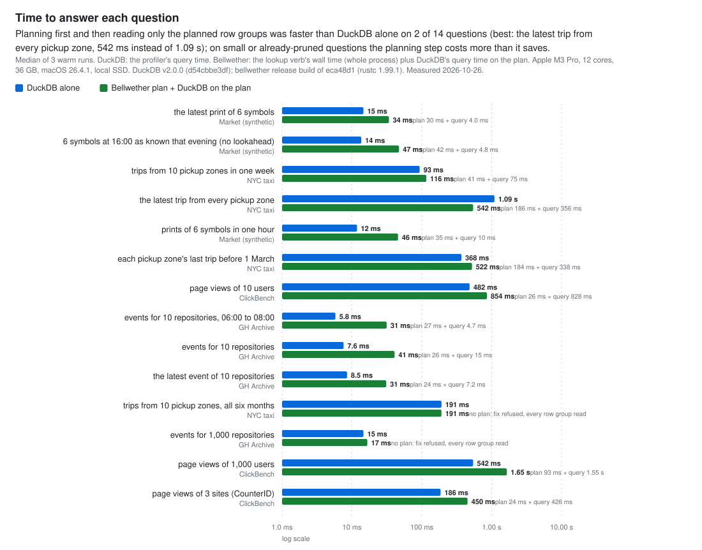
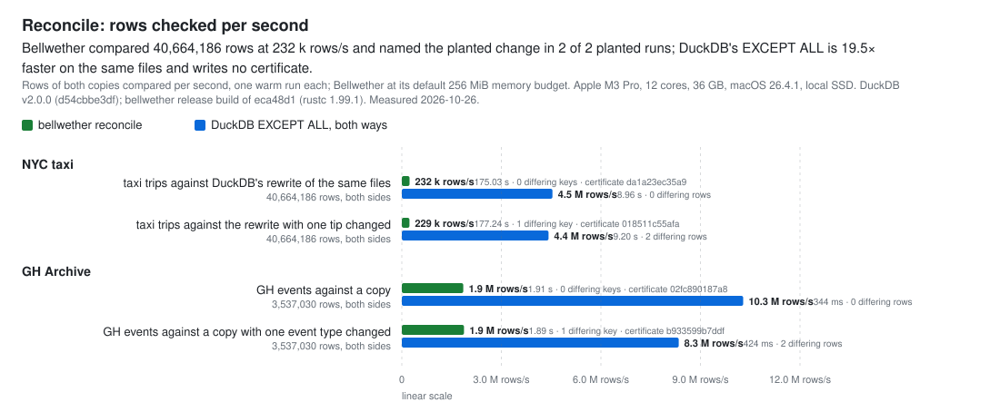

# Measured: questions people ask, answered three ways

Every number on this page is a row of [`results/showcase.json`](results/showcase.json), written by [`scripts/showcase.sh`](../../scripts/showcase.sh) and rendered by [`scripts/render_charts.py`](../../scripts/render_charts.py); the tables between the markers below are generated and CI checks that they match the file. Each row names the machine, the build, and the date it was measured on.

## What was measured

Each question is a lookup a person or a job actually runs: the rows for a set of keys, perhaps in a time window; the newest row per key; the row per key current at an instant; and, for market data, the row per symbol valid at one time as known at a later one, so a backtest cannot see the future. Each is answered on the same files three ways:

- **Full scan.** Every row group of the dataset. Bytes are the compressed sizes summed from the Parquet footers.
- **DuckDB alone.** The question as SQL (`SELECT *` with the keys as a literal `IN` list, window functions with `rank() = 1` for newest and as-of), run by the DuckDB command-line tool with its own pruning (min/max statistics, filter pushdown). Bytes and row groups are what DuckDB's JSON profiler reports (`io.total_bytes_read`, `total_row_groups_scanned`); time is the profiler's query time, the median of three warm runs.
- **Bellwether.** `bellwether why` on the unindexed folder (what the question costs today, and what each candidate key would cost, by exact replay), then `bellwether fix` on the key `why` recommended, or on the cheapest candidate when it recommended none, so a key that cannot help is put to `fix` and refused. After `fix`, the lookup verb (`locate`, `latest`, or `asof`) prints its plan, and DuckDB runs the same SQL restricted to the plan's row groups (`file_row_number` ranges, which DuckDB prunes to the row group), measured like DuckDB alone. The two DuckDB answers are fingerprinted (row count and the sum of a hash of every row, so the order of rows does not matter and duplicate rows still count) and the script stops if they differ; they never did. When `fix` refuses there is no index and no plan, so those questions have no plan column.

Every question gets its own index directory, so no question sees another's key. Reconcile compares two copies of a dataset by key with `bellwether reconcile` (default 256 MiB memory budget), against DuckDB's `EXCEPT ALL` both ways over the same files. In a planted run the script fails unless the key `reconcile` reports (in its `--json` output; the certificate holds the counts) is the one it planted.

### Datasets

- **NYC taxi**: yellow trips for 2024-01 through 2024-06, the files as published by the city's TLC. The published files carry no min/max statistics on any column (the Datasets table below counts the column chunks), so no engine can skip a row group from the footers alone; a temporal key records each zone's time bounds per row group when it is built.
- **GH Archive**: the hours 00 to 11 of 2024-01-01, flattened by DuckDB from nested JSON to `repo_id`, `actor_id`, `type`, `created_at` (one file per hour, so `created_at` statistics already separate the hours).
- **ClickBench**: `hits_0.parquet` through `hits_9.parquet` of the `athena_partitioned` split. The rows are sorted by `CounterID`, so DuckDB's statistics already prune a `CounterID` lookup; `UserID` is scattered.
- **Market (synthetic)**: `bellwether bench market --rung medium --seed 7`, prints with restatements and late arrivals, in `day=` directories read as a partition column on every side (`--partitioning hive` for Bellwether, `hive_partitioning=true` for DuckDB). Generated by the binary under test; included because no public dataset has a known-time column.

Keys are distinct values chosen by a seeded hash (`ORDER BY hash(col, 42)`), so a rerun with the same DuckDB picks the same ones. DuckDB also writes the GH files and the taxi rewrite, so the script refuses to run with a DuckDB version other than the one the results file records, and on downloads whose sha256 differs from the ones recorded there, unless told `--accept-new-inputs` (and then it re-measures everything).

### What is not run through `fix`, and why

Bitemporal keys (`temporal2:symbol@ts,known_at`) cannot be proposed or receipted until storage version 2, so the no-lookahead question's key was built with `index` and has no receipt; its row has a plan but no prediction. `why` prices the question's valid-time as-of, which is what its "unindexed" row shows.

## Charts

<!-- results:showcase-charts:begin -->

  <picture>
    <source media="(prefers-color-scheme: dark)" srcset="../assets/results-bytes-dark.svg">
    
  </picture>

  <picture>
    <source media="(prefers-color-scheme: dark)" srcset="../assets/results-replay-dark.svg">
    
  </picture>

  <picture>
    <source media="(prefers-color-scheme: dark)" srcset="../assets/results-latency-dark.svg">
    
  </picture>

  <picture>
    <source media="(prefers-color-scheme: dark)" srcset="../assets/results-reconcile-dark.svg">
    
  </picture>

<!-- results:showcase-charts:end -->

## Every number

<!-- results:showcase-detail:begin -->
### Bytes and row groups

| Question | Full scan | DuckDB alone | Bellwether, unindexed | Bellwether, after fix | DuckDB on the plan | Same answer |
|---|---:|---:|---:|---:|---:|---|
| `taxi-zones-week`: trips from 10 pickup zones in one week | 341,861,576 (22) | 342,283,753 (22) | 341,861,576 (22) | 25,463,985 (2) | 25,532,131 (2) | yes, 1,090 trips |
| `taxi-latest-zone`: the latest trip from every pickup zone | 341,861,576 (22) | 342,283,753 (22) | 341,861,576 (22) | 94,403,070 (6) | 94,607,580 (6) | yes, 269 trips |
| `taxi-asof-zone`: each pickup zone's last trip before 1 March | 341,861,576 (22) | 342,283,753 (22) | 341,861,576 (22) | 125,753,844 (8) | 125,960,972 (8) | yes, 274 trips |
| `taxi-zones-all`: trips from 10 pickup zones, all six months | 341,861,576 (22) | 342,282,093 (22) | 341,861,576 (22) | – (no index) | – (no plan) | no plan |
| `gh-repos10`: events for 10 repositories | 12,817,897 (24) | 13,014,505 (24) | 12,817,897 (24) | 5,190,369 (8) | 5,288,673 (8) | yes, 31 events |
| `gh-repos10-window`: events for 10 repositories, 06:00 to 08:00 | 12,817,897 (24) | 2,318,639 (4) | 12,817,897 (24) | 891,513 (1) | 907,897 (1) | yes, 1 event |
| `gh-latest10`: the latest event of 10 repositories | 12,817,897 (24) | 13,014,505 (24) | 12,817,897 (24) | 5,190,369 (8) | 5,288,673 (8) | yes, 11 events |
| `gh-repos1000`: events for 1,000 repositories | 12,817,897 (24) | 13,014,505 (24) | 12,817,897 (24) | – (no index) | – (no plan) | no plan |
| `cb-users10`: page views of 10 users | 1,486,306,919 (28) | 1,436,174,181 (24) | 1,486,306,919 (28) | 558,576,049 (9) | 560,109,961 (9) | yes, 33 page views |
| `cb-users1000`: page views of 1,000 users | 1,486,306,919 (28) | 1,488,572,074 (28) | 1,486,306,919 (28) | 1,485,098,816 (27) | 1,487,344,196 (27) | yes, 6,659 page views |
| `cb-counters3`: page views of 3 sites (CounterID) | 1,486,306,919 (28) | 384,641,089 (5) | 1,486,306,919 (28) | 382,622,313 (5) | 383,461,916 (5) | yes, 974,143 page views |
| `mkt-window`: prints of 6 symbols in one hour | 52,309,684 (960) | 3,273,360 (24) | 52,309,684 (960) | 979,512 (18) | 1,159,736 (18) | yes, 275 prints |
| `mkt-latest`: the latest print of 6 symbols | 52,309,684 (960) | 12,476,452 (194) | 52,309,684 (960) | 279,411 (5) | 312,179 (5) | yes, 6 prints |
| `mkt-asof-known`: 6 symbols at 16:00 as known that evening (no lookahead) | 52,309,684 (960) | 7,293,825 (99) | 52,309,684 (960) | 327,274 (6) | 376,426 (6) | yes, 6 prints |

Bytes (row groups). Full scan and Bellwether columns are exact footer sums; DuckDB columns are its profiler's `total_bytes_read` and `total_row_groups_scanned`, which include footer reads.

### `why` → `fix`: predicted against realized

| Question | `why` recommended | Key | Predicted | Realized (fix's replay after apply) | Planned (lookup after fix) | `fix` | Receipt |
|---|---|---|---:|---:|---:|---|---|
| `taxi-zones-week` | `temporal:PULocationID@tpep_pickup_datetime` | `temporal:PULocationID@tpep_pickup_datetime` | 25,463,985 | 25,463,985 | 25,463,985 | applied | `067d0237cad8401d4ca7b519dca148fc499f49dd7d89931407fa5b7b1ec757dc` |
| `taxi-latest-zone` | `temporal:PULocationID@tpep_pickup_datetime` | `temporal:PULocationID@tpep_pickup_datetime` | 94,403,070 | 94,403,070 | 94,403,070 | applied | `d0d83cca613d023c9d61cf4cd40de6f525c4f4e74048bd84beecf5ed01bb061c` |
| `taxi-asof-zone` | `temporal:PULocationID@tpep_pickup_datetime` | `temporal:PULocationID@tpep_pickup_datetime` | 125,753,844 | 125,753,844 | 125,753,844 | applied | `2d787162521b78c7d74d850595432caf12faab952b0d5ebca90f7a3857987695` |
| `taxi-zones-all` | `none` | `exact:PULocationID` | 341,861,576 | – | – (no index) | refused: nothing_to_gain | – |
| `gh-repos10` | `exact:repo_id` | `exact:repo_id` | 5,190,369 | 5,190,369 | 5,190,369 | applied | `a4c3e61d97e231e1aa9a657e1b7c5927c718167b0661aad9d87b2d4674f11573` |
| `gh-repos10-window` | `temporal:repo_id@created_at` | `temporal:repo_id@created_at` | 891,513 | 891,513 | 891,513 | applied | `fc6131e70ac98dddacc2094f8249fe2d9fbf3178068c51b724687cc78a00b1fb` |
| `gh-latest10` | `temporal:repo_id@created_at` | `temporal:repo_id@created_at` | 5,190,369 | 5,190,369 | 5,190,369 | applied | `9c767a6c2148aeaff3c2585697488776e0552768ac1511e316a8c9ca5ca6eae9` |
| `gh-repos1000` | `none` | `exact:repo_id` | 12,817,897 | – | – (no index) | refused: nothing_to_gain | – |
| `cb-users10` | `exact:UserID` | `exact:UserID` | 558,576,049 | 558,576,049 | 558,576,049 | applied | `4803b83224ed3b878b2250821c502346bb4f032749f6cf9f38f4007a57251937` |
| `cb-users1000` | `exact:UserID` | `exact:UserID` | 1,485,098,816 | 1,485,098,816 | 1,485,098,816 | applied | `2a06719c5c99e7bf38f62269950663b4ebc0e4467ffd4bccfaafa8e0339312a7` |
| `cb-counters3` | `exact:CounterID` | `exact:CounterID` | 382,622,313 | 382,622,313 | 382,622,313 | applied | `2c5b5edd08051f51e22adb10efcfd8ebe4d13b3c0d2626f8bab262181882b104` |
| `mkt-window` | `temporal:symbol@ts` | `temporal:symbol@ts` | 979,512 | 979,512 | 979,512 | applied | `da9466db90e30b4550ad822115f31c95ddaea8f417b37c83acb2bdea4395d825` |
| `mkt-latest` | `temporal:symbol@ts` | `temporal:symbol@ts` | 279,411 | 279,411 | 279,411 | applied | `bd28726a02125839294cfab18257c794685cc642e80f6d7011394baeaa357998` |
| `mkt-asof-known` | `temporal:symbol@ts` | `temporal2:symbol@ts,known_at` | not priced | – | 327,274 | not run: bitemporal keys are built with index (no receipt until storage v2) | – |

Receipt hashes identify the records this run wrote; a rerun writes new ones (each record carries its creation time), so they are marked `identity`, not `exact`.

### Time

| Question | DuckDB alone | `why` | `fix` | Lookup plan | DuckDB on the plan | Plan + DuckDB on the plan |
|---|---:|---:|---:|---:|---:|---:|
| `taxi-zones-week` | 80 ms | 17.24 s | 13.76 s | 40 ms | 64 ms | 105 ms |
| `taxi-latest-zone` | 1.09 s | 17.41 s | 25.76 s | 190 ms | 354 ms | 544 ms |
| `taxi-asof-zone` | 346 ms | 17.46 s | 21.68 s | 183 ms | 334 ms | 517 ms |
| `taxi-zones-all` | 186 ms | 11.18 s | 2.23 s | – | – | – |
| `gh-repos10` | 7.1 ms | 1.05 s | 1.35 s | 26 ms | 6.5 ms | 32 ms |
| `gh-repos10-window` | 5.7 ms | 1.78 s | 1.65 s | 27 ms | 4.8 ms | 32 ms |
| `gh-latest10` | 8.1 ms | 1.79 s | 1.68 s | 26 ms | 7.4 ms | 34 ms |
| `gh-repos1000` | 16 ms | 1.03 s | 608 ms | – | – | – |
| `cb-users10` | 454 ms | 45.01 s | 8.83 s | 30 ms | 236 ms | 266 ms |
| `cb-users1000` | 466 ms | 44.76 s | 11.57 s | 90 ms | 486 ms | 576 ms |
| `cb-counters3` | 178 ms | 44.28 s | 10.60 s | 24 ms | 182 ms | 206 ms |
| `mkt-window` | 13 ms | 1.19 s | 945 ms | 37 ms | 9.5 ms | 46 ms |
| `mkt-latest` | 17 ms | 1.15 s | 928 ms | 30 ms | 4.5 ms | 35 ms |
| `mkt-asof-known` | 15 ms | 1.12 s | – | 40 ms | 4.8 ms | 45 ms |

Median of 3 warm runs for DuckDB and the lookup; `why` and `fix` once each (they write records). `–`: not run (no index, or no `fix`). Apple M3 Pro, 12 cores, 36 GB, macOS 26.4.1, local SSD. DuckDB v2.0.0 (d54cbbe3df); bellwether release build of 7f3318f (rustc 1.99.1) for Market (synthetic); bellwether release build of eca48d1 (rustc 1.99.1) for NYC taxi, GH Archive, ClickBench. Measured 2026-10-26. 1-minute load average while timing: 3.7 to 8.8 on 12 cores.

### Reconcile

| Run | Rows (both sides) | Bellwether | Differing keys | Reported key | Passes | Pass | Certificate | DuckDB EXCEPT ALL | Differing rows |
|---|---:|---:|---:|---|---:|---|---|---:|---:|
| `rec-taxi-same`: taxi trips against DuckDB's rewrite of the same files | 40,664,186 | 174.60 s, 233 k rows/s | 0 | – | 37 | yes | `befdc5bf7597300616ab8e6094305fa8fd2796b46e46932302fe8f1e257f58f9` | 8.79 s, 4.6 M rows/s | 0 |
| `rec-taxi-planted`: taxi trips against the rewrite with one tip changed | 40,664,186 | 173.40 s, 235 k rows/s | 1 | `2, 2024-03-01T00:14:03Z, 142, 7.9` | 37 | no | `83800768015cebfcf7e142b063b582ebfa362c9fd7157e62a92f5ab864981c80` | 7.95 s, 5.1 M rows/s | 2 |
| `rec-gh-same`: GH events against a copy | 3,537,030 | 1.89 s, 1.9 M rows/s | 0 | – | 4 | yes | `a99dde3db2013552fe3f123b89e7416c3165eba77c53ba25a4fd019c72a23b73` | 300 ms, 11.8 M rows/s | 0 |
| `rec-gh-planted`: GH events against a copy with one event type changed | 3,537,030 | 1.77 s, 2.0 M rows/s | 1 | `629347145, 796623, 2024-01-01T05:00:25Z` | 4 | no | `92902ba4b6e246801e2bd2ae9438bf2ac84f5f9626f4304963a29218e4e3ee89` | 298 ms, 11.9 M rows/s | 2 |

### Datasets

| Dataset | Files | Row groups | Rows | Bytes | Column chunks with min/max statistics |
|---|---:|---:|---:|---:|---:|
| NYC yellow taxi trips, 2024-01 to 2024-06 (public) | 6 | 22 | 20,332,093 | 341,861,576 | 0 of 418 |
| GH Archive events, 2024-01-01 00:00 to 11:59 UTC, flattened (public) | 12 | 24 | 1,768,515 | 12,817,897 | 96 of 96 |
| ClickBench hits, athena_partitioned hits_0..9 (public) | 10 | 28 | 10,000,000 | 1,486,306,919 | 2,940 of 2,940 |
| market prints, synthetic (`bellwether bench market --rung medium --seed 7`) | 120 | 960 | 1,873,726 | 52,309,684 | 4,800 of 4,800 |

### The questions as SQL

`<work>` is the script's scratch directory (`$SHOWCASE_DIR/work`).

- `taxi-zones-week` (10 PULocationID values): `SELECT * FROM read_parquet('<work>/taxi/*.parquet', hive_partitioning=false) WHERE PULocationID IN (6, 28, 65, 93, 119, 121, 183, 189, 240, 258) AND tpep_pickup_datetime BETWEEN '2024-03-04 00:00:00'::TIMESTAMP AND '2024-03-10 23:59:59'::TIMESTAMP`
- `taxi-latest-zone` (262 PULocationID values): `SELECT * FROM read_parquet('<work>/taxi/*.parquet', hive_partitioning=false) WHERE PULocationID IN (1, 2, 3, 4, 5, 6, 7, 8, 9, 10, 11, 12, 13, 14, 15, 16, 17, 18, 19, 20, 21, 22, 23, 24, 25, 26, 27, 28, 29 ... , 251, 252, 253, 254, 255, 256, 257, 258, 259, 260, 261, 262, 263, 264, 265) AND tpep_pickup_datetime IS NOT NULL QUALIFY rank() OVER (PARTITION BY PULocationID ORDER BY tpep_pickup_datetime DESC) = 1`
- `taxi-asof-zone` (262 PULocationID values): `SELECT * FROM read_parquet('<work>/taxi/*.parquet', hive_partitioning=false) WHERE PULocationID IN (1, 2, 3, 4, 5, 6, 7, 8, 9, 10, 11, 12, 13, 14, 15, 16, 17, 18, 19, 20, 21, 22, 23, 24, 25, 26, 27, 28, 29 ... 5, 256, 257, 258, 259, 260, 261, 262, 263, 264, 265) AND tpep_pickup_datetime <= '2024-03-01 00:00:00'::TIMESTAMP QUALIFY rank() OVER (PARTITION BY PULocationID ORDER BY tpep_pickup_datetime DESC) = 1`
- `taxi-zones-all` (10 PULocationID values): `SELECT * FROM read_parquet('<work>/taxi/*.parquet', hive_partitioning=false) WHERE PULocationID IN (6, 28, 65, 93, 119, 121, 183, 189, 240, 258)`
- `gh-repos10` (10 repo_id values): `SELECT * FROM read_parquet('<work>/gh/*.parquet', hive_partitioning=false) WHERE repo_id IN (114280073, 275775044, 402693469, 465027419, 547734612, 611491057, 660984829, 670519300, 719618159, 726451981)`
- `gh-repos10-window` (10 repo_id values): `SELECT * FROM read_parquet('<work>/gh/*.parquet', hive_partitioning=false) WHERE repo_id IN (114280073, 275775044, 402693469, 465027419, 547734612, 611491057, 660984829, 670519300, 719618159, 726451981) AND created_at BETWEEN '2024-01-01 06:00:00'::TIMESTAMPTZ AND '2024-01-01 07:59:59'::TIMESTAMPTZ`
- `gh-latest10` (10 repo_id values): `SELECT * FROM read_parquet('<work>/gh/*.parquet', hive_partitioning=false) WHERE repo_id IN (114280073, 275775044, 402693469, 465027419, 547734612, 611491057, 660984829, 670519300, 719618159, 726451981) AND created_at IS NOT NULL QUALIFY rank() OVER (PARTITION BY repo_id ORDER BY created_at DESC) = 1`
- `gh-repos1000` (1000 repo_id values): `SELECT * FROM read_parquet('<work>/gh/*.parquet', hive_partitioning=false) WHERE repo_id IN (1957456, 3390243, 3816238, 6201092, 7994556, 9420892, 12324257, 12484732, 12895187, 13831185, 19393303, 20482496 ... 6, 737749354, 737749513, 737750441, 737750988, 737751192, 737753107, 737754841, 737755024, 737755400, 737756357, 737756955, 737757324, 737758757, 737759142, 737760480, 737760865, 737761004, 737761372)`
- `cb-users10` (10 UserID values): `SELECT * FROM read_parquet('<work>/clickbench/*.parquet', hive_partitioning=false) WHERE UserID IN (420421175586282399, 524024939451046084, 646231023803422106, 842646847295587519, 865935002991210152, 1496499850068514979, 2997964801790601600, 4894761480655464070, 5658018640776778170, 8294817380481169612)`
- `cb-users1000` (1000 UserID values): `SELECT * FROM read_parquet('<work>/clickbench/*.parquet', hive_partitioning=false) WHERE UserID IN (-9186490622702176332, -9174148678125078926, -8997699347696106721, -8798529654331665751, -8385243822720300 ... 8215957939, 9079867110999096390, 9094042955612786579, 9103179509659659974, 9110504748401412974, 9111948073848832554, 9166587872421067317, 9172238356551457601, 9190574921475655653, 9202331566124194106)`
- `cb-counters3` (3 CounterID values): `SELECT * FROM read_parquet('<work>/clickbench/*.parquet', hive_partitioning=false) WHERE CounterID IN (515, 1483, 1919)`
- `mkt-window` (6 symbol values): `SELECT * FROM read_parquet('<work>/market/data/*/*.parquet', hive_partitioning=true) WHERE symbol IN ('S0100', 'S0108', 'S0140', 'S0153', 'S0170', 'S0171') AND ts BETWEEN '2026-01-15 15:00:00'::TIMESTAMPTZ AND '2026-01-15 15:59:59'::TIMESTAMPTZ`
- `mkt-latest` (6 symbol values): `SELECT * FROM read_parquet('<work>/market/data/*/*.parquet', hive_partitioning=true) WHERE symbol IN ('S0100', 'S0108', 'S0140', 'S0153', 'S0170', 'S0171') AND ts IS NOT NULL QUALIFY rank() OVER (PARTITION BY symbol ORDER BY ts DESC) = 1`
- `mkt-asof-known` (6 symbol values): `SELECT * FROM read_parquet('<work>/market/data/*/*.parquet', hive_partitioning=true) WHERE symbol IN ('S0100', 'S0108', 'S0140', 'S0153', 'S0170', 'S0171') AND ts <= '2026-01-15 16:00:00'::TIMESTAMPTZ AND known_at <= '2026-01-16 00:00:00'::TIMESTAMPTZ QUALIFY rank() OVER (PARTITION BY symbol ORDER BY ts DESC, known_at DESC) = 1`
- `rec-taxi-same` (key (VendorID,tpep_pickup_datetime,PULocationID,fare_amount)): `SELECT * FROM ((SELECT *, 'left' AS side FROM (SELECT * FROM read_parquet('<work>/taxi/*.parquet') EXCEPT ALL SELECT * FROM read_parquet('<work>/taxi_duck/*.parquet'))) UNION ALL (SELECT *, 'right' AS side FROM (SELECT * FROM read_parquet('<work>/taxi_duck/*.parquet') EXCEPT ALL SELECT * FROM read_parquet('<work>/taxi/*.parquet'))))`
- `rec-taxi-planted` (key (VendorID,tpep_pickup_datetime,PULocationID,fare_amount)): `SELECT * FROM ((SELECT *, 'left' AS side FROM (SELECT * FROM read_parquet('<work>/taxi/*.parquet') EXCEPT ALL SELECT * FROM read_parquet('<work>/taxi_duck_mut/*.parquet'))) UNION ALL (SELECT *, 'right' AS side FROM (SELECT * FROM read_parquet('<work>/taxi_duck_mut/*.parquet') EXCEPT ALL SELECT * FROM read_parquet('<work>/taxi/*.parquet'))))`
- `rec-gh-same` (key (repo_id,actor_id,created_at)): `SELECT * FROM ((SELECT *, 'left' AS side FROM (SELECT * FROM read_parquet('<work>/gh/*.parquet') EXCEPT ALL SELECT * FROM read_parquet('<work>/gh_copy/*.parquet'))) UNION ALL (SELECT *, 'right' AS side FROM (SELECT * FROM read_parquet('<work>/gh_copy/*.parquet') EXCEPT ALL SELECT * FROM read_parquet('<work>/gh/*.parquet'))))`
- `rec-gh-planted` (key (repo_id,actor_id,created_at)): `SELECT * FROM ((SELECT *, 'left' AS side FROM (SELECT * FROM read_parquet('<work>/gh/*.parquet') EXCEPT ALL SELECT * FROM read_parquet('<work>/gh_mut/*.parquet'))) UNION ALL (SELECT *, 'right' AS side FROM (SELECT * FROM read_parquet('<work>/gh_mut/*.parquet') EXCEPT ALL SELECT * FROM read_parquet('<work>/gh/*.parquet'))))`

Apple M3 Pro, 12 cores, 36 GB, macOS 26.4.1, local SSD. DuckDB v2.0.0 (d54cbbe3df); bellwether release build of 7f3318f (rustc 1.99.1) for Market (synthetic); bellwether release build of eca48d1 (rustc 1.99.1) for NYC taxi, GH Archive, ClickBench. Measured 2026-10-26.
<!-- results:showcase-detail:end -->

## Reading the numbers honestly

- **Where DuckDB already does well, an index adds nothing.** On data sorted by the key (ClickBench by `CounterID`), DuckDB's own min/max statistics skip as many row groups as the index plans. `why` does not see this yet: it prices the unindexed cost as a full scan, not as that min/max baseline, so it recommended the key and `fix` attested it. The README's "When an index can't help" table names each such question.
- **Where the keys sit in every row group, nothing helps.** `why` recommends no key and `fix` refuses (`nothing_to_gain`). Where they sit in nearly every row group, `why` can still recommend a key that saves almost nothing, and `fix` attests it (ClickBench, 1,000 users).
- **What is exact and what is not.** Footer sums (the full scan, Bellwether's predicted and planned bytes), the row groups in a plan, and row counts are exact: the same on every run over the same files. DuckDB's profiler bytes are measured: the same SQL can report a slightly different count from one run to the next. Receipt and certificate hashes are identities: a rerun writes new records, with new hashes. Times depend on the machine and on whatever else ran on it; each timed row carries the load average in its `notes`.
- **The plan costs time.** Bellwether's time is the lookup verb's whole process (start, read the index, plan) plus DuckDB on the plan. On small datasets, or where DuckDB prunes as well, that is overhead.
- **How DuckDB reads the plan is not tuned for speed.** It gets the plan as one `read_parquet` per file with `file_row_number` ranges, joined by `UNION ALL`. DuckDB prunes those ranges to the row group (its profiler confirms the row groups and bytes), but that query can run slower than DuckDB's own scan even when it reads fewer bytes, and its time varies from run to run more than the bytes do; the Time table shows this run. Handing the plan to an engine natively is milestone M7.
- **Not measured here:** cold caches, object storage (every file is on local disk), and engines other than DuckDB.
